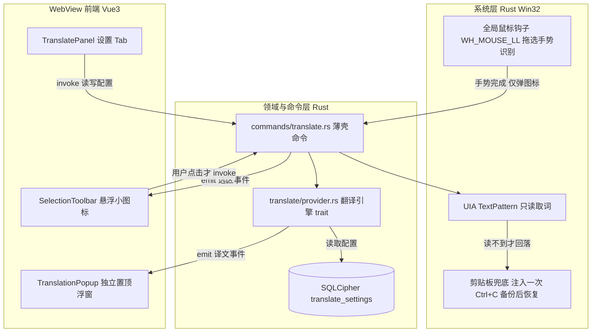

## User Requirements

用户希望为桌宠「七七」新增**全局划词翻译**能力，并参考已具备该功能的应用，产出一份**开发子计划文档**写入 `d:/qiqi/qiqi/.codebuddy/plans` 目录；用户明确要求「有问题问我」，已完成一轮澄清并确认四项关键选择：使用**专用翻译 API**（不复用现有对话模型通道）、仅以**悬浮小图标**触发、以**独立置顶小浮窗**展示译文、**仅在用户主动点击后才取词**，并指定参考「元宝的划词翻译」。

## Product Overview

在任意第三方应用中用鼠标选中文字后，选区旁浮出一枚轻量小图标；用户点击图标才执行取词与翻译，译文出现在跟随选区的独立置顶浮窗中，可一键复制、按 Esc 或点击外部收起。设置界面提供总开关、目标语言、翻译服务与密钥配置。最终交付物为一份可直接指导开发的 Markdown 子计划（背景决策、参考对照、架构、改动清单、验收），落到指定 plans 目录。

## Core Features

- 选中文字后浮出悬浮小图标，点击才翻译；同一选区不重复弹出，密码框与勿扰时段跳过。
- 独立置顶译文浮窗：展示原文与译文、源/目标语言与所用服务，支持复制译文、Esc 或点击外部关闭。
- 设置项：功能总开关、目标语言、翻译服务选择与密钥、脱敏回显；仅在主动触发后取词，不自动改写剪贴板。
- 参考元宝划词工具栏等应用的交互对照，并产出一份含架构、逐文件改动、权限、迁移、国际化与验收的完整开发子计划文档。

明确非目标（列入后续迭代）：划词即译自动模式、生词本、朗读、截图 OCR 翻译、翻译历史记录、全局快捷键触发。

## Tech Stack Selection

- **本轮交付物**：单个 Markdown 文档，路径 `d:/qiqi/qiqi/.codebuddy/plans/全局划词翻译-悬浮工具条与译文浮窗实施计划.md`；沿用仓库既有子计划六段式（背景与决策 / 架构 / 目录结构与改动 / 实现要点 / 设计风格 / 验收），参考 `联网搜索-WebSearch实施计划.md`。
- **文档所述功能沿用锁定栈**（已核实，不引入新框架）：Tauri 2 + Rust 承载全部系统能力（Win32 全局鼠标钩子、UI Automation、剪贴板、窗口定位）；Vue 3 + TypeScript（script setup 单文件组件）+ vue-i18n 承载浮窗、工具条与设置面板；SQLCipher 经 rusqlite_migration 存配置；reqwest 调第三方翻译接口。前端不引 Node 原生模块，不新增美术资源。
- 组件库：项目无第三方 UI 库，沿用自绘 Jelly-Toy 设计 token（`src/styles/tokens.css`）。

## Implementation Approach

采用「先核实、再分章撰写、最后审查提交」的策略，产出**只描述、不实现**的子计划文档。文档必须把已确认的四项决策转译成可执行的架构与契约：

1. **专用翻译 API**：新增 `TranslateProvider` trait（类比已核实的 `llm/web_search.rs` 的 `SearchProvider` 模式），首期一个零配置免 Key 通道（保证开箱可用）+ 一个 BYOK 引擎（DeepL / 有道），Key 经 IPC → Rust → SQLCipher，接口仅回 `hasKey` 与末 4 位指纹（复用 `commands/search_settings.rs` + `M9` 范式）。Trade-off：不走 LLM 通道即不复用 `llm/quota.rs` 记账，文档需把「翻译是否计入内置额度」列为待确认项并给出建议（BYOK 不计，与联网搜索口径一致）。
2. **悬浮小图标主动触发**：`WH_MOUSE_LL` 手势识别只用于「选中完成」判定并 emit 弹图标事件，**手势阶段不取词、不注入按键**（对齐元宝「工具条出现时不取词」）。代价是多一次点击，换来最小越权与误触。
3. **第三窗口**：`tauri.conf.json` 新增 `translator` 窗口（transparent、alwaysOnTop、skipTaskbar、decorations:false、visible:false）；`capabilities/default.json` 的 `windows` 数组需加入该 label 并逐项申请权限（B2 最小授权、禁通配、自定义命令免授权）。
4. **仅主动触发时取词**：点击后 UIA `TextPattern.GetSelection()` 优先；读不到才注入一次 `Ctrl+C`，取词前备份、读完恢复剪贴板并加互斥锁；跳过密码框（UIA IsPassword）、控制台与勿扰时段。需写明已知风险：点击浮窗若抢焦点会丢失原选区（需「不激活窗口」策略或在手势阶段以 UIA 只读缓存文本）、目标窗口管理员权限受 UIPI 拦截、部分应用 UIA 不支持。

**性能与可靠性**：复用 `probe/scheduler.rs` 唯一的 100ms 单点轮询，不新增轮询线程；钩子回调只做阈值判定与置位（O(1) 每帧），取词与 HTTP 全部移到命令层 tokio 异步；事件按「状态翻转/选区去重」才 emit，避免洪泛。翻译请求设连接/总超时，失败仅 log + 前端本地化提示，不阻断其它功能。

## Implementation Notes

- **已核实的关键约束必须写进文档**：`commands/mod.rs` 明确「命令层禁止 emit 事件，事件在领域模块」→ 所有 `translate:*` 事件由新建 `translate/` 领域模块 emit，命令层仅转发；`window/click_through.rs::is_passthrough_managed` 只认 `LABEL_MAIN`，第三窗口不得被穿透托管，否则整窗点不动且无复位路径；`db/migrations.rs` 当前 `TARGET_VERSION = 10`、链 10 条 → 新迁移为 `M11`、`TARGET_VERSION = 11`，禁止改历史 SQL；`src/main.ts` 按 label 分发视图，新增第三窗口需在该处扩展分支。
- **契约（文档内用文字精确定义，不臆造签名）**：命令 `translate_settings_get/save`、`translate_capture_selection`、`translate_execute`、`translate_popup_show/hide/position`；事件 `translate:selection:show`（选区屏幕矩形 + 去重 key）、`translate:result`（原文/译文/语言/引擎）、`translate:error`、`translate:dismiss`。DTO 落 `src/api/types.ts` 并与 Rust serde 一一对应。
- **错误处理与日志**：新增错误场景不得走「Rust 中文 `AppError.message` 直出」路径（i18n-rules §3 存量缺口），前端按 `kind` 用 `t()` 兜底；日志沿用 `[模块]` 前缀的 `eprintln!` 风格，**不打印选中文本、译文、Key 与 baseUrl 全文**，失败信息只带 HTTP 状态与截断前缀。
- **国际化**：所有新增可见文案（工具条、浮窗、设置 Tab、错误/成功提示、aria-label）必须在 `zh-CN.ts` 与 `en-US.ts` 成对加键，复用 `useLocale`，不新建第二套字典或语言状态；Rust 侧若新增托盘词条同步 `i18n.rs` 两条分支。
- **Blast radius**：本轮**只新增一个 md 文件**，不触碰任何业务文件、不提交构建产物或密钥；文档内把后续改动全部标注为增量、迁移备份先行，并给出按逻辑单元拆分的 Conventional Commits 提交序列与「提交后 `git status` 干净」检查。

## Architecture Design

分层保持与现有 `probe/ → commands/ → 领域模块 → 前端视图` 一致：系统层只上报「选区完成」手势与屏幕坐标；领域层负责取词、provider 调用、事件广播与配置；命令层做参数校验与转发；WebView 层渲染工具条、浮窗与设置面板。第三窗口通过 `window/manager.rs` 新增常量定位，配置走 `translate_settings` 单行表。



## Directory Structure

**本轮实际落盘（唯一文件）**：

```
d:/qiqi/qiqi/.codebuddy/plans/
└── 全局划词翻译-悬浮工具条与译文浮窗实施计划.md   # [NEW] 子计划文档。含背景与四项已确认决策、默认假设、参考应用对照表（元宝/Pot/Bob/有道/dsh/SelectionTranslator）、架构与数据流、IPC 命令与事件契约、逐文件改动清单、Windows 手势与取词策略及焦点/剪贴板/UIPI 风险处置、第三窗口与 capabilities 权限矩阵增量、provider 抽象与 Key 加密存储及 M11 迁移、i18n 落地清单、Jelly-Toy 设计风格、性能与隐私红线、单测与验收、分阶段提交拆分、非目标与后续迭代。仅描述，不实现。
```

**文档内需规划的目标改动清单（作为文档内容，非本轮修改）**：

```
src-tauri/tauri.conf.json                       # [MODIFY] 新增第三窗口 translator 定义
src-tauri/capabilities/default.json             # [MODIFY] windows 数组加入 translator，逐项申请权限
src-tauri/src/lib.rs                            # [MODIFY] 唯一组装锚位接线（钩子启动、invokeregister、窗口事件）
src-tauri/src/probe/selection.rs                # [NEW] 手势判定与选区去重（纯函数可测）
src-tauri/src/probe/scheduler.rs                # [MODIFY] 复用单点轮询，不新增线程
src-tauri/src/window/manager.rs                 # [MODIFY] LABEL_TRANSLATE 常量、浮窗定位与隐藏
src-tauri/src/window/click_through.rs           # [MODIFY] 保持仅 main 托管，隔离第三窗口
src-tauri/src/translate/                        # [NEW] mod/provider/capture/client/settings 领域层
src-tauri/src/commands/translate.rs             # [NEW] 薄壳命令（禁 emit、禁 SQL）
src-tauri/src/commands/mod.rs                   # [MODIFY] 注册 translate 模块
src-tauri/src/db/migrations/M11__translate_settings.sql  # [NEW] 幂等单行配置表
src-tauri/src/db/migrations.rs                  # [MODIFY] chain 追加 M11、TARGET_VERSION=11
src-tauri/src/db/repositories/translate_settings.rs      # [NEW] 参数化读写
src-tauri/src/db/models/ + config.rs / i18n.rs  # [MODIFY] DTO、阈值常量、托盘词条
src/main.ts                                     # [MODIFY] 按 label 分发 TranslationPopup 视图
src/views/translate/                            # [NEW] SelectionToolbar.vue / TranslationPopup.vue
src/views/settings/SettingsWindow.vue           # [MODIFY] PanelKey 增 translate
src/components/window/SideNav.vue               # [MODIFY] 增 Tab 项与字典键
src/views/settings/panels/TranslatePanel.vue    # [NEW] 总开关/目标语言/引擎与 Key 配置
src/api/translate.ts + src/api/types.ts         # [NEW/MODIFY] IPC 封装与 DTO
src/i18n/locales/zh-CN.ts + en-US.ts            # [MODIFY] 成对新增键
src/tests/                                      # [NEW] 纯函数与组件单测
docs/design/接口契约.md                          # [MODIFY] 增命令/事件/DTO 章节
```

## SubAgent

- **code-explorer**
- Purpose: 撰写文档前以 medium 深度核实剩余集成锚点（`src/api/client.ts` 的错误规整、`window/tray.rs` 与 `window/mod.rs` 的窗口组装、`docs/design/接口契约.md` 章节结构、设置面板与 SideNav 的 Tab 注册链路、`bubble mode` 事件命名风格）并查证第三方翻译 API 官方文档要点。
- Expected outcome: 输出一份核实清单，使子计划中的逐文件改动清单、IPC 契约、权限矩阵增量与迁移编号全部对应真实代码与官方 API，无臆造路径或签名。