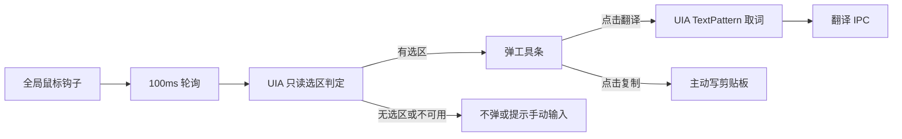

## 产品概述
生成一份**子计划文档**到 `d:\qiqi\qiqi\.codebuddy\plans\`，主题为「划词翻译零污染优化」。本轮只产出计划文档，不改产品代码、不改配置、不提交。

## 核心需求
- 修复用户反馈的 BUG：划词/双击时若复制了选中文本，用户后续复制粘贴操作会异常（剪贴板被选中词覆盖或被彻底清空）。
- 已确认的三项决策：
  1. **零污染取词**：接入 UI Automation，手势阶段完全不 `clear()`、不注入 `Ctrl+C`；用 `TextPattern` 只读取词。
  2. **工具条「复制」按钮保留**：用户主动点击仍写剪贴板，符合直觉；探测链路不再碰剪贴板。
  3. **工具条弹出门控**：用 UIA 只读 bool 判断有无选区，配合去重与点外部收起抑制误弹。
- 需明确推翻 2026-11-11 的旧裁决「文本手势选中词永久留在剪贴板」，并说明与三份历史计划（它们本就要求取词前后剪贴板完全一致）的关系。
- 需为 UIA 不可用场景（终端、远程桌面、自绘 UI、旧版系统）设计明确兜底与用户可见提示。


## Tech Stack Selection
计划文档面向现有工程，无需引入新框架。实现阶段将复用：

- Rust 侧：`windows` crate（需新增 UIAutomation/Accessibility 相关 feature）或 `uiautomation` crate，`arboard` 仅保留给用户主动复制路径。
- 前端：Vue 3 + TypeScript + VitePress 风格既有组件，IPC 沿用 `@tauri-apps/api/core` 的 `invoke`。
- 测试：Rust 单测（`selection.rs` 内）、Vitest 组件契约测试（`TranslateComponents.spec.ts`）。

## Implementation Approach

### 现状根因（已核实）
`has_selected_text()` 在 `selection.rs:480-521` 对全局钩子捕获的每一次双击/拖选都执行 `clipboard.clear()` 作哨兵并 `simulate_ctrl_c()`。命中时把选中词永久留在剪贴板，覆盖用户内容；未命中且原剪贴板为图片/文件时，`get_text()` 返回 None，`restore_text()` 走 `clipboard.clear()` 彻底清空。全局 `WH_MOUSE_LL` 钩子对任何第三方应用的拖选/双击都会置位，100ms 轮询消费，导致用户主观上「复制粘贴永远失效」。

### 目标架构
- **手势阶段**：`poll_selection` 只记录坐标与手势类型，通过 UIA 只读 bool 判定「当前焦点元素是否有文本选区」，不读取文本、不触碰剪贴板。
- **点击翻译阶段**：`translate_capture_selection` 走 UIA `TextPattern.GetSelection()` 只读取词；失败时按兜底策略处理，不再静默改写用户剪贴板。
- **主动复制阶段**：工具条「复制」按钮继续调用 `translate_copy_result` 写剪贴板，这是用户明确行为，不属于探测链路。
- **缓存状态**：移除 `GestureClipboard` 的「命中后留剪贴板供复用」语义，`gesture_captured_text` 与 `still_owns_clipboard` 改为基于 UIA 内存态或删除。

### 兜底策略（需写进子计划）
1. UIA 可用但取词失败：emit 可行动提示（如「无法读取选中文字，请在输入框中粘贴」），不回退 `Ctrl+C`。
2. UIA 不可用（终端/远程桌面/自绘 UI）：手势阶段不弹工具条或弹「需手动输入」的简化工具条，由配置或运行时探测决定。
3. 保留 `capture_with_wait` 作为被显式开关启用时的兜底路径，但必须先备份并完整还原剪贴板，且对非文本内容不执行 `clear()`——若无法完整还原则放弃该路径并提示用户。
4. 所有兜底路径都必须在日志中记录原因，禁止静默改写剪贴板。

### 性能与可靠性
- UIA COM 调用需固定在专用 STA 线程，避免阻塞 100ms 主轮询线程；每次查询设置超时上限（建议 50ms），超时即视为不可用。
- UIA 只读 bool 判定要复用同一次 COM 初始化的元素引用，避免每次手势重复枚举 UI 树。
- 去重窗口沿用现有 500ms 双击判定与 8px 拖拽阈值；点外部收起逻辑保持不变。

## Implementation Notes（执行细节）
- `restore_text()` 的 `previous=None → clipboard.clear()` 分支必须删除或改写，这是「彻底清空用户图片/文件」的直接元凶。
- `window/manager.rs:86-95` 的 `hide_translator` 注释与 `clear_gesture_clipboard` 语义要同步更新，不再写「选中词原样保留」。
- `translate_popup_show(compact=false)` 中清理捕获状态的调用保留，但注释要改为「丢弃内存选区缓存，不动剪贴板」。
- i18n 需新增/改写一条提示（如「划词不会改变剪贴板」），并复核 `translate.toolbar.selectionCopied` 的措辞是否与新语义一致。
- 历史计划 `.codebuddy/plans/全局划词翻译-悬浮工具条与译文浮窗实施计划.md` 等三份文档本就要求「不改写剪贴板」，新子计划应声明恢复这些原始约束。

## Architecture Design
计划文档需包含一张时序/组件关系图，说明：



关键边界：A 到 H 的整条探测链路不得调用 `arboard` 的任何写方法。

## Directory Structure
子计划文档将创建于：

```
d:/qiqi/qiqi/.codebuddy/plans/
└── 划词翻译-UIA零污染取词实施计划.md   # [NEW] 完整子计划：背景根因、三项已确认决策、
                                      # UIA 架构与线程模型、兜底矩阵、逐文件改动清单、
                                      # 测试验收、历史裁决推翻与记忆同步、风险与回滚
```

计划文档内部需引用的现有文件（仅改文档时列出，不在本轮修改）：
- `src-tauri/src/probe/selection.rs`
- `src-tauri/src/probe/scheduler.rs`
- `src-tauri/Cargo.toml`
- `src-tauri/src/commands/translate.rs`
- `src-tauri/src/window/manager.rs`
- `src-tauri/src/db/models/dto.rs`
- `src/api/translate.ts`、`src/api/types.ts`
- `src/views/translate/SelectionToolbar.vue`、`TranslationPopup.vue`、`TranslatorWindow.vue`
- `src/i18n/locales/zh-CN.ts`、`en-US.ts`
- `src-tauri/src/probe/selection.rs` 内单测、`src/tests/components/TranslateComponents.spec.ts`
- `docs/design/接口契约.md`
- 项目记忆 `feedback_clipboard.md` 与 `MEMORY.md`

## Key Code Structures
子计划中需精确定义以下接口契约（仅描述，不在本轮实现）：

- `has_selection_uia() -> bool`：只读判定，不取文本、不写剪贴板。
- `capture_selection_uia() -> Option<CapturedSelectionDto>`：返回已预留的 `via: "uia"`，不改变 `CapturedSelectionDto` 形状。
- 兜底决策函数：`resolve_capture_fallback(reason) -> FallbackAction`，枚举至少包含 `ManualInput`、`DisabledWithHint`、`ExplicitClipboardWithRestore`（需显式开关且完整还原）。


## Agent Extensions
### SubAgent
- **code-explorer**
  - Purpose: 在实现阶段开始前核对 `windows` crate 当前版本对 UIAutomation feature 的支持情况，并复查 `probe/selection.rs` 与 `translate.rs` 的调用链。
  - Expected outcome: 产出精确的 feature 名称与需修改函数清单，避免子计划中的技术细节与实际依赖版本不符。
