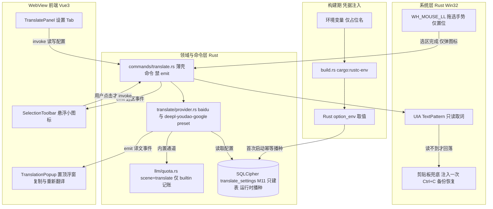

## 产品概述

为 Windows 桌宠「七七」新增全局划词翻译能力，并产出一份开发子计划文档写入 `.codebuddy/plans` 目录。用户在任意第三方应用中选中文字后，选区旁浮出一枚轻量小图标；点击图标才执行取词与翻译，译文显示在跟随选区的独立置顶浮窗中。本轮交付物为一份可直接指导开发的 Markdown 子计划，文档需覆盖架构、逐文件改动、权限、迁移、国际化、额度口径与验收；参考「元宝划词工具栏」等同类应用的交互。

## 核心功能

- **主动触发划词**：选中文字后浮出小图标，点击才翻译；同一选区不重复弹出，密码框与勿扰时段跳过；手势阶段只识别选区、不取词、不自动改写剪贴板。
- **独立置顶译文浮窗**：展示原文、译文、源与目标语言及所用服务；提供译文一键快速复制、重新翻译；按 Esc 或点击外部收起。
- **翻译服务双通道**：内置百度翻译零配置通道（凭据不落在代码与仓库中、运行时写入加密数据表），自定义通道可选 DeepL、有道、Google 并自填密钥；内置翻译计入内置额度，自定义翻译不计入统计；本版本仅提供中英互译。
- **设置项**：功能总开关、译入语言、服务选择与密钥配置、密钥脱敏回显；额度耗尽时给出提示并引导切换自定义服务。
- **子计划文档**：写入指定目录，含两轮确认的决策与安全处置声明、同类应用对照表、架构与数据流、IPC 契约、逐文件改动清单、取词风险与降级、第三窗口与权限矩阵增量、迁移与基线同步、国际化清单、验收与提交拆分、非目标与后续迭代。

## 视觉效果

延续 Jelly-Toy 治愈系：小图标为粉彩圆角胶囊、选区旁轻微淡入与悬浮微动效；译文浮窗为半透明玻璃拟态卡片，原文与译文分层排版，复制与重新翻译为圆形图标按钮并带 hover 反馈，加载与失败状态有柔和过渡。

## 明确非目标（后续迭代）

划词即译自动模式、生词本、朗读、截图 OCR 翻译、翻译历史记录、全局快捷键触发、多语种与第三语言。

## 一、交付物与技术栈

**本轮唯一落盘**：一份 Markdown 文档 `d:/qiqi/qiqi/.codebuddy/plans/全局划词翻译-悬浮工具条与译文浮窗实施计划.md`（[NEW]，已核实 plans 目录无同主题文件）。沿用仓库既有子计划六段式（背景与决策 / 架构 / 目录结构与改动 / 实现要点 / 设计风格 / 验收），参照 `联网搜索-WebSearch实施计划.md`。**只描述、不实现功能代码，不修改任何业务文件，不写入任何凭据字面值**。

**文档所述功能沿用锁定栈**（已核实，不引新框架）：Tauri 2 + Rust 承载全部系统能力（Win32 低级鼠标钩子、UI Automation、剪贴板、窗口定位与穿透）；Vue 3 + TypeScript（script setup）+ vue-i18n 承载小图标、译文浮窗与设置面板；SQLCipher 经 `rusqlite_migration` 存配置与额度；`reqwest` 调第三方翻译接口。前端不引 Node 原生模块、不新增美术资源、不引入第三方 UI 库，沿用自绘 Jelly-Toy tokens（`src/styles/tokens.css`）。

**凭据编译期链路（已核实）**：`src-tauri/build.rs` 当前仅 3 行 `tauri_build::build()`；扩展为从环境变量读取并以 `cargo:rustc-env` 传出，Rust 侧用 `option_env!` 取值，首次启动由领域层幂等播种进 SQLCipher。CI 注入点为 `.github/workflows/release.yml` 的 tauri-action 步骤 `env`（当前仅 `GITHUB_TOKEN`）；本地 `scripts/build-release.ps1` 需同步注入。文档只写占位环境变量名与机制，不写任何真实值。

## 二、实现策略与关键决策

采用「先核实、再分章撰写、最后审查提交」三步产出文档，并把两轮确认的决策转译成可执行的架构与契约：

1. **凭据：编译期注入 + 运行时播种**。满足「代码与仓库无明文」，同时与 `scripts/verify-release-data.mjs` 的 `dist/` 明文凭据扫描、`release_data_guard.rs` 的干净库基线断言共存。折中必须写明：客户端二进制仍可逆向，需平台侧限额与域名白名单兜底；环境变量未注入时降级为「内置通道未配置」双语提示，不阻断启动，也不使守卫失败。
2. **M11 只建表、不 INSERT**。已核实 `verify-release-data.mjs` 的 `INSERT_ALLOW` 仅含 `pet_states / app_settings / default_model_settings / search_settings`，向新表 INSERT 会被发布守卫判定失败。故 `M11__translate_settings.sql` 仅 `CREATE TABLE IF NOT EXISTS`（仿 `M9__search_settings.sql` 的 `id=1 CHECK` 单行结构），单行配置与内置凭据改由 Rust 首次启动以参数化 SQL 幂等写入。理由：避开白名单改动、满足「凭据不放代码」、把种子收敛到单一真源；代价是必须明确播种落点（`db::init` 流程内还是 `lib.rs` setup 内）及其对发布守卫基线的影响。
3. **发布基线三处同步**。已核实 `src-tauri/src/db/README.md` §7.2 为 14 张表 / 6 行系统基础数据，`src-tauri/tests/release_data_guard.rs` 的 `BASELINE_ROWS` 硬编码 14 行，`verify-release-data.mjs` 第 5 项双向校验二者一致；且守卫逐表 COUNT 并断言表存在。新增表必须同步：README §2 表清单（14 改 15）、§7.2 表格与合计、`BASELINE_ROWS` 增加 `translate_settings`、`baseline_values_are_production_defaults` 增加默认值断言、`baseline_rows_contain_no_test_markers` 的 UNION ALL 覆盖新表文本列（断言失败信息不得回显凭据）。文档另需提示：当前静态守卫的凭据正则不匹配百度密钥形态，建议作为可选增量扩展扫描。
4. **额度口径（已核实，直接落地）**。`quota_usage::should_charge` 仅认 `tier == builtin`；`llm/quota.rs::record_call` 在无 usage 时按 `CallChars` 经 `estimate_tokens` 兜底并标 `token_source=estimated`。内置百度走 `scene=translate` / `tier=builtin` / `platform=百度翻译`，按原文与译文字符数折算 credits；自定义 preset 传 `tier=custom`，由 `should_charge` 自动跳过落库与展示，天然满足「不计入统计」。失败与超时记 0 点但保留明细；「重新翻译」每一次真实发起的请求各记一条。
5. **交互与取词**。`WH_MOUSE_LL` 只做拖选手势判定（位移与时长阈值）与「选区完成」置位，手势阶段不取词、不注入按键（对齐元宝「工具条出现时不取词」）；用户点击图标后 UIA `TextPattern.GetSelection()` 优先，读不到才注入一次 `Ctrl+C` 并备份/恢复剪贴板、加互斥锁；跳过密码框、控制台与勿扰时段。第三窗口 `translator`：transparent、alwaysOnTop、skipTaskbar、decorations:false、visible:false。

**性能与可靠性**：复用 `probe/scheduler.rs` 唯一的 100ms 单点轮询，不新增线程；钩子回调只做 O(1) 阈值判定与置位；取词（UIA/剪贴板）与翻译 HTTP 全部移到 tokio 异步命令层，避免阻塞钩子与轮询；事件按「选区去重 / 状态翻转」才 emit，避免洪泛；翻译请求设连接与总超时，失败仅 log 并给前端本地化提示，不阻断其它功能。瓶颈为网络 I/O（随原文长度线性），以超时、in-flight 去重、同选区缓存与失败降级兜底；整体待机额外开销接近常数级，符合待机 CPU 低于 2%、内存低于 150 MB 的红线。

## 三、执行要点（写进文档的硬约束）

- **已核实锚位**：`commands/mod.rs` 头部明确命令层禁 emit 事件（事件在领域模块）、是 `#[tauri::command]` 唯一栖息地、禁拼 SQL；`window/click_through.rs::is_passthrough_managed` 只认 `LABEL_MAIN`，第三窗口不得被穿透托管；`src/main.ts` 的 `resolveRootComponent` 当前返回 `PetWindow | SettingsWindow` 联合类型，新增窗口需扩展返回类型与分支，并让 translator 透明窗口套用 `pet-window` class；`lib.rs` 是唯一组装锚位（插件、setup、invoke_handler、窗口事件）；`capabilities/default.json` 的 `windows` 数组为 `["main","settings"]`，需加入新 label 并逐项申请最小权限（禁通配，自定义命令免授权）；`db/migrations.rs` 的 `TARGET_VERSION = 10` 改为 11、链尾追加 M11，禁止改历史 SQL；`llm/web_search.rs` 的 `SearchProvider` trait 为 provider 抽象范例；`commands/search_settings.rs` 为 Key 脱敏范式（`has_key` + 末 4 位指纹、`None` 不改、`Some("")` 清空、薄壳加 inner 可测）。
- **契约用文字精确定义、不臆造签名**：命令 `translate_settings_get/save`、`translate_capture_selection`、`translate_execute`、`translate_retry`、`translate_copy_result`、`translate_popup_show/hide/position`；事件 `translate:selection:show`（选区屏幕矩形加去重 key）、`translate:result`（原文/译文/源与目标语言/引擎/是否内置）、`translate:error`、`translate:dismiss`；DTO 落 `src/api/types.ts` 并与 Rust serde 一一对应，读取接口不得回传明文 Key。
- **Provider 抽象**：`TranslateProvider` trait 类比 `SearchProvider`，preset 为 `baidu`（内置，编译期凭据）/ `deepl` / `youdao` / `google`（BYOK，每个一个实现，参考 Pot 多引擎分层）。百度签名字段、错误码、QPS 与字符上限，以及 DeepL / 有道 / Google 的鉴权与请求格式**全部须查官方文档后写入**，禁臆造（baseline §G）。
- **仅中英互译**：源语言自动识别仅 zh 与 en，目标为相反语言；设置可锁定「译入中文 / 译入英文」两档，其它语言给双语提示不支持；不做多语种语言表。
- **错误处理与日志**：新增错误场景不得走「Rust 中文 `AppError.message` 直出」路径（i18n-rules §3 存量缺口），前端按 `kind` 用 `t()` 兜底；日志沿用 `[模块]` 前缀 `eprintln!` 风格，不打印选中文本、译文、Key 与 baseUrl 全文，失败信息只带 HTTP 状态与截断前缀。
- **国际化**：小图标、浮窗、设置 Tab、复制与重译按钮、成功与失败提示、aria-label 全部在 `zh-CN.ts` 与 `en-US.ts` 成对加键，复用现有单一真源与 `useLocale`，不新建第二套字典或语言状态；Rust 侧新增托盘词条同步 `src-tauri/src/i18n.rs` 两条分支。
- **Blast radius**：本轮只新增一个 md 文件；文档内把后续改动全部标为增量、迁移备份先行，并给出按逻辑单元拆分的 Conventional Commits 序列（如 `docs(plans): 更新全局划词翻译开发子计划`），写明「审查 `git status --porcelain` 与 `git diff`、仅 `git add` 本文档、提交后确认工作区干净、禁提交密钥与构建产物」。

## 四、架构设计

分层保持 `probe → commands → 领域模块 → 前端视图` 一致：系统层只上报选区完成手势与屏幕坐标；领域层负责取词、provider 调用、事件广播、配置与内置额度记账；命令层做参数校验与转发；WebView 层渲染小图标、浮窗与设置面板。第三窗口经 `window/manager.rs` 新增常量定位，配置走 `translate_settings` 单行表。



## 五、目录结构

**本轮实际落盘（唯一文件）**

```
d:/qiqi/qiqi/.codebuddy/plans/
└── 全局划词翻译-悬浮工具条与译文浮窗实施计划.md   # [NEW] 子计划文档。含两轮确认决策与凭据安全处置声明、参考应用对照表（元宝/Pot/Bob/有道/dsh/SelectionTranslator）、架构与数据流、IPC 命令与事件契约、逐文件改动清单、Windows 手势与取词策略及焦点/剪贴板/UIPI/密码框风险处置、第三窗口与 capabilities 权限矩阵增量、编译期凭据注入与 M11 只建表及发布基线三处同步、内置额度与自定义不计账口径、仅中英互译语言策略、i18n 落地清单、Jelly-Toy 设计风格、性能与隐私红线、单测与验收、分阶段提交拆分、非目标与后续迭代。仅描述，不实现。
```

**文档内需规划的目标改动清单（作为文档内容，非本轮修改）**

```
src-tauri/build.rs                                  # [MODIFY] 读环境变量并以 cargo:rustc-env 传出，缺失时降级
.github/workflows/release.yml                        # [MODIFY] tauri-action 步骤 env 注入两个 secrets
scripts/build-release.ps1                           # [MODIFY] 本地一键打包同步注入环境变量
src-tauri/tauri.conf.json                           # [MODIFY] 新增第三窗口 translator 定义
src-tauri/capabilities/default.json                 # [MODIFY] windows 数组加入 translator 并逐项申请权限
src-tauri/src/lib.rs                                # [MODIFY] 唯一组装锚位接线（钩子启动、播种、invoke 注册、窗口事件）
src-tauri/src/probe/selection.rs                    # [NEW] 手势判定与选区去重（纯函数可测）
src-tauri/src/probe/scheduler.rs                    # [MODIFY] 复用单点轮询，不新增线程
src-tauri/src/window/manager.rs                     # [MODIFY] LABEL_TRANSLATE 常量、浮窗定位与隐藏
src-tauri/src/window/click_through.rs               # [MODIFY] 保持仅 main 托管，隔离第三窗口
src-tauri/src/translate/                            # [NEW] mod/provider/presets/capture/client/settings/quota 领域层
src-tauri/src/commands/translate.rs                 # [NEW] 薄壳命令（禁 emit、禁 SQL）
src-tauri/src/commands/mod.rs                       # [MODIFY] 注册 translate 模块
src-tauri/src/db/migrations/M11__translate_settings.sql  # [NEW] 仅建表，不 INSERT
src-tauri/src/db/migrations.rs                      # [MODIFY] 链尾追加 M11、TARGET_VERSION 改 11
src-tauri/src/db/connection.rs 或 translate/bootstrap.rs  # [MODIFY/NEW] 首次启动幂等播种内置凭据与单行配置
src-tauri/src/db/repositories/translate_settings.rs # [NEW] 参数化读写与脱敏回显
src-tauri/src/db/models/ + config.rs / i18n.rs      # [MODIFY] DTO、阈值常量、托盘词条
src-tauri/src/db/README.md                          # [MODIFY] §2 表清单 14 改 15、§7.2 基线表与合计
src-tauri/tests/release_data_guard.rs               # [MODIFY] BASELINE_ROWS 与默认值/无测试串断言
scripts/verify-release-data.mjs                     # [MODIFY 可选] 凭据正则扩展与说明同步
src-tauri/src/llm/quota.rs + db/repositories/quota_usage.rs  # [MODIFY] scene 扩 translate、字符折算口径
src/main.ts                                         # [MODIFY] 按 label 分发 TranslationPopup 视图
src/views/translate/                                # [NEW] SelectionToolbar.vue / TranslationPopup.vue（复制与重新翻译）
src/views/settings/SettingsWindow.vue               # [MODIFY] PanelKey 增 translate
src/components/window/SideNav.vue                   # [MODIFY] 增 Tab 项与字典键
src/views/settings/panels/TranslatePanel.vue        # [NEW] 总开关、译入语言、服务与 Key 配置
src/api/translate.ts + src/api/types.ts             # [NEW/MODIFY] IPC 封装与 DTO
src/i18n/locales/zh-CN.ts + en-US.ts                # [MODIFY] 成对新增键
src/tests/                                          # [NEW] 纯函数与组件单测
docs/design/接口契约.md                              # [MODIFY] 增命令/事件/DTO 与额度口径章节
```

## SubAgent

- **code-explorer**
- Purpose: 撰写文档前以 medium 深度核实剩余集成锚点：`build.rs` 与 `Cargo.toml` 的编译期注入接线、`release.yml` 与 `build-release.ps1` 的 secrets 注入位、`release_data_guard.rs` 的 `BASELINE_ROWS` 与 README §7.2 基线闭合、`src/api/client.ts` 的 `normalizeError` 与 `AppError.kind`、`SideNav.vue` 与设置面板的 Tab 注册链路、`docs/design/接口契约.md` 章节结构、`bubble mode` 事件命名风格，并查证百度、DeepL、有道、Google 翻译 API 官方文档要点。
- Expected outcome: 一份核实清单，使子计划的逐文件改动清单、IPC 契约、权限矩阵增量、M11 与基线登记、内置额度折算口径全部对应真实代码与官方 API，无臆造路径或签名。