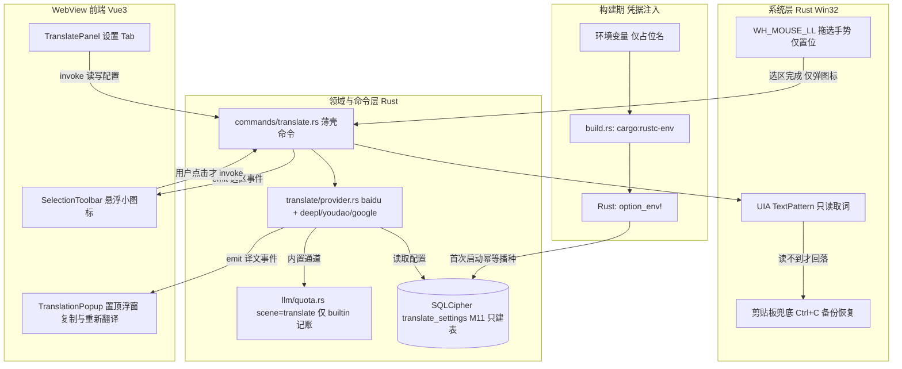

# 全局划词翻译（悬浮工具条与译文浮窗）实施计划

> 子计划：为「七七」新增全局划词翻译能力。
> 生成日期：2026-11-09。状态：已实现（2026-11-09 收口，实现偏差见 §七）。
> 上位依据：[design-baseline.mdc](mdc:.codebuddy/rules/design-baseline.mdc)、[code-standards.mdc](mdc:.codebuddy/rules/code-standards.mdc)、[i18n-rules.mdc](mdc:.codebuddy/rules/i18n-rules.mdc)、[development-guide.mdc](mdc:.codebuddy/rules/development-guide.mdc)、[docs/design/接口契约.md](mdc:docs/design/接口契约.md)。
> 格式参照：[联网搜索-WebSearch实施计划.md](mdc:.codebuddy/plans/联网搜索-WebSearch实施计划.md)。
> **本文件只描述实现方案，不含任何凭据字面值，也不修改任何业务代码。**

---

## 一、背景与决策

### 1.1 背景与参考应用对照

在任意第三方应用（浏览器、Office、PDF、编辑器、聊天软件）中选中文字后，希望不切换窗口即可完成翻译。同类应用已形成较稳定的交互范式，本方案以「腾讯元宝划词工具栏」为主参照：

| 应用 | 触发与交互 | 取词方式 | 结果展示 | 本方案借鉴点 |
| :--- | :--- | :--- | :--- | :--- |
| **腾讯元宝划词工具栏**（用户指定参考） | 选中文字后选区旁浮出操作条（搜索 / 翻译 / 复制 / 朗读），**点「翻译」才出结果**；设置「当选中文本时显示工具栏」总开关 | 工具条出现阶段不取词、不注入按键 | 独立翻译窗口，支持「窗口置顶」「连续划词」 | **核心参照**：手势阶段只弹图标，点击才取词；总开关；结果页置顶 |
| Pot-Desktop | 全局快捷键触发；内置 20+ 翻译引擎 | UIA Automation + 剪贴板两路 | 置顶浮窗 | `services/translate/<provider>/` 的 preset 分层；`pot-app/Selection` 取词思路 |
| Bob（macOS） | Selection / Snip / Manual 三种输入 + Shortcut 层 | 系统辅助功能 | 置顶浮窗 | 输入子系统与展示解耦 |
| 有道词典 / dsh-select-assist | 划词后弹悬浮菜单，点击菜单项才取词 | UIA `TextPattern` 主路径 + 剪贴板仅兜底 | 悬浮结果窗 | 同一选区只弹一次、Esc / 点外部收起、尽量不碰剪贴板 |
| SelectionTranslator-Windows | 拖选 / 双击 / 三击自动翻译 | UIA + 安全剪贴板兜底 | 跟随鼠标浮窗 | 手势阈值判定与剪贴板还原 |
| Windows 三条取词路线（通用事实） | — | ① UIA `TextPattern.GetSelection()`：不碰剪贴板、不抢焦点，但终端 / 远程桌面 / 自绘 UI / 部分 PDF 失效；② `SendInput` 模拟 `Ctrl+C` 读剪贴板：兼容最广，但会真实改动剪贴板且管理员权限窗口受 UIPI 拦截；③ 悬浮按钮：最不越权、多一次点击 | — | 采用 ③ 触发 + ① 主路径 + ② 兜底 |

### 1.2 已确认决策（两轮问答）

| # | 决策项 | 结论 |
| :--- | :--- | :--- |
| 1 | 翻译服务 | **专用翻译 API**，不复用现有 LLM 对话通道（`llm/client.rs` 的 OpenAI 兼容流式链路） |
| 2 | 触发方式 | **仅悬浮小图标**：选中文字后在选区旁弹图标/工具条，用户点击后才取词翻译；不做「划词即译」自动模式，全局快捷键不作为必需触发 |
| 3 | 结果展示 | **独立置顶小浮窗**（新增第三窗口，跟随选区，Esc / 点外部关闭） |
| 4 | 取词底线 | **仅主动触发时取词**；手势阶段不取词、不自动注入按键、不改写剪贴板 |
| 5 | 零配置通道 | **内置百度翻译**（应用自带凭据，用户无需配置即可用） |
| 6 | 内置凭据存放 | **写入加密数据表、代码中不留明文**：构建期环境变量注入 → `option_env!` → 首次启动幂等播种进 SQLCipher |
| 7 | 自定义通道 | **预设服务商 BYOK**：DeepL / 有道 / Google，每个 preset 一个 provider 实现，用户自填 Key |
| 8 | 额度 | **内置翻译计入内置额度**；**自定义翻译 API 不计入统计** |
| 9 | 浮窗操作 | 提供**译文快速复制**与**重新翻译** |
| 10 | 语种范围 | **本版本只提供中英互译**（zh ↔ en），不做多语种语言表 |

### 1.3 默认假设（如需变更，执行前提出）

- 中英互译：源语言自动识别仅 `zh` / `en`，目标为相反语言；设置里可锁定「译入中文 / 译入英文」两档（或保持自动互译）；其它语言给双语提示「暂不支持」。
- 「重新翻译」：用当前 provider 重发同一原文，带 loading 态与本地化失败提示；in-flight 期间去重防连点；每一次真实发起的请求各记一条账。
- 「快速复制」：用户主动点击后由 Rust 写剪贴板并给双语 toast；这不违反「手势阶段不自动改写剪贴板」。
- 隐私与体验约束：密码框与敏感输入跳过、勿扰（DND）时段禁用、同一选区不重复弹窗、控制台窗口跳过。
- 月度内置额度耗尽：给双语提示并引导切换自定义服务，不静默失败。
- 功能总开关默认值：建议默认开启以体现「零配置即可用」，但设置面板与托盘必须提供显著关闭入口；若产品侧要求默认关闭，执行前确认。

### 1.4 凭据安全处置声明（红线）

1. 用户提供了百度翻译开放平台 APPID 与密钥的字面值。**该值不得出现在本计划、迁移 SQL、Rust / Vue 源码、`.env.example`、日志、提交信息、前端产物或任何会进入 git 的文件中**。文档与代码只出现占位环境变量名（本文用 `QIQI_BAIDU_APPID` / `QIQI_BAIDU_SECRET` 举例，实际名以执行时约定为准）。
2. 采用**构建期注入 + 运行时播种**：`build.rs` 从环境变量读取并以 `cargo:rustc-env` 传出，Rust 侧用 `option_env!` 取值，首次启动由领域/仓储层以参数化 SQL 幂等写入 SQLCipher 的 `translate_settings` 表。仓库与迁移 SQL 均无明文。
3. **禁止**把凭据写进 `M11` 迁移 SQL：一是与「禁提交 API Key」红线冲突，二是 `scripts/verify-release-data.mjs:117-127` 的 `INSERT_ALLOW` 白名单不含新表，会直接判发布失败。项目虽有 M6「内置模型生产 Key 写在迁移 SQL」的先例，本功能明确不采用。
4. 环境变量未注入时（本地普通 `cargo test`、CI 未带 env 的步骤）用 `option_env!` 返回 `None` 降级：内置通道标记为「未配置」，给双语提示，不阻断启动、不使发布守卫失败。
5. **必须写明的安全现实**：凭据随客户端二进制分发，仍可被逆向提取，「代码无明文」不等于「绝对保密」。上线前需在百度开放平台侧配置可用的额度上限 / IP 或域名白名单（具体能力以官方文档为准），并把内置通道视为「配额受限的共享凭据」。更彻底的隔离（服务端代理）列为后续迭代。
6. 日志沿用 `[模块]` 前缀 `eprintln!` 风格，**不打印选中文本、译文、APPID、密钥与 baseUrl 全文**；`verify-release-data.mjs` 的 `dist/` 明文凭据扫描现有正则不匹配百度密钥形态，作为可选增量扩展扫描规则。

### 1.5 明确非目标（后续迭代）

划词即译自动模式、连续划词、生词本、朗读 / TTS、截图 OCR 翻译、翻译历史记录、全局快捷键触发、多语种与第三语言、服务端翻译代理、自定义 HTTP 模板引擎、同构百度自定义凭据。

---

## 二、架构

### 2.1 分层与数据流

保持与现有 `probe → commands → 领域模块 → 前端视图` 一致：系统层只上报「选区完成」手势与屏幕坐标；领域层负责取词、provider 调用、事件广播、配置与内置额度记账；命令层做参数校验与转发；WebView 层渲染小图标、浮窗与设置面板。



### 2.2 从选中到译文的时序

1. Rust 侧 `WH_MOUSE_LL` 低级钩子只做 O(1) 的位移 / 时长阈值判定，识别「拖选完成」后置位，并由领域模块 emit `translate:selection:show`（含选区屏幕矩形与去重 key）；**此阶段不读剪贴板、不注入按键、不取词**。
2. 第三窗口 `translator` 的 `SelectionToolbar` 收到事件后，在选区旁淡入小图标；同一选区去重，密码框 / 控制台 / DND 时段跳过；点别处或超时收起。
3. 用户点击图标 → `translate_capture_selection`：UIA `TextPattern.GetSelection()` 优先；读不到才注入一次 `Ctrl+C`，取词前备份剪贴板、读完恢复并加互斥锁；取词与后续 HTTP 全在 tokio 异步命令层，不阻塞钩子与轮询。
4. `translate_execute` 依配置选 provider：内置百度（编译期凭据）/ DeepL / 有道 / Google（BYOK）。内置通道成功后按 `scene=translate` 记账；自定义通道 `tier=custom` 由 `should_charge` 自动跳过。
5. emit `translate:result` → `TranslationPopup` 展示原文 / 译文 / 语种 / 服务；提供复制与重新翻译；Esc 或点击外部 emit `translate:dismiss` 并隐藏浮窗。
6. 失败 emit `translate:error`（带 `kind` 与 `retryable`），前端按 `kind` 用 `t()` 本地化提示，不显示 Rust 中文 message。

### 2.3 关键技术决策

| # | 决策 | 理由与代价 |
| :--- | :--- | :--- |
| 1 | 编译期注入 + 运行时幂等播种 | 满足「代码与仓库无明文、凭据落加密表」；代价是本地开发需配环境变量、CI 与本地打包脚本都要注入，且二进制可逆向（见 §1.4） |
| 2 | `M11` **只建表，不 INSERT** | `verify-release-data.mjs:117-127` 的 `INSERT_ALLOW` 仅含 `pet_states / app_settings / default_model_settings / search_settings`，向新表 INSERT 会 FAIL；把凭据与默认配置收敛到 Rust 播种单一真源 |
| 3 | 发布基线四处同步 | `db/README.md` §2 / §3 / §7.2、`tests/release_data_guard.rs` 的 `BASELINE_ROWS`、`migrations.rs` 的 `TARGET_VERSION` 与链；详见 §4.10。守卫是**枚举式**，不改也不会自动发现新表，故按纪律主动补齐 |
| 4 | 内置计入额度 / 自定义不计 | `quota_usage::should_charge(tier)` 仅认 `tier == "builtin"`；自定义传 `tier=custom` 天然跳过落库与展示，零额外分支 |
| 5 | 手势只置位、点击才取词 | 对齐元宝「工具条出现时不取词」，最小越权、最少误触；代价是多一次点击 |
| 6 | 新增第三窗口 `translator` | 译文较长、桌宠窗口 A 仅 150×150（另有 420×300 气泡扩展态）不够用；代价是要动窗口定义、权限矩阵、视图分发与穿透隔离 |
| 7 | `TranslateProvider` trait + preset 实现 | 类比 `llm/web_search.rs` 的 `SearchProvider`；四种服务鉴权差异大，按 preset 各一个实现，便于单测用桩替换 |
| 8 | 仅中英互译 | 用户明确本版范围；不做语言表，只做 `auto / zh / en` 三态目标语言与源语言受限判定 |
| 9 | 播种走 `init` 与 `init_with_key` 共同路径 | `release_data_guard.rs` 的 `fresh_db()` 走 `init_with_key`，会绕过 `db::init`；只写在 `init` 里守卫永远看不到，基线形同虚设 |

### 2.4 IPC 契约

> 命名沿用接口契约 v1.0：命令 `snake_case`、事件 `域:对象:动作` 全小写冒号分隔（如 `window:chat:toggle`、`chat:stream:delta`）。下表为**契约草案**，实现前先改 `docs/design/接口契约.md` §2 / §3 / §4，再动双端代码。应用自定义命令免 capability 授权（勘误#1，`接口契约.md:17`）。

**命令表**（格式仿 `接口契约.md:19-84` 四列）

| 命令 | 参数 | 返回 | 说明 |
| :--- | :--- | :--- | :--- |
| `translate_settings_get` | — | `TranslateSettings` | 读取配置；内置 APPID / 密钥与自定义 Key **均不明文回传**，只回 `hasBuiltinCredential` / `hasCustomKey` + `customKeyFingerprint` 末 4 位 |
| `translate_settings_save` | `TranslateSettingsPayload` | `()` | 保存总开关、译入语言、provider、自定义 Key；`customKey = None` 不改存量、`Some("")` 清空（沿用 `search_settings` 范式） |
| `translate_capture_selection` | `selectionKey: string` | `CapturedSelection` | 点击图标后取词，返回原文与选区矩形；UIA 优先、剪贴板兜底 |
| `translate_execute` | `text: string, targetLang?: "auto" \| "zh" \| "en"` | `TranslateResult` | 调当前 provider；内置通道成功后记账 |
| `translate_retry` | `resultId: string` | `TranslateResult` | 同原文 + 当前 provider 重发；in-flight 去重；每次真实请求各记一条 |
| `translate_copy_result` | `text: string` | `()` | Rust 写剪贴板（用户主动点击） |
| `translate_popup_show` | `rect: SelectionRect` | `()` | Rust 侧定位并显示浮窗，窗口不抢焦点 |
| `translate_popup_hide` | — | `()` | 隐藏浮窗并复位穿透状态（若适用） |
| `translate_popup_position` | `rect: SelectionRect` | `()` | 选区 / 鼠标移动时重定位 |

**事件表**（格式仿 `接口契约.md:86-98` 四列）

| 事件 | 发出方 | 负载 | 订阅方 |
| :--- | :--- | :--- | :--- |
| `translate:selection:show` | `probe/selection`（领域模块） | `{ selectionKey, rect, cursor }` | `SelectionToolbar` |
| `translate:selection:hide` | `probe/selection` | `{ selectionKey }` | `SelectionToolbar` |
| `translate:result` | `translate/` | `TranslateResult` | `TranslationPopup` |
| `translate:error` | `translate/` | `{ resultId, kind, retryable }` | `TranslationPopup` |
| `translate:dismiss` | 前端 / `translate/` | `{ selectionKey }` | 工具条与浮窗 |

**DTO**（落 `src/api/types.ts`，与 Rust serde 一一对应；行内定义写法仿 `接口契约.md:43`）

```
TranslateSettings   = { enabled: boolean; targetLang: "auto"|"zh"|"en";
                        provider: "baidu"|"deepl"|"youdao"|"google";
                        hasBuiltinCredential: boolean;
                        hasCustomKey: boolean; customKeyFingerprint: string|null }
SelectionRect       = { x: number; y: number; width: number; height: number }
CapturedSelection   = { selectionKey: string; text: string; rect: SelectionRect;
                        via: "uia"|"clipboard" }
TranslateResult     = { resultId: string; sourceText: string; translatedText: string;
                        sourceLang: "zh"|"en"; targetLang: "zh"|"en";
                        provider: TranslateSettings["provider"];
                        isBuiltin: boolean; quotaExhausted: boolean }
```

**错误**：Rust `AppError`（`src-tauri/src/error.rs:9-24`）6 变体 `Db / Llm / Window / Probe / Io / Config`，`kind` 序列化值为全小写 `db / llm / window / probe / io / config`；前端 `normalizeError`（`src/api/client.ts:24-35`）白名单另含 `unknown`。注意 `接口契约.md:13` §1 的变体写法易误读为大写 kind，以 §6 勘误#1 为准。**新增错误场景不得走「Rust 中文 `AppError.message` 直出」路径**（i18n-rules §3），前端按 `kind` 用 `t()` 兜底。

### 2.5 第三窗口与权限矩阵增量

**`tauri.conf.json` 新增窗口**（与现有 `main` / `settings` 并列）

| 字段 | 值 | 理由 |
| :--- | :--- | :--- |
| `label` | `translator` | 前后端窗口契约常量 |
| `transparent` / `decorations` / `shadow` | `true` / `false` / `false` | 悬浮卡片无边框 |
| `alwaysOnTop` / `skipTaskbar` | `true` / `true` | 译文需覆盖第三方应用、不占任务栏 |
| `width` / `height` / `resizable` | 约 380×260 / `false` | 容纳原文 + 译文 + 两个操作按钮（最终尺寸以设计稿为准） |
| `visible` | `false` | 由选区事件按需显示 |
| `center` | `false` | 位置由 Rust 依选区矩形计算 |

**联动锚位（已核实，缺一不可）**

- `src-tauri/src/window/manager.rs:5-6`：现有仅 `LABEL_MAIN` / `LABEL_SETTINGS`，新增 `LABEL_TRANSLATOR`。
- `src-tauri/src/commands/window.rs:114` `resolve()` 的 label 白名单必须同步加入，否则窗口命令被拒。
- `src-tauri/capabilities/default.json:5`：`windows` 由 `["main","settings"]` 改为 `["main","settings","translator"]`。**若浮窗定位 / 显隐全部走自定义命令，则不需要新增权限条目**（自定义命令免授权，勘误#1）；若前端直接调用 `core:window:allow-set-position` / `allow-hide` / `allow-show`，须在 `接口契约.md` §4.1 权限矩阵逐项申请，禁通配、禁预授权。推荐前者。
- `src/main.ts:18-25` `resolveRootComponent()` 当前返回 `Promise<typeof PetWindow | typeof SettingsWindow>`，`label === "settings"` 走设置窗、其余走桌宠窗；需扩展返回类型与 `translator` 分支，透明窗口套用 `pet-window` class。
- `src-tauri/src/window/click_through.rs:18-20` `is_passthrough_managed(label)` 只认 `LABEL_MAIN`；**第三窗口不得被穿透托管**，否则整窗点不动且无复位路径。
- `src-tauri/src/lib.rs`：唯一组装锚位，`.setup()` 接线钩子启动与播种、`.invoke_handler()` 注册命令、`on_window_event` 的 CloseRequested → hide 逻辑需考虑新窗口（建议浮窗关闭 = 隐藏而非关闭）。

**「不抢焦点」风险**：点击小图标或显示浮窗若激活窗口，会导致第三方应用选区丢失、UIA 读不到文本。Tauri 2 是否提供开箱即用的「显示但不激活」开关需查官方文档；备选为 Rust 侧对 HWND 设置 `WS_EX_NOACTIVATE` 扩展样式，或在手势阶段以 UIA 只读缓存选区文本。**此为最大技术风险，须在实现前做隔离验证**（baseline §K）。

---

## 三、目录结构与改动

> 以下均为**功能实现阶段**的规划改动，本轮不落盘。[NEW] / [MODIFY] 标注增量；路径与符号均已核实。

**构建期凭据注入**

```
src-tauri/build.rs                            # [MODIFY] 当前 3 行仅 tauri_build::build()；读环境变量→cargo:rustc-env，补 rerun-if-env-changed
.github/workflows/release.yml                 # [MODIFY] :64 tauri-action step 级 env 注入两个 secrets；:58-60 守卫 step 同步 env 或提到 jobs.release.env
scripts/build-release.ps1                     # [MODIFY] :324 守卫段之前设进程级 $env:（照抄 :214-216 风格），禁用 Write-Host 打印值
```

**窗口与能力**

```
src-tauri/tauri.conf.json                     # [MODIFY] app.windows 新增 translator 定义（见 §2.5）
src-tauri/capabilities/default.json           # [MODIFY] :5 windows 数组加入 translator；仅当浮窗走前端 window API 时逐项申请权限
src-tauri/src/window/manager.rs               # [MODIFY] LABEL_TRANSLATOR 常量、浮窗定位与显示/隐藏（现仅 :5-6 两个常量）
src-tauri/src/window/click_through.rs         # [MODIFY] 保持 is_passthrough_managed 只认 LABEL_MAIN，隔离第三窗口
src-tauri/src/commands/window.rs              # [MODIFY] :114 resolve() 的 label 白名单加入 translator
```

**Rust 组装、领域层与命令层**

```
src-tauri/src/lib.rs                          # [MODIFY] 唯一组装锚位：setup 启动钩子/播种、invoke_handler 注册、窗口事件
src-tauri/src/probe/selection.rs              # [NEW] 手势阈值判定与选区去重（纯函数可测，不持有系统句柄）
src-tauri/src/probe/scheduler.rs              # [MODIFY] 复用唯一 100ms 单点轮询，不新增线程
src-tauri/src/translate/                      # [NEW] mod.rs / provider.rs / presets/{baidu,deepl,youdao,google}.rs
                                              #       capture.rs / client.rs / settings.rs / bootstrap.rs
src-tauri/src/commands/translate.rs           # [NEW] 薄壳命令（参数校验 + 转发，不拼 SQL；事件在领域模块 emit）
src-tauri/src/commands/mod.rs                 # [MODIFY] 注册 translate 模块
src-tauri/Cargo.toml                          # [MODIFY] 按 UIA / 剪贴板 / 钩子实际需要扩展 windows 0.58 features 或增补 crate（查官方文档后定）
src-tauri/src/config.rs                       # [MODIFY] 手势阈值、请求超时、截断长度等常量（现 :80/:89-94 已有额度常量）
src-tauri/src/i18n.rs                         # [MODIFY] 若新增托盘「划词翻译开关」词条，同步两条语言分支
```

**数据层与发布基线**

```
src-tauri/src/db/migrations/M11__translate_settings.sql   # [NEW] 仅 CREATE TABLE IF NOT EXISTS，单行 id=1 CHECK，禁止 INSERT
src-tauri/src/db/migrations.rs                            # [MODIFY] :20 TARGET_VERSION 10→11；:69 后追加 M11（禁改历史 SQL）
src-tauri/src/db/connection.rs                            # [MODIFY] 在 init 与 init_with_key 共同路径、apply_migrations 之后调用播种；
                                                          #          禁止在此写业务 SQL（:5 纪律），SQL 全放仓储
src-tauri/src/db/repositories/translate_settings.rs       # [NEW] 参数化幂等播种/读写，Row::has_key() 范式（仿 search_settings.rs:48-50）
src-tauri/src/db/repositories/mod.rs                      # [MODIFY] 注册新仓储
src-tauri/src/db/models/                                 # [MODIFY] DTO 与 Row（目录，非 models.rs 单文件）
src-tauri/src/db/README.md                                # [MODIFY] §2 表清单 14→15、§3 迁移链加 M11、§7.2 表格与合计
src-tauri/tests/release_data_guard.rs                     # [MODIFY] :26-43 BASELINE_ROWS 加 1 行；:98-162 默认值断言；
                                                          #          :165-187 UNION ALL 覆盖新表文本列；顺带修正 :48 的 M1–M9 注释
scripts/verify-release-data.mjs                          # [MODIFY 可选] :176 凭据正则扩展；说明同步（勿动 INSERT_ALLOW）
```

**额度**

```
src-tauri/src/llm/quota.rs                    # [MODIFY] 扩 scene=translate 的折算入口（record_call 现有签名不改，见 §4.4）
src-tauri/src/db/repositories/quota_usage.rs # [MODIFY] :41 scene 注释补 translate；必要时补场景白名单校验
```

**前端**

```
src/main.ts                                   # [MODIFY] :18-25 resolveRootComponent 返回类型与 translator 分支
src/views/translate/SelectionToolbar.vue      # [NEW] 选区旁悬浮小图标（去重、超时、Esc、点击才 invoke）
src/views/translate/TranslationPopup.vue      # [NEW] 置顶浮窗：原文/译文/语种/服务 + 复制 + 重新翻译
src/views/settings/SettingsWindow.vue        # [MODIFY] :33-34 PanelKey 增 translate；:108-117 模板 v-if 分支
src/components/window/SideNav.vue            # [MODIFY] :10-22 props/emit 联合类型、:26-35 items；顺序与 PanelKey 一致
src/views/settings/panels/TranslatePanel.vue # [NEW] 总开关、译入语言、服务选择、自定义 Key 与脱敏回显
src/api/translate.ts                         # [NEW] IPC 封装，每个 await invoke 有 try/catch 与用户可见反馈
src/api/types.ts                             # [MODIFY] TranslateSettings / CapturedSelection / TranslateResult 等 DTO
src/i18n/locales/zh-CN.ts + en-US.ts         # [MODIFY] 成对新增键（en-US.ts 末尾 satisfies MessageShape 会做编译期同键校验）
src/styles/tokens.css                        # [不改动] 仅复用现有 token
src/tests/                                   # [NEW] 手势纯函数、额度口径、DTO 脱敏、浮窗组件单测（复用 setup-i18n.ts）
docs/design/接口契约.md                       # [MODIFY] §2 命令表、§3 事件表、§4 DTO/权限矩阵、§6 勘误按需登记
```

---

## 四、实现要点

### 4.1 凭据注入与运行时播种

- `build.rs` 现仅 `tauri_build::build()`，`Cargo.toml:17-18` 的 build-dependencies 只有 `tauri-build`；用 `std::env::var` + `println!("cargo:rustc-env=...")` 即可，**无需新依赖**。全仓库无 `cargo:rustc-env` / `option_env!` 先例（`env!` 仅用于 `commands/update.rs:58,86` 的 `CARGO_PKG_VERSION`），这是全新机制，须补 `cargo:rerun-if-env-changed=QIQI_BAIDU_APPID` 等，否则改 secret 不触发重编译。
- Rust 侧用 `option_env!` 取 `Option<&'static str>`；未注入时回落 `None`，不 panic、不阻断启动。
- **CI 注入点**：`.github/workflows/release.yml:64` 的 `Build and publish Tauri app` step 是当前 workflow 唯一的 `env:` 块（仅 `GITHUB_TOKEN`），在此新增两个 secrets。⚠️ `:58-60` 的 `Verify clean-install data baseline` step 跑在 tauri-action **之前**且无 env；若其编译 / 运行需要该值，必须同步加 `env:` 或把变量提到 `jobs.release.env`（当前 workflow 无 job 级 env）。`:54-55` 静态守卫 step 同理。
- **本地注入点**：`scripts/build-release.ps1` 在 `:352`（`pnpm tauri build`）之前设置进程级 `$env:`，风格照抄 `:214-216`；为让 `:331` 的 `cargo test --test release_data_guard` 也拿到值，注入语句应放在 `:324` 守卫段之前。`Invoke-Checked`（`:88-126`）无 env 形参，不能靠它传；`build-release.cmd` 仅 `%*` 转发，无需改。**禁止 `Write-Host` 打印凭据值**。
- **播种落点（易踩坑）**：`db::init` 是 `db/mod.rs:15` 对 `connection::init`（`connection.rs:25-30`）的重导出，不是独立文件；`connection.rs:5` 明令禁止写业务 SQL。而 `release_data_guard.rs:53` 的 `fresh_db()` 走 `init_with_key`（`connection.rs:172-176`），**会绕过 `init`**。因此播种必须做成 `apply_migrations` 之后由 `init` 与 `init_with_key` **共同调用**的函数，SQL 落在 `repositories/translate_settings.rs`，`connection.rs` 只做一次调用，否则守卫测试永远看不到新行。
- `M11` 表结构仿 `M9__search_settings.sql:12-19` 的 `id INTEGER PRIMARY KEY CHECK (id = 1)` 单行表；但 **M11 不写** M9 那种 `INSERT ... SELECT ... WHERE NOT EXISTS` 静态种子，改由 Rust 幂等写入（参数化 SQL）。建议字段：`enabled` / `target_lang` / `provider` / `custom_api_key` / `custom_app_id` / `builtin_app_id` / `builtin_secret`；无论环境变量是否注入都播种 1 行（未注入时凭据列为空），使基线行数确定。
- 读取接口只回 `hasBuiltinCredential` / `hasCustomKey` + 末 4 位指纹，仿 `commands/search_settings.rs:15-42`；`None` 不改、`Some("")` 清空。

### 4.2 手势检测与取词

- `WH_MOUSE_LL` 回调只做位移 / 时长阈值判定与 O(1) 置位（阈值落 `config.rs`，值需实测；参考同类应用约 5–12px / 60ms），不做 COM、HTTP 或日志 IO；复杂逻辑移到 tokio 异步命令层。复用 `probe/scheduler.rs` 的唯一 100ms 单点轮询，**不新增轮询线程**。
- 选区去重：`selectionKey`（原文 hash + 屏幕矩形 + 时间戳，或 UIA 运行时 ID），同一 key 只弹一次图标；Esc / 点别处 / 超时收起；「连续划词」不在本版范围。
- 跳过规则：密码框（UIA `IsPassword`）、控制台窗口、DND 时段（复用现有 `dnd` 配置与 `probe/idle.rs` 状态）、自家三个窗口。
- 点击图标后取词：UIA `TextPattern.GetSelection()` 优先；读不到才注入一次 `Ctrl+C`（可用 `Ctrl+Insert` 双保险），取词前备份剪贴板、等待与有限重试、读完恢复、全程互斥锁；用户正在按 `Ctrl+C` 或取词期间自行复制时不写入剪贴板。
- 已知失败与降级：目标窗口以管理员权限运行时注入按键被 UIPI 拦截；部分应用 UIA 不支持；点击浮窗若抢焦点会丢失原选区（见 §2.5）。这些都给双语降级提示，不静默失败、不阻断其它功能。
- 实现前须查官方文档核实：Windows UIA 的 COM 线程模型（STA/MTA）、`WH_MOUSE_LL` 回调约束与消息循环、多显示器 / DPI 坐标换算（选区矩形 → 窗口逻辑坐标）、Tauri 2 窗口「不抢焦点」可行性（baseline §G / §K）。

### 4.3 TranslateProvider 与第三方 API 核对

- `TranslateProvider` trait 类比 `llm/web_search.rs` 的 `SearchProvider`；preset 为 `baidu`（内置）/ `deepl` / `youdao` / `google`（BYOK），每个一个实现，便于单测用桩替换。HTTP 一律 Rust 侧 `reqwest` + tokio，连接 / 总超时，失败信息只带 HTTP 状态与截断前缀，不回显 Key 或原文。
- **百度通用翻译 API 已核实要点**（官方 `https://fanyi-api.baidu.com/product/113`、`/doc/23`）：
  - `GET / POST https://fanyi-api.baidu.com/api/trans/vip/translate`；POST 时 `Content-Type: application/x-www-form-urlencoded`，UTF-8；
  - 参数 `q` / `from` / `to` / `appid` / `salt` / `sign`，`sign = MD5(appid + q + salt + 密钥)`，32 位小写；
  - 建议单次 `q` ≤ 2000 字符；计费字符按源语言字符长度计（汉字 / 字母 / 标点 / 空格 / HTML 标签均计）；
  - 成功返回 `from` / `to` / `trans_result[].src` / `.dst`；失败返回 `error_code` / `error_msg`；
  - QPS、免费额度与完整错误码表**以官方接入文档为准**；超限需截断 + 双语提示，或分段翻译后合并。
- **DeepL 已核实要点**（官方 `https://developers.deepl.com/docs/getting-started/auth`）：`Authorization: DeepL-Auth-Key <key>`，`POST /v2/translate`，JSON `text` 数组 + `target_lang`，返回 `translations[].text` / `detected_source_language` / `billed_characters`；免费 / 付费 endpoint 不同，实现前核对；常见错误码 400 / 403 / 413 / 429 / 456。
- **有道智云 / Google Cloud Translation**：实现前须查各自官方文档确认签名算法、鉴权方式、请求 / 响应字段、错误码与限额。第三方博客对照（如有道 SHA256 签名、3 位错误码）仅作线索，**不得照抄进实现**（baseline §G「AI 生成的第三方库 / API 调用须先查官方文档」）。
- 本版 provider 统一只请求 `zh` / `en` 方向；各服务的语言代码映射（百度 `zh`/`en`、DeepL `ZH`/`EN` 等）以官方文档核对后集中在 preset 内，不散落到 UI。

### 4.4 内置额度记账 / 自定义不计账

- `llm/quota.rs:30-38` 的真实签名为 `record_call(conn: &Connection, scene: &str, hit: Option<(&str,&str,&str)>, usage: Option<TokenUsage>, chars: CallChars, ok: bool, error: Option<&str>) -> Result<(), AppError>`（**首参 `conn`，共 7 参**，`hit` 是 `(tier, model, platform)` 三元组）；`hit = None` 时整笔跳过，内置通道务必传完整三元组。
- 百度翻译按字符计费、无 token usage → 传 `usage: None`、`CallChars { prompt: 原文字符数, completion: 译文字符数 }`，由 `estimate_tokens`（`quota_usage.rs:33-35`）折算并标 `token_source="estimated"`；权重在 `config.rs:89-94`（`WEIGHT_IN_DEFAULT=1.0`、`WEIGHT_OUT_DEFAULT=2.0`、`TOKEN_ESTIMATE_CHARS_PER_TOKEN=1.6`），月度额度 `config.rs:80` `QUOTA_MONTHLY_CREDITS=100_000`。
- 记账值：`scene="translate"`、`tier="builtin"`、`model` 记服务名、`platform="百度翻译"`。需同步 `QuotaUsageInput.scene` 注释（现为 chat / proactive / distill / diary）与前端用量明细的场景字典键（i18n-rules §2：后端下发字段按原文精确映射，成对加键）。
- 失败 / 超时：`ok=false` 记 0 点但保留明细（`quota_usage.rs` 既有语义）；「重新翻译」每一次真实发起的请求各记一条。
- 自定义通道传 `tier="custom"`（或不调 `record_call`），`should_charge`（`quota_usage.rs:59-61`）自动跳过落库与展示，设置页用量明细不出现自定义翻译记录。
- 额度耗尽：命令层读月汇总，`quotaExhausted=true` + 双语提示并引导切换自定义服务；不静默失败、不扣点。

### 4.5 仅中英互译

- 目标语言三态 `auto`（默认，自动互译）/ `zh` / `en`，设置面板只有两档锁定 + 自动，不建多语种语言表。
- 源语言优先取 provider 返回的检测语种（百度 `from`、DeepL `detected_source_language`），仅接受 `zh` / `en`；其它给双语「暂不支持」提示，不发起多语种请求。
- `auto` 下按检测结果取相反语言；锁定档下 `to` 固定。语言名展示走 i18n 字典（「中文」/「English」按惯例以母语呈现，i18n-rules §3 豁免）。

### 4.6 快速复制与重新翻译

- 浮窗底部两个圆形图标按钮，双语 `aria-label` / `title`，hover 微动效。
- 复制：`translate_copy_result` → Rust 写剪贴板（需扩展 `windows` crate 的剪贴板 features，查官方文档）→ 双语 toast；**不经前端 `navigator.clipboard`**（边界隔离 baseline §G）。这是用户主动点击，不违反「手势阶段不自动改写剪贴板」。
- 重新翻译：`translate_retry` 以缓存的 `resultId → 原文 + provider + targetLang` 重发；loading 态禁用按钮并做 in-flight 去重；成功 emit `translate:result` 覆盖同一卡片、不新建浮窗；失败保留旧译文 + 本地化错误提示；每次真实请求各记一条账。

### 4.7 错误处理与日志

- 新增错误场景按既有 `AppError` kind 归类，前端按 `kind` 用 `t()` 兜底；**不得新增「Rust 中文 `message` 直出给用户」路径**（i18n-rules §3 存量缺口登记）。
- 每个 `await invoke(...)` 必须 `try/catch` 且给用户可见反馈，绝不吞错；IPC 返回值有明确 Interface，禁 `any` / `@ts-ignore`。
- 日志沿用 `[模块]` 前缀 `eprintln!`：**不打印选中文本、译文、APPID、密钥、baseUrl 全文**；失败只带 HTTP 状态与截断前缀；守卫断言失败信息不得回显凭据。
- 注意：`commands/mod.rs:1-9` 头部虽写「禁 emit 事件」，但现码 `commands/chat.rs` / `pet.rs` / `probe.rs` / `update.rs` 已有命令层 emit；本方案仍推荐事件在领域模块 emit，但不把它当作不可违背的硬约束。`window_set_bubble_mode`（`commands/window.rs:93-95`）不 emit 任何事件，事件命名以 `域:对象:动作` 全小写冒号分隔为准。

### 4.8 国际化落地清单

1. 先加字典：`src/i18n/locales/zh-CN.ts` 写中文原值，`en-US.ts` 加同名键与译文（末尾 `satisfies MessageShape<typeof zhCN>` 会做编译期同键校验）；键按区域分区，如 `translate.toolbar.*`、`translate.popup.*`、`translate.panel.*`、`translate.error.*`、`sideNav.translate`。
2. 再改组件：`useI18n()` + `t("key")`；动态数组 / 映射用 `computed`；`aria-label` / `title` / placeholder / toast / 空状态 / 错误提示全覆盖。
3. 新增 Tab 需同步 5 处：`SettingsWindow.vue` 的 `PanelKey` 与模板分支、`SideNav.vue` 的 props / emit 联合类型与 `items`、两份字典（`sideNav.translate`）。
4. 若新增托盘「划词翻译开关」，同步 `src-tauri/src/i18n.rs` 两条语言分支与 `window/tray.rs`。
5. 后端下发的 `scene` 等字段按原文精确映射到字典键；测试注入见 `src/tests/setup-i18n.ts`，英文断言后还原 `DEFAULT_LOCALE`。

### 4.9 性能与隐私红线

- 待机额外开销接近常数级：复用唯一 100ms 轮询、钩子回调 O(1)、无新增线程；符合待机 CPU < 2%、内存 < 150 MB（baseline §L）。
- MVP 绝不主动截图；取词只在用户点击后进行；密码框 / DND / 控制台跳过；选中文本与译文不落日志、不落库（本版无历史记录）。
- API Key 绝不进前端 `.env` / `localStorage` / 代码；前端不引 Node 原生模块；SQL 全部参数化；拖拽与窗口定位由 Rust 处理。

### 4.10 迁移与发布基线同步（易漏联动）

| 文件 | 改动 | 说明 |
| :--- | :--- | :--- |
| `db/migrations/M11__translate_settings.sql` | [NEW] 仅 `CREATE TABLE IF NOT EXISTS` | 不含 INSERT / UPDATE，避开 `verify-release-data.mjs:117-127` 白名单 |
| `db/migrations.rs` | `TARGET_VERSION` 10→11、链尾追加 M11 | `README.md` §3 迁移链表同步加 M11 行 |
| `db/README.md` §2 | 「表清单（14 张）」→ 15 张，补一行 | 复核 §2 的「仓储数 12 < 表数 14」口径 |
| `db/README.md` §7.2 | 表格加 1 行、合计改「15 张表、7 行系统基础数据」 | 因运行时播种 1 行；若改为 0 行纯配置表则为「6 行」，二者必须与守卫一致 |
| `tests/release_data_guard.rs` | `BASELINE_ROWS` 加 `("translate_settings", "SELECT COUNT(*) FROM translate_settings", 1)` | `:26-43` 现 14 条；`all_baseline_tables_exist_and_schema_version_matches`（`:79-95`）自动跟随，无需改 |
| 同上 `baseline_values_are_production_defaults` | 加默认值断言 | 只断言 `provider` / `enabled` / `target_lang` 等结构字段，**不回显凭据** |
| 同上 `baseline_rows_contain_no_test_markers` | UNION ALL（`:170-175` 现覆盖 8 列）加新表文本列 | 尤其含 `custom_api_key` / `app_id` 的列；`assert_clean`（`:58-62`）失败信息不得回显明文 |
| `scripts/verify-release-data.mjs` | `:201-241` 双向比对 README §7.2 与 `BASELINE_ROWS` | **改 README 或守卫任一处，另一处必须同时改**；`INSERT_ALLOW` 不动；第 4 项凭据正则可选扩展 |
| 三处过时注释 | `release_data_guard.rs:48`、`db/README.md:196`、`release.yml:57` 的「M1–M9」 | 实际已是 M1–M10，顺带修正为 M1–M11 |

> 守卫是**枚举式**（`for ... in BASELINE_ROWS`），不会自动枚举 `sqlite_master`；即使三处都不改，CI 也不会 FAIL。按项目纪律仍须主动登记，避免新增表成为防线盲区。

---

## 五、设计风格

延续 Jelly-Toy 治愈系（参照 `docs/design/pet-design/index.html` 与 `src/styles/tokens.css`，不新增美术资源、不引第三方 UI 库）：

- **悬浮小图标**：粉彩圆角胶囊（约 32×32），`--matcha-deep` 描边 + `--bg-window` 玻璃底 + `--shadow-card`，选区旁 120ms 淡入（`--dur-fast` / `--ease-jelly`），hover 微上移；不遮挡选中文字，自动避让屏幕边缘。
- **译文浮窗**：半透明玻璃拟态卡片（`--bg-window` / `--r-lg` / `--shadow-card`），原文用 `--ink-soft` 小字、译文用 `--ink` 正文（`--font-disp`），语种与服务以 chip 呈现；顶部细窄标题条显示服务名与「内置 / 自定义」标识。
- **操作区**：复制与重新翻译为圆形图标按钮，`hover` 点亮 `--peach` 描边；复制成功有轻量反馈；重新翻译期间按钮转 loading 并禁用；失败态用柔和提示条（`--line` 分隔），不用刺眼红色。
- **设置面板**：与现有 `general / llm / dnd` 等 Tab 同构；开关用既有 `ui/` 组件，译入语言为二选一胶囊，服务为下拉 + Key 输入（脱敏回显），额度耗尽提示用 HintBox 风格。
- 所有新增文案与 `aria-label` 走 i18n 字典，见 §4.8。

---

## 六、验收

### 6.1 功能验收

1. 在浏览器 / Word / VS Code / 文本型 PDF 中拖选文字 → 选区旁淡入小图标；**未点击时剪贴板内容不变、无翻译请求**。
2. 点击图标 → UIA 取词成功 → 浮窗显示原文、译文、语种与「内置·百度翻译」；内置额度明细新增 `scene=translate` 一条。
3. 终端 / 自绘 UI 等 UIA 失效场景 → 剪贴板兜底取词成功，且**取词前后用户剪贴板内容完全一致**；并发复制不互相污染。
4. 密码框、控制台、DND 时段、自家窗口内不弹图标；同一选区不重复弹出；Esc / 点外部收起。
5. 切换「译入中文 / 译入英文」与自动互译：中→英、英→中正确；选入其它语言给双语「暂不支持」提示、不发起请求。
6. 一键复制：系统剪贴板得到译文并弹双语 toast（各语言模式下文案正确）。
7. 重新翻译：loading 态、in-flight 去重、成功覆盖同一卡片、失败保留旧译文 + 本地化提示；每次真实请求各记一条账。
8. 配置 DeepL / 有道 / Google 自定义 Key 后翻译成功，且**用量明细与月度汇总不出现该笔**（`tier=custom` 跳过）。
9. 内置通道未注入凭据 / 网络失败 / 超限 / 额度耗尽：均给双语降级提示，不崩溃、不阻断桌宠其它功能。
10. 多显示器与不同 DPI 缩放下图标与浮窗定位正确；管理员权限窗口取词失败有明确提示。

### 6.2 安全与数据验收

- 全仓搜索确认：无 APPID / 密钥字面值（源码、迁移 SQL、计划文档、`.env.example`、日志格式串、提交信息、前端产物）。
- 内置凭据只存在于编译期环境变量与 SQLCipher 表；`translate_settings_get` 序列化结果不含任何明文 Key，单测覆盖（仿 `commands/search_settings.rs:73-82`）。
- 未注入环境变量时 `cargo test` / `pnpm tauri dev` 正常编译运行，内置通道显示「未配置」。
- `pnpm tauri build` 安装包与 `dist/` 不含明文凭据；`pnpm verify:release-data` 通过（README §7.2 与 `BASELINE_ROWS` 双向一致）。
- 迁移链 `TARGET_VERSION=11`；从空库与存量 M10 库分别前向迁移成功、重复迁移幂等、迁移前备份 `.db`。
- 新表不被点击穿透托管；`translator` 窗口关闭 = 隐藏而非销毁。

### 6.3 门禁

```
pnpm typecheck && pnpm test && pnpm lint && pnpm format:check && pnpm build
cd src-tauri && cargo fmt --check && cargo test --lib && cargo test --test release_data_guard \
  && cargo clippy --all-targets -- -D warnings
pnpm verify:release-data
```

另按 i18n-rules §5：扫描 `src/` 新增硬编码中文、切到 English 逐项走查新增界面（含托盘）、关闭设置窗口再打开仍可点击且语言保持。

### 6.4 提交拆分（按逻辑单元，Conventional Commits）

> `scope` 必须取自 `commitlint.config.js` 的 `scope-enum`（`renderer / ui / ipc / window / db / i18n / ai / memory / affection / probe / deps / docs / ads / pet-design / website / ci / release`）。本功能尚无专属 scope，按主题就近选择，勿用 `plans` / `translate` / `tauri` / `design` 等未登记值。

本轮：`docs(docs): 新增全局划词翻译开发子计划`（只提交本文件，提交前审查 `git status --porcelain` + `git diff`，禁 `git add -A`，提交后确认工作区干净）。

功能实现阶段建议序列：

1. `docs(ipc): 接口契约增补划词翻译命令/事件/DTO 与额度口径`
2. `feat(db): 新增 translate_settings 表（M11）与发布基线登记`
3. `build(ci): 编译期注入内置翻译凭据并运行时幂等播种`
4. `feat(ai): 实现 TranslateProvider 与百度/DeepL/有道/Google 预设`
5. `feat(probe): 增加选区手势识别与工具条事件`
6. `feat(window): 新增 translator 独立浮窗与权限矩阵`
7. `feat(db): 内置额度记账与自定义通道不计账`
8. `feat(ui): 划词工具条、译文浮窗与设置面板（中英双语）`
9. `test(ai): 纯函数、脱敏与组件单测`

每轮提交后确认 `git status` 干净；禁提交 `.env`、Key、`*.db`、构建产物（always-applied 自动提交纪律）。

### 6.5 冷眼审查三问（baseline §K）

① 有没有漏 `await` 或错误捕获（尤其 `invoke`、SSE / HTTP、剪贴板恢复）？② 有没有把 PIXI 实例塞进响应式状态（本功能不新增 PIXI 对象，仍需确认浮窗不是 PIXI 容器）？③ 有没有在 Rust 里写死系统绝对路径或凭据？

---

## 七、实现状态与偏差登记（2026-11-09）

### 7.1 已实现（按提交）

| 提交 | 内容 |
| :--- | :--- |
| `69b1b5d` | `docs(ipc)` 接口契约增补命令 / 事件 / DTO / 额度口径 |
| `e980aff` | `feat(db)` M11 只建表 + 发布基线登记（15 张表 / 7 行） |
| `d8d55b0` | `build(ci)` 编译期注入凭据、首次启动幂等播种、DTO 与守卫断言 |
| `610a1b9` | `feat(ai)` `TranslateProvider` 四预设、翻译编排、内置额度记账、命令层 |
| `f0ee771` | `feat(probe)` 全局划词手势、点击后剪贴板取词、译文复制 |
| `5e98304` | `feat(window)` 第三窗口、权限矩阵、视图分发、取词前恢复前台窗口 |
| `2e900e0` | `feat(ui)` 工具条、译文浮窗、设置面板、IPC 封装、中英双语 |

### 7.2 与计划的偏差（后续迭代）

1. **UIA `TextPattern` 主路径未接入**：本版取词仅用剪贴板法（`SendInput` 注入 `Ctrl+C` + 备份/恢复 + 互斥锁），`CapturedSelection.via` 固定 `clipboard`。浏览器 / Office / VS Code 等常规应用可用；终端 / 自绘 UI 与管理员权限窗口（UIPI）仍会失败并给本地化提示。接入 UIA 需补 `windows` crate 的 COM 绑定或引入 `uiautomation` crate 并核实官方 API。
2. **密码框检测未实现**：仅按前台窗口类名跳过控制台 / 终端；未读取 UIA `IsPassword` 属性，故密码输入框仍可能被取词。属隐私待办，优先级高。
3. **DND 时段禁用未在 Rust 侧实现**：`probe/selection.rs::poll_selection` 未读勿扰配置；需接入 `app_settings` type=2 的时段判定。
4. **浮窗「不抢焦点」未用 `WS_EX_NOACTIVATE`**：改为在取词前用 `SetForegroundWindow` 恢复拖选时记录的原前台窗口，避免 `Ctrl+C` 发给自家窗口；`SetForegroundWindow` 受 UIPI 限制时功能会降级。
5. **工具条形态、定位与触发（2026-11-09 二/三/四次迭代）**：工具条已改为元宝式横向胶囊（品牌图标 + 翻译 + 复制 + 关闭）；工具条与译文卡片都贴在**选中词右下角**（间距 6px），坐标全程用物理像素、`Position::Physical` 设置窗口，修正高 DPI 下把物理坐标当逻辑坐标导致的定位偏移；**双击左键选中词也触发工具条，但必须是确有选中文本时**——两次按下间隔 ≤500ms、位移 ≤6px 触发后，用 `capture_selection` 探测（Ctrl+C 读剪贴板、空则忽略、之后恢复原剪贴板，无副作用），仅当取到文本才 emit；`WH_MOUSE_LL` 记录窗口物理矩形，**点击窗口之外**由 `poll_selection` 隐藏窗口并 emit `translate:selection:hide`，不再 4s 超时自动消失；点击窗口内透明区域由前端 `@click.self` 收起；**复制按钮只把选中原文写入系统剪贴板**，不翻译、不自动收起窗口。`translate:error` 已 emit，但前端主要用命令返回的 `AppError.kind` 做本地化提示。
6. **额度耗尽判定**：请求前用月汇总拦截并返回 `AppError::Config`（前端本地化提示），`quotaExhausted` 字段为请求后标记，非阻塞式拦截。
7. **凭据注入**：本地发布脚本只校验环境变量存在并提示，不代为设置；CI 需在仓库 secrets 配置 `QIQI_BAIDU_APPID` / `QIQI_BAIDU_SECRET`；注入时启动路径会把百度凭据同步覆盖到 M13 表，未注入则用 M13 种子。
8. **内置双服务商协同（2026-11-10 四次迭代）**：新增 M13 表 `builtin_translate_providers`，承载百度 + 讯飞凭据（讯飞为 APPID / APISecret / APIKey 三项，RFC1123 GMT + HMAC-SHA256 签名 + base64 请求/响应正文）、启停与各自 `monthly_granted`；`prepare()` 按当月各家 `quota_usage_platform_monthly.used` 升序选候选并剔除已达上限的，`execute()` 在某家请求失败时自动切换下一家重试一次；记账 `platform` 改为动态服务名，两家因此分别计量。自填服务商仍整体优先且不做切换；讯飞为内置专属，自填会被 `AppError::Config` 拒绝。**两家明文凭据进入仓库与安装包**，须在百度 / 讯飞控制台配置额度上限与调用白名单。
9. **额度总闸误伤修复（2026-11-10 五次迭代）**：初版曾用 `quota_usage_monthly`（聊天 / 主动话术 / 记忆沉淀等所有内置场景共用的全局额度）给翻译加总闸，导致「只启用讯飞」时明明各家额度充足却报 `配置或额度不满足`。已移除该总闸，翻译只按各家 `monthly_granted` 判定、两家都用尽才拒绝；同时把取词失败从 `AppError::Config` 改为 `AppError::Probe`，前端 `configHint()` 细分「两家都停用 / 凭据缺失」「两家都达上限」等可行动提示，避免同类问题无法定位。
10. **内置配置收归底层（2026-11-10 六次迭代）**：按用户要求移除设置页「内置翻译服务」整张卡片（用量条、月度上限输入框、启停开关），并删除 `translate_save_builtin_provider` 写命令、`SaveBuiltinTranslateProviderPayload` DTO 与前端写入 API/类型——上层不再有任何改上限或开关的入口。`monthly_granted` / `is_can_use` 由 M13 种子在底层固定为安全兜底，两家**按当月用量自动均衡 + 失败切换**完全在 `service.rs` 内部完成；`translate_list_builtin_providers` 保留为只读视图，仅用于 `configHint()` 错误诊断。`get_settings().has_builtin_credential` 改由 M13 真源判定，避免 M12 历史列被清空时设置页误报「未配置」。M13 历史 SQL 按红线不修改，文件头「设置页可改」的初始设计说明以 `db/README.md` §2 为准。
11. **兜底上限 5,000 与超额提示（2026-11-10 七次迭代）**：兜底上限由 50,000 对齐为**每家每月 5,000**（`config::BUILTIN_TRANSLATE_MONTHLY_GRANTED` 同步；M13 已入库不可改，按铁律新增 `M14__builtin_translate_cap_5000.sql` 全表对齐，存量库与全新库统一口径）。超额提示分两级：**任一家**达到上限即把结果 `quotaExhausted` 置 true，译文弹窗提示「已自动切换服务，长期使用建议添加自定义翻译服务商」（`builtin_any_exhausted`）；**两家都**达到上限则 `prepare()` 拒绝，错误 toast 提示「请添加自定义翻译服务商或下月再试」（`configHint()` 的 `builtinExhausted` 分支）。
12. **拖动桌宠误弹工具条（2026-11-11 修复）**：`mouse_proc` 的 `WM_LBUTTONDOWN` 原先只排除 translator 浮窗，桌宠 main 窗口上的按下被当成第三方应用划词；拖动位移 ≥8px、时长 ≥60ms 恰好满足 `is_drag`，而**拖选路径不做剪贴板探测**，松手即 emit `translate:selection:show`。修复：钩子用 `WindowFromPoint` + `GetAncestor(GA_ROOT)` + `GetWindowThreadProcessId` 比对当前进程 PID，自家窗口（桌宠 / 设置 / 浮窗）的按下不记录手势、并清空双击计数（避免与之后第三方点击拼成误判双击、误注入 `Ctrl+C`）；判定抽为纯函数 `should_ignore_gesture` 并补单测。点击自家窗口仍按"窗口之外"收起已显示的工具条。

### 7.3 门禁结果

- `pnpm typecheck` / `pnpm lint` / `pnpm format:check` / `pnpm build` 通过；`pnpm test` 163 项通过（含 8 项划词翻译组件单测）。
- `cargo test --lib` 187 项、`cargo test --test release_data_guard` 4 项、`cargo clippy --all-targets -- -D warnings` 通过。
- `pnpm verify:release-data` 通过（15 张表双向一致、迁移 SQL 无违规写入、`dist/` 无凭据）。
- **未做**：`pnpm tauri dev` 手工回归（需注入真实凭据并启动桌面窗口），按 §六 验收清单逐项走查。

