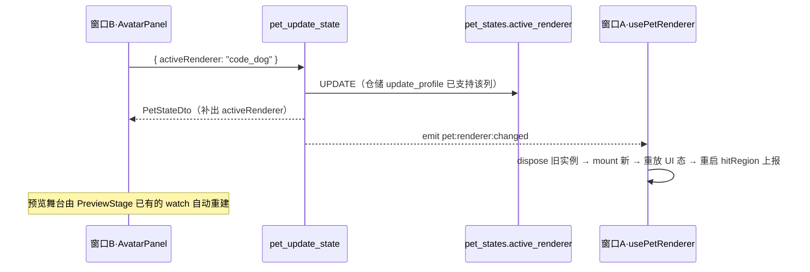

# 内置狗狗形象与形象切换子计划（第二套内置形象「汪汪」+ 即时切换）

| 项 | 内容 |
| :--- | :--- |
| 父计划 | [.codebuddy/plans/桌宠-任务拆分与开发顺序规划.md](桌宠-任务拆分与开发顺序规划.md) §二「表现层需求」（"形象为纯代码绘制的极简猫/**狗**，不依赖美术资源"）、§三 阶段 2 / 任务 C1（已完成，本计划为其形象扩展）、§六 G4（Phase 3 自定义形象预留——本计划**不动**它） |
| 规则依据 | `.codebuddy/rules/`：code-standards §3/§6（注释与 PIXI 规范）、design-baseline §D（渲染器契约与果冻公式）/§I/§J/§K、lint-rules（门禁命令）、development-guide（工作流） |
| 范围边界 | **做**：新增第二套内置形象 `code_dog`（PIXI **矢量重绘**，动效与猫完全对等）；抽出猫狗共享的渲染基类；打通形象选择的**持久化读出**与**立即生效**（含后端 DTO 字段 + 切换事件）；UX 层启用「汪汪」卡片。**不含**：Phase 3 自定义形象导入（`CustomSpriteRenderer`，属 G4）、`IPetRenderer` 契约变更、气泡/好感度/其它 D2 面板改动、任何美术资源引入 |
| 用户裁决 | ① 矢量重绘（非 jpg 贴图）；② 切换**立即生效**（非重启后生效）；③ 动效与猫完全对等；④ 选项卡名「汪汪」；⑤ 配色（2026-10-25）：**猫改奶油黄**（照 `pet-cat.jpg`）、**狗保持抹茶绿**、猫副标题「奶油黄」**不修改** |
| 现状 | C1 已完成：`renderer/IPetRenderer.ts`（契约）、`renderer/physics.ts`（5 个纯函数 `breathScales` / `dampedRecovery` / `stretchFactor` / `eyeOffset` / `jellyImpulse`，`src/tests/renderer/physics.spec.ts` 9 用例）、`renderer/CodeCatRenderer.ts`（矢量绘制 + 单一 Ticker + 命中区 + 边缘吸附躺倒）、`renderer/factory.ts`（注册表仅 `code_cat`）、`composables/usePetRenderer.ts`（模块级单例）、`views/pet/PetWindow.vue`（挂载点）、`components/settings/PreviewStage.vue`（独立 PIXI 实例，**已具备 watch id 即重建**） |
| 阻塞断点 | ① Rust `PetStateDto`（`db/models.rs`）**不含 `active_renderer`**，前端 `applyPetState` 也不写 `activeRenderer` → `petStore.activeRenderer` 恒为初始值 `"code_cat"`，即**形象选择从未被读回**（重启也只显示猫）；② 窗口 A 只在 `onMounted` 建一次渲染器，无 watch、无切换事件 |
| 状态 | **已执行**（2026-10-26）——执行结果与偏差登记见文末第十三节 |

---

## 一、关键裁决

| # | 文档原文模糊点 | 裁决 |
| :--- | :--- | :--- |
| 1 | 狗用什么方式呈现 | **PIXI 矢量重绘**，与 `CodeCatRenderer` 同体系。`docs/design/pet-design/assets/pet-dog.jpg`（1080×1080，米色**不透明**底）仅作**绘制参照**，不进 `src/assets/`；直接贴图会在透明桌宠窗口出现方形色块且无法眨眼/视线跟随 |
| 2 | 已有 435 行 `CodeCatRenderer` 怎么扩第二条 | **抽共享基类** `PetRendererBase`（承载九成通用逻辑），猫狗各自只提供「几何常量 + 一次性绘制」。**不复制**第二份 435 行类 |
| 3 | 切换何时生效 | **立即生效**。新增 Rust emit `pet:renderer:changed` → 窗口 A dispose + 重建；同时补齐 DTO 字段，使「重启后」场景一并正确 |
| 4 | 狗的动效范围 | 与猫**完全对等**：呼吸、眨眼、视线跟随、尾巴摆动、点击果冻弹动、边缘吸附躺倒旋转 |
| 5 | 选项卡命名 | 「汪汪」（取自设计稿 `docs/design/pet-design/index.html` 的 `data-name="汪汪"`，**不用** `AvatarPanel` 现存的「狗子」） |
| 6 | 几何常量能否照抄猫 | **不能**。`CORE_*` / `BODY_CENTER_Y` 决定命中区与"吸附只露半个圆"的裁切圆心。照抄会让狗躺倒时露出错误部位、点击判定偏移 |
| 7 | `selectRenderer` 里的 `id === "code_cat"` 硬编码 | **删除**。选项卡清单改由 `factory.listRenderers()` 派生；保存失败回滚到**切换前的值**（而非写死回猫）。Phase 3 加形象只需在注册表加一行 |
| 8 | 「导入自定义形象」占位卡 | **保留**（仍属 G4/Phase 3）：其点击不参与形象 id 判断，继续走原 toast；切勿误判为可选形象 |
| 9 | 配色 | **已定**（2026-10-25）：猫按 `pet-cat.jpg` 更正为**奶油黄**（现实现误用绿色 `0x7CA65B`，与设计稿「猫猫·奶油黄」不符）；**狗保持抹茶绿**（即猫正在用的那组绿，常量整体迁移给狗）；猫的副标题「奶油黄」**不修改**（改色后反而名副其实）。色值见 **§五.1 / §五.2** |

---

## 二、任务分解（AV1–AV7）

| ID | 任务 | 具体内容 | 依赖 | 验收标准 |
| :--- | :--- | :--- | :--- | :--- |
| AV1 | 共享渲染基类 | 新建 `src/renderer/PetRendererBase.ts`：抽出 `Application` 生命周期、单一 `Ticker`（呼吸/果冻阻尼回弹/眨眼/视线跟随/摆尾/表情复位）、`updateHitRegion`、`relayout`、`playAction`、`setExpression`、`lookAt`、`getHitRegion`、`setIdleMode`、`setEdgeSleep`、`dispose`；定义外接的形状描述接口 `PetShapeSpec`（§三 3.2） | - | 猫继承后行为与现状逐帧一致（手感回归） |
| AV2a | 猫继承基类（**暂不动配色**） | `CodeCatRenderer` 删除通用逻辑，仅保留猫的几何常量 + `draw()` 图层；`IPetRenderer` 契约**不变**；`physics.ts` 不动；`COLOR_*` 一批常量**原样保留** | AV1 | `pnpm typecheck` 零错；physics.spec 9 用例仍全绿；猫静态/动态观感**逐帧零变化**（改造前后截图比对） |
| AV2b | 猫改色为奶油黄 | 按 §五.1 替换 `COLOR_BODY` / `COLOR_BODY_DEEP` 并新增刘海色常量；**几何、图层结构、动画一律不动**（§五.1 红线：任何坐标/形状/动画参数都不许改，本次只允许颜色变化） | AV2a | 猫呈奶油黄且与 `docs/design/pet-design/assets/pet-cat.jpg` 对得上；形态/动效与 AV2a 完全一致；diff 中除 `COLOR_*` 行外无其它改动 |
| AV3 | 狗狗形象绘制 | 新建 `src/renderer/CodeDogRenderer.ts`：按参考图矢量绘制（§五.2），提供自有 `PetShapeSpec`；配色沿用**抹茶绿**（`#7CA65B` / `#5D8541`，即猫的旧色，**不随猫改色而调整**） | AV1 | 浏览器可见坐姿小狗，透明背景；呼吸/眨眼/视线/摆尾/果冻/吸附躺倒六项动效齐备；狗为抹茶绿、猫为奶油黄，两套一眼可分 |
| AV4 | 注册与清单驱动 | `factory.ts` 注册 `code_dog`（`listRenderers()` 随之返回两项）；`AvatarPanel` 的 OPTIONS 改为由注册表派生，「汪汪」取消灰显、`disabled` 由注册表有无决定；失败回滚改为还原旧 id；更新 `PetOptionCard` / `PreviewStage` 里"狗子未实现"的过时注释 | AV3 | 设置面板出现两张可选卡片 + 一张虚线占位；选中卡显示「✓ 使用中」 |
| AV5 | 后端读出当前形象 | `db/models.rs` 的 `PetStateDto` 增 `active_renderer: String`（结构体已有 `#[serde(rename_all = "camelCase")]` → 前端字段 `activeRenderer`）；`pet_update_inner` 构造时补上 `row.active_renderer`；`src/api/types.ts` 的 `PetStateDto` 同步增字段；`state/petStore.ts` 的 `applyPetState` 写入 `activeRenderer` | - | 库里改为 `code_dog` 后重启应用，桌宠与预览都显示狗 |
| AV6 | 立即生效链路 | `commands/pet.rs`：`pet_update_state` 增 `app: AppHandle` 参数（Tauri 2 无 `State::app_handle()`，同 C5 裁定），仅当 incoming `active_renderer` 存在且与旧值不同时 emit `pet:renderer:changed`；`usePetRenderer.ts` 抽出 `mountRenderer(id)` 并导出 `rebuildRenderer(id)`；`PetWindow.vue` 增 `listen("pet:renderer:changed")`（挂进现有 `unlisteners` 数组）→ 写 `petStore.activeRenderer` → 重建 → **重放 UI 态**（§六.3） | AV4, AV5 | 点击卡片后窗口 A **当场**变成新形象，无需重启；预览同步（`PreviewStage` 已有 watch） |
| AV7 | 测试与门禁收口 | 前端：`src/tests/renderer/rendererRegistry.spec.ts`（注册表/越界回落）+ `petStore.spec.ts` 补 `applyPetState` 写入 `activeRenderer`；Rust：`cargo test --lib` 与既有 `tests/repositories_it.rs` 断言同步；跑全套门禁（§九） | AV1–AV6 | 新增用例全绿 + 既有 `cargo test --lib` 119 项、`physics.spec.ts` 9 项**零回归** + clippy `-D warnings` 零告警 |

> 执行顺序：AV5（后端字段，可先行落地）→ AV1 → **AV2a → AV2b** → AV3 → AV4 → AV6 → AV7。AV7 随写随补，不集中到最后。

---

## 三、共享基类设计（AV1 / AV2a）

### 3.1 为什么抽基类而非复制

猫狗通用部分约占九成：`Application` 初始化、**单一 Ticker** 的全部动画推进、命中区核算、边缘吸附的旋转+位移数学、`setIdleMode`、`dispose`。若复制第二份，后续任何物理/吸附改动都要改两遍且极易走样。

### 3.2 形状描述接口（计划固化）

```ts
/** 每套形象向基类提供的**静态描述**：几何常量 + 一次性绘制。 */
export interface PetShapeSpec {
  /** 核心命中矩形（局部坐标，含身体+头+耳，不含尾），决定点击穿透范围。 */
  core: { left: number; top: number; width: number; height: number };
  /** 形象"圆盘"中心 Y（局部坐标）：边缘吸附半圆裁切的圆心基准。 */
  bodyCenterY: number;
  /** 整体缩放（两套形象观感尺寸一致即可沿用 0.6）。 */
  scale: number;
}

/** 一次性绘制出的四个图层，绘制顺序即入容器顺序。 */
export interface PetLayers {
  /** 尾巴：独立容器，pivot 在根部，每帧仅 rotation。 */
  tail: Container;
  /** 身体 + 面部 + 腮红 + 鼻（合并的单个 Graphics，绘制一次）。 */
  body: Graphics;
  /** 双耳（狗为垂耳）。 */
  ears: Graphics;
  /** 眼睛容器：lookAt / 眨眼 / 表情作用于此。 */
  eyes: Container;
}
```

基类持 `protected abstract spec(): PetShapeSpec` 与 `protected abstract draw(): PetLayers`；`mount()` 内以 `spec()` 取几何、`draw()` 取图层，之后复用**同一段** Ticker 与吸附数学。

### 3.3 迁移纪律（避免改变猫的现有行为）

- `petRoot` 的分层与 `addChild` 顺序保持 `tail → head(body, ears, eyes)` 不变。
- `headG` **不可设 pivot**（既有注释已说明会导致 awake 态错位）；旋转居中继续由 `setEdgeSleep` 的 position 补偿实现。
- Ticker 回调体内保持**零 `new`、零对象/数组字面量**；临时量一律复用类字段。
- `getHitRegion()` 继续返回**复用的同一对象**。
- AV2a 完成后按 PIXI 8 实态复核 `Application.init` / `app.destroy(true, {children:true})` 签名（C1 已核对过，此处仅确认未被基类化改动）。
- AV2a 阶段**一个色值都不改**——这样才能把"重构是否破坏观感"单独验干净；改色统一留到 AV2b。

---

## 四、几何常量标定（AV3，禁止照抄猫）

| 常量 | 猫现值 | 狗**初值** | 说明 |
| :--- | :--- | :--- | :--- |
| `PET_SCALE` | `0.6` | `0.6` | 观感相近则不动 |
| `CORE_LEFT` | `-68` | **`-86`** | 须覆盖**外凸的垂耳**（耳外沿 -86），否则点击耳朵点不中 |
| `CORE_TOP` | `-96`（含尖耳顶点） | **`-58`** | 垂耳不上冲，顶端就是身体上沿（-56 + 3px 描边） |
| `CORE_W` | `136` | **`172`** | 由 `-86` 到右耳外沿 `86` |
| `CORE_H` | `154` | **`116`** | 由 `-58` 到身体底 `58` |
| `CORE_CENTER_Y` | `TOP + H/2` | 同公式 | 旋转中心，不得手写数值 |
| `BODY_CENTER_Y` | `1`（= `-56 + 114/2`） | `1` | 身体矩形一致则不变；这是吸附半圆的圆心，改动需肉眼复核露出部位 |

以上为**起点值**，以目视校准为准；验收项：狗边缘吸附躺倒时，朝向屏幕内侧露出的须是耳 + 眼 + 脸 + 毛发，不得露出尾根或腰腹。

---

## 五、形象配色与造型规范（AV2b / AV3）

两套形象共用 **Jelly-Toy 圆润玩具风**（`src/styles/tokens.css`）：同样的圆角矩形身体、椭圆面盘、两点豆眼、腮红与小鼻，**区别在耳型轮廓与配色**。色值一律集中在各自渲染器顶部的 `COLOR_*` 常量区（禁散落魔法数，与 C5 阈值集中纪律一致）。

### 5.1 猫：配色更正为奶油黄（照 `pet-cat.jpg`）

现实现把猫画成了绿色，与设计稿「猫猫 · 奶油黄」及参考图都不符。**本次只改颜色**。

> **红线（用户明确裁决：猫只改色、不动几何）**：禁止改动任何坐标数值、图形形状、`roundRect/ellipse/poly/bezierCurveTo` 的参数、图层结构与 `addChild` 顺序、缩放与动画常量（`PET_SCALE`/`BREATH_OMEGA`/`TAIL_*`/`BLINK_*`）、以及几何相关的 `CORE_*` / `BODY_CENTER_Y`。**唯一允许的差异**是下表列出的 `COLOR_*` 色值替换与新增常量 `COLOR_BANGS`。

| 常量 | 现值（绿·误） | 新值（奶油黄） | 说明 |
| :--- | :--- | :--- | :--- |
| `COLOR_BODY` | `0x7CA65B` | **`0xF2D9A2`** | 身体/双耳主色，同设计 token 奶油系 |
| `COLOR_BODY_DEEP` | `0x5D8541` | **`0xD9BC7E`** | 描边与尾巴，深一档奶油 |
| `COLOR_BANGS`（**新增**） | —（现复用 `COLOR_BODY`） | **`0xF8F2E2`** | 额前刘海：参考图上是比面盘更浅的米白，继续用身体色会与耳/头糊成一片 |
| `COLOR_FACE` | `0xFFFEF9` | 不变 | 白色面盘 |
| `COLOR_INK` | `0x403A2E` | 不变 | 豆眼 |
| `COLOR_BLUSH` | `0xF5AEB9` | 不变 | 腮红 |
| `COLOR_NOSE` | `0xFF9E5E` | 不变 | 小圆鼻（参考图无鼻，属**几何/配件**范畴，本次不动） |

> 这两个绿色常量**不是废弃**，而是整体迁移给狗（§5.2）——调色板总量不变，只是换了主人。

**第一版反馈（用户："看起来像个绿方块，不像狗"）**——垂耳原本画在身体轮廓**内部**且与身体同色，只剩 2px 描边，剪影上完全没有耳朵。修正要点（已实装）：

| 项 | 修正 |
| :--- | :--- |
| 垂耳 | 移到**身体轮廓之外**（身体 x 仅 ±68，耳改为 ±86），靠改变整体剪影形成耳朵；`CORE_LEFT/CORE_W` 随之改为 `-86 / 172` |
| 鼻头 | 猫是小橘鼻 `#FF9E5E`；狗改为**大黑鼻** `COLOR_INK`（9×7） |
| 嘴 | 新增下弯弧线微笑（狗嘴比猫更有笑感） |
| 眼睛 | 猫是竖长胶囊 `roundRect`；狗改为**圆润椭圆** `ellipse(±24, -14, 11, 13)`，眼形也成区分点 |
| 吻部 | 面盘下再叠一层白椭圆，让口鼻"凸"出来 |

### 5.2 狗：矢量绘制规范（照 `pet-dog.jpg`）

沿用「喵喵」同家族造型，**区别只在垂耳轮廓**，配色保持**抹茶绿**（用户裁决：狗的不换）。

| 部位 | 画法 |
| :--- | :--- |
| 配色 | 身体 `#7CA65B` / 深 `#5D8541`（即猫的旧色）；面盘 `#FFFEF9`；豆眼 `#403A2E`；腮红 `#F5AEB9`；鼻 `#FF9E5E` |
| 姿态 | 端坐、正面朝向用户、居中画幅，与猫一样留出尾巴安全余量 |
| 身体 | 超大圆角矮胖矩形（`roundRect(-68, -56, 136, 114, 46)` 同猫，可微调），保持玩具感 |
| **垂耳**（第一识别点） | 顶部两侧向下垂的**长圆角**耳，`poly/roundRect` 组合成 capsule，长度到嘴角以下；**不是**猫的尖三角立耳 |
| 面部 | 白色椭圆面盘，略低于猫以显"吻部"；可选张嘴吐舌增强辨识度 |
| 五官 | 黑色椭圆豆眼（沿用 `COLOR_INK`）入 `eyes` 容器以便复用动画；橘色小圆鼻；两颊淡粉腮红 |
| 尾巴 | 短粗一条（`stroke` 比猫更宽些），同上由 `TAIL_OMEGA` 驱动 rotation 摆动 |
| 背景 | 完全透明（`backgroundAlpha: 0` 由基类保证） |

---

## 六、即时切换链路（AV6）

### 6.1 时序



### 6.2 Rust：保持 `pet_update_inner` 纯函数可被集成测试直调（沿用 C5 的 core/emit 拆分）

```rust
#[tauri::command]
pub fn pet_update_state(
    payload: UpdatePetPayload,
    app: AppHandle,          // Tauri 2 无 State::app_handle()，与 C5 同一裁定
    state: State<'_, AppState>,
) -> Result<PetStateDto, AppError> {
    let conn = state.db.lock().map_err(|e| AppError::Db(format!("获取数据库连接失败: {e}")))?;
    // 仅当请求确实要改形象时才多读一次旧值用于变更判定（避免干扰 petName 的防抖保存）
    let wants_renderer_change = payload.active_renderer.is_some();
    let prev_renderer = if wants_renderer_change {
        Some(pet_states::get(&conn)?.active_renderer)
    } else {
        None
    };
    let dto = pet_update_inner(&conn, payload)?;   // 纯逻辑（无 AppHandle），可直测
    if let Some(prev) = prev_renderer
        && dto.active_renderer != prev
    {
        let _ = app.emit("pet:renderer:changed", &dto.active_renderer);
    }
    Ok(dto)
}
```

### 6.3 重建与 UI 态重放（易漏项）

```ts
await rebuildRenderer(petStore.activeRenderer);
// 重放重建前的用户可见状态，否则换形象会"顺手把桌宠叫醒/重置"
if (sleepSnap.value && snapEdge) setEdgeSleep(true, snapEdge, settingsStore.snapShowRatio);
refreshIdleFps(); // probeIdle || sleepSnap → setIdleMode
```

- `usePetRenderer` 内缓存最近一次 `setExpression`（可用一个普通变量，不进响应式），重建后重放，避免表情闪回 `neutral`。
- 重建期间先停 `hitRegion` 上报再重启，并**立即补报一次**；`lastRegionKey` 需清零，否则残留旧矩形的指纹会命中"变化才 invoke"的短路判定，导致穿透误判。
- `PetWindow.vue` 的监听器必须 push 进既有的 `unlisteners` 数组随卸载清理。

---

## 七、测试用例清单

**前端 Vitest**

| # | 用例 | 断言 |
| :--- | :--- | :--- |
| 1 | `factory.createRenderer("code_dog")` | 返回 `CodeDogRenderer` 实例（非回落猫） |
| 2 | `createRenderer("nope")` | 回落 `code_cat`（既有容错不退化） |
| 3 | `listRenderers()` | 恰含 `code_cat` 与 `code_dog` |
| 4 | `applyPetState` | 传入 `{ activeRenderer: "code_dog" }` 后 `petStore.activeRenderer === "code_dog"`（这是本次修的核心 bug） |
| 5 | 形状常量自洽 | 两套 spec 均满足 `core.height > 0`、`bodyCenterY` 落在 body 矩形纵向范围内 |

**Rust**

| # | 用例 | 断言 |
| :--- | :--- | :--- |
| 6 | `pet_update_inner` 回读 | 写入 `active_renderer='code_dog'` 后返回 DTO 的该字段随之更新 |
| 7 | 既有 `tests/repositories_it.rs` | 断言同步（DTO 多一个字段后不得失配） |

**手工验证（GUI，必做）**

1. 设置面板两张卡片均可选；选中卡显示「✓ 使用中」，另一张取消角标
2. 点击「汪汪」→ **预览舞台与窗口 A 当场**变成狗（全程不重启应用）
3. 狗六项动效齐备：呼吸起伏、随机眨眼、鼠标移动眼珠跟随、尾巴摆动、点击 Q 弹、拖到屏幕左/右边缘**躺倒只露半边且露出的是头脸**（左右两侧各验一次）
4. 切回「喵喵」同样即时生效；猫的**形态与动效**与改动前一致，仅**配色**变为奶油黄，且与 `docs/design/pet-design/assets/pet-cat.jpg` 对得上；选项卡副标题仍显示「奶油黄」（不修改）
5. **重启应用后仍是上次选中的形象**（验证 AV5 修复）
6. 边缘吸附休眠中切换形象 → **不会把桌宠叫醒**，仍保持躺倒姿态（§6.3 重放）
7. 网络/保存失败（断库模拟）→ 卡片回滚到切换前的那张，而非必定回猫

---

## 八、文件清单（本计划允许的 diff 范围）

| 文件 | 操作 | 内容 |
| :--- | :--- | :--- |
| `src/renderer/PetRendererBase.ts` | **NEW** | 共享宿主：`Application` 生命周期、单一 Ticker、物理/眨眼/视线/表情、命中区、边缘吸附、`setIdleMode`、`dispose`；导出 `PetShapeSpec` / `PetLayers` |
| `src/renderer/CodeCatRenderer.ts` | MODIFY | ①（AV2a）继承基类，仅留猫的几何常量与 `draw()`，结构/行为零变化；②（AV2b）配色更正为奶油黄、新增 `COLOR_BANGS`——**唯一有意的视觉变化**（§五.1） |
| `src/renderer/CodeDogRenderer.ts` | **NEW** | 狗：按参考图矢量绘制 + 自有几何常量与配色 |
| `src/renderer/factory.ts` | MODIFY | 注册 `code_dog`（一行） |
| `src/renderer/IPetRenderer.ts` | 只读 | 契约不变（如需补类型，先回写规范再改） |
| `src/composables/usePetRenderer.ts` | MODIFY | 抽出 `mountRenderer(id)`，导出 `rebuildRenderer(id)`；缓存并重放最近表情；重建时停/启 hitRegion 上报并清零 `lastRegionKey` |
| `src/views/pet/PetWindow.vue` | MODIFY | `listen("pet:renderer:changed")` 挂进既有 `unlisteners` → 写 store → 重建 → 重放 `setEdgeSleep` / `refreshIdleFps()` |
| `src/state/petStore.ts` | MODIFY | `applyPetState` 写入 `activeRenderer` |
| `src/api/types.ts` | MODIFY | `PetStateDto` 增 `activeRenderer: string` |
| `src/views/settings/panels/AvatarPanel.vue` | MODIFY | OPTIONS 由 `listRenderers()` 派生、启用「汪汪」、删除 `id === "code_cat"` 硬编码、回滚到旧 id |
| `src/components/settings/PetOptionCard.vue` | MODIFY（仅注释） | 更新"未实现形象如狗子"的过时文档注释 |
| `src/components/settings/PreviewStage.vue` | MODIFY（注释 + 允许微调底色） | 更新只提 `CodeCatRenderer` 的居中注释；奶油黄在现有米色渐变底上对比偏弱，允许微调该类内的背景两个色值（**只改底色，不改形象**） |
| `src/tests/renderer/rendererRegistry.spec.ts` | **NEW** | 用例 1–3、5 |
| `src/tests/state/petStore.spec.ts` | **NEW**（目录已有 `chatStore.spec.ts`） | 用例 4 |
| `src-tauri/src/db/models.rs` | MODIFY | `PetStateDto` 增 `active_renderer: String` |
| `src-tauri/src/commands/pet.rs` | MODIFY | `pet_update_state` 增 `app: AppHandle`；变更时 emit `pet:renderer:changed`；DTO 构造补字段 |
| `src-tauri/tests/repositories_it.rs` | MODIFY | DTO 字段断言同步 |
| `docs/design/接口契约.md` | MODIFY（§5） | 登记 `active_renderer` 的**值域真源**（内置两项），与 C1 回写 `PetAction.click` 的先例一致 |
| 父计划 C1 / G4 行 | MODIFY | 状态回写：C1 追加"第二形象扩展见本子计划"；G4 明确未涉及 |

> 目录纪律：`renderer/` 平铺（C1 §五 已登记该差异，不调整目录）。类文件用 PascalCase（`PetRendererBase.ts`），非类模块才用 camelCase（`physics.ts` / `factory.ts`）。
> **不动**：`pet-dog.jpg` / `pet-cat.jpg`（留在 `docs/design/pet-design/assets/` 作参照，不进 `src/assets/`）、Phase 3 导入 UI、`IPetRenderer` 契约、气泡/好感度链路。

---

## 九、验证门禁与 DoD

- [ ] `pnpm typecheck` 零错误（strict、`noUnusedLocals`/`noUnusedParameters`）
- [ ] `pnpm lint` 0 problems；`pnpm format:check` 通过；`pnpm build` 成功
- [ ] `pnpm test`（Vitest）新增 + 既有用例全绿
- [ ] `cargo check --all-targets` / `cargo fmt --check` / `cargo clippy --all-targets -- -D warnings` 零告警；`cargo test --lib` 零回归
- [ ] 手工清单 §七 全过（尤其第 3 项左右边缘吸附、第 4 项猫改色后对得上参考图、第 5 项重启保持、第 6 项休眠中切换不唤醒）
- [ ] diff 范围仅限 §八 文件清单；完成后回写父计划 C1/G4 行状态
- [ ] **AV2b diff 复核**：除 `COLOR_*` 常量行外，不得出现任何坐标 / 形状参数 / 图层顺序 / 动画常量的改动（猫只改色不动几何）
- [ ] 冷眼三问自查（baseline §K）：
  - ① **清理**：重建路径是否先 `dispose()` 旧实例？是否移除 `resize` 监听？`unlisteners` 是否在卸载时清空？
  - ② **响应式隔离**：`grep "from \"vue\"\|reactive(\|ref(" src/renderer/` → **零命中**（PIXI 实例只存普通类字段）；表情缓存亦用普通变量
  - ③ **帧内零分配**：Ticker 回调体内无 `new`、无对象/数组字面量；`new Graphics/Container` 只出现在 `draw()`/`mount()`
  - ④ 红线：无写死绝对路径、无 `any`、无 `@ts-ignore`；SQL 保持参数化

---

## 十、风险与回退

| 风险 | 对策 |
| :--- | :--- |
| 抽基类时改动到猫的现有行为 | **刻意把"重构"与"改色"拆成 AV2a / AV2b**：AV2a 以"逐帧观感零变化"验收并先回归，确认无误后再进 AV2b，否则分不清观感变化是重构破坏还是预期改色。回退：`git revert` 到 C1 已完成的 `CodeCatRenderer`，改走"复制第二份类"方案 |
| 狗躺倒时吸附半圆露出部位不对 | `CORE_*` / `BODY_CENTER_Y` 目视校准（§四 提供起点值）；左右边缘各验一次 |
| 切换事件丢失 / 窗口 A 未监听 | 事件在两窗口均为运行时订阅；同时补齐 DTO 持久化读出，保证"最差情况重启后正确"；保存失败回滚的正确性见 §七 手工第 7 项 |
| 重建后 UI 态被重置（躺倒的宠物被叫醒） | §6.3 强制重放；命中区需清零 `lastRegionKey` 并立即补报，否则穿透误判 500ms |
| `active_renderer` 存了未注册的值（如历史脏数据） | `factory.createRenderer` 已有"未知值回落 `code_cat`"容错，DTO 读出后同样受益；选项卡 `selected` 判定对未注册 id 自然不命中 |
| 奶油黄在浅色桌面 / 预览底色上对比不足 | 窗口 A 悬浮在用户桌面上，对比度不可控（浅色壁纸下猫容易"融进去"）——属已知取舍，靠 `COLOR_BODY_DEEP`（`#D9BC7E`）3px 描边兜住轮廓。预览舞台允许微调底色（§八）。若后续反馈仍看不清，再评估加深描边或加柔光 |

---

## 十一、执行顺序

AV5（后端字段与读出，可先行）→ AV1（基类）→ **AV2a（猫继承基类）+ 回归确认逐帧零变化** → AV2b（猫改奶油黄）→ AV3（狗绘制，保持抹茶绿）→ AV4（注册与面板）→ AV6（切换链路）→ AV7（门禁收口）。

AV7 随写随补。**AV2a 未回归通过前，不得进 AV2b 或 AV3**——否则改色会把重构引入的观感问题掩盖掉。

---

## 十二、配色裁决记录（已定，2026-10-25）

**背景**：原实现把猫画成了绿色 `0x7CA65B`（正是设计稿标给狗的「抹茶绿」），与设计稿「猫猫 · 奶油黄」及 `pet-cat.jpg` 都不符，导致两套形象会撞色。

**用户裁决**：**猫改奶油黄（照 `pet-cat.jpg`）、狗保持抹茶绿、猫副标题不修改**。

| 项 | 结论 |
| :--- | :--- |
| 猫 | `COLOR_BODY` `0x7CA65B` → **`0xF2D9A2`**；`COLOR_BODY_DEEP` `0x5D8541` → **`0xD9BC7E`**；新增 `COLOR_BANGS` `0xF8F2E2`（§五.1）。几何/图层/动画不动 |
| 狗 | 沿用**抹茶绿** `0x7CA65B` / `0x5D8541`——即猫的旧常量整体迁移（§五.2） |
| `AvatarPanel` 副标题 | 猫「奶油黄」**保持原样不改**（改色后名副其实）；狗「抹茶绿」 |
| 遗留（仅记录，不改） | 参考图上猫**没有鼻子**，但现有渲染器画了橘色 `0xFF9E5E` 小圆鼻；遵"只改色不动几何"，**鼻子及其几何位置保持原样**，此为与参考图的已知视觉差异，接受即可 |

由此两套形象靠**配色（黄 vs 绿）+ 耳型（尖立耳 vs 垂耳）**双重区分，原风险表中的撞色问题自然消解。

---

## 十三、执行结果与计划对应（2026-10-26）

| 计划任务 | 实际结果 | 对应 |
| :--- | :--- | :--- |
| AV1 共享基类 | `src/renderer/PetRendererBase.ts`（NEW）：`Application` 生命周期、单一 Ticker（呼吸/果冻/眨眼/视线/摆尾/表情复位）、命中区、`relayout`、`playAction`、`setExpression`、`lookAt`、`getHitRegion`、`setIdleMode`、`setEdgeSleep`、`dispose`；导出 `PetShapeSpec` / `PetLayers`，子类只实现 `spec()` + `draw()` | ✅ |
| AV2a 猫继承基类 | `CodeCatRenderer`（435 行 → 约 100 行）：删除全部通用逻辑，**`COLOR_*` 一批常量原样保留**，几何/图层/动画零改动 | ✅ |
| AV2b 猫改色 | `COLOR_BODY` → `0xf2d9a2`、`COLOR_BODY_DEEP` → `0xd9bc7e`、新增 `COLOR_BANGS = 0xf8f2e2` 用于额前刘海；**坐标/形状/图层顺序/动画常量一行未动** | ✅ |
| AV3 狗狗形象 | `CodeDogRenderer.ts`（NEW）：抹茶绿 `0x7ca65b`/`0x5d8541`、垂耳胶囊（`roundRect(±, -52, 34, 80, 17)`）、短粗尾、自有几何常量 | ✅（几何见偏差 ①） |
| AV4 注册与清单驱动 | `factory.ts` 注册 `code_dog`；`AvatarPanel` 的 OPTIONS 由 `listRenderers()` + `PET_META` 派生，删除 `id === "code_cat"` 硬编码，失败回滚到**切换前的值**；更新 `PetOptionCard` / `PreviewStage` 过时注释 | ✅ |
| AV5 后端读出 | `PetStateDto` 增 `active_renderer`（两处构造点同步）；`api/types.ts` 增 `activeRenderer`；`applyPetState` 写入；`AvatarPanel` 挂载时 `refreshActiveRenderer()`（只改 renderer、不动名字，避免与输入框 300ms 防抖打架） | ✅ |
| AV6 立即生效 | `pet_update_state` 增 `app: AppHandle`（+ `use tauri::Emitter`），仅当 id 变化且后端确实变更时 emit `pet:renderer:changed`；`usePetRenderer` 导出 `rebuildRenderer(id)`（停/启上报 + 清零 `lastRegionKey` + 立即补报 + 重放表情）；`PetWindow` 监听并推入既有 `unlisteners`，重建后重放 `setEdgeSleep` 与 `refreshIdleFps()` | ✅ |
| AV7 测试与门禁 | `rendererRegistry.spec.ts`（NEW，6 用例）+ `petStore.spec.ts`（NEW，3 用例）；前端 18 文件全绿、Rust `cargo test --lib` 151 项全绿 | ✅（门禁见偏差 ②③） |

### 偏差登记

| # | 偏差 | 说明 |
| :--- | :--- | :--- |
| ① | 狗的 core 未按 §四 起点值，实为 **`-86 / -58 / 172 / 116`** | §四 起点值按"耳朵会上冲"估算；实际垂耳**不上冲**（顶端即身体上沿 -58），且首版视觉反馈后垂耳改为**外凸到 ±86**，故横向比猫更宽。§四 已声明"起点值以目视校准为准"，按真实几何修正后命中区与半圆裁切圆心才正确 |
| ② | `cargo fmt` 顺带修了 `search_settings.rs` / `web_search.rs` 两个**非本次改动**文件 | 二者此前就存在格式漂移；`cargo fmt --check` 是门禁项，纯格式改动无语义风险 |
| ③ | `cargo test --test repositories_it` 未能运行 | 应用正在运行，`target/debug/qiqi.exe` 被占用（os error 5）。已由 `cargo check --all-targets` 确认集成测试编译通过；且 `tests/` 下无 `PetStateDto` 引用（grep 零命中），无断言失配风险 |

### 门禁终态

`pnpm typecheck` ✅ / `pnpm lint` 0 problems ✅ / `pnpm format:check` ✅ / `pnpm build` ✅ / `pnpm test` **18 文件全绿** ✅
`cargo check --all-targets` ✅ / `cargo fmt --check` ✅ / `cargo clippy --all-targets -- -D warnings` ✅ / `cargo test --lib` **151 passed** ✅

### 冷眼三问自查（DoD）

| # | 项 | 结果 |
| :--- | :--- | :--- |
| ① | 清理 | `rebuildRenderer` 先 `dispose()` 再 mount；`PetWindow` 监听器推入 `unlisteners` 随卸载清理；基类 `dispose` 仍移除 `resize` 监听 + `destroy(true, {children:true})` ✅ |
| ② | 响应式隔离 | `grep "from \"vue\"\|reactive(\|ref(" src/renderer/` → 零命中；表情缓存 `lastExpression` 为普通模块级变量 ✅ |
| ③ | 帧内零分配 | Ticker 回调体仍无 `new`、无对象/数组字面量；`new Graphics/Container` 只出现在子类的 `draw()` 与基类 `mount()` ✅ |
| ④ | AV2b 只改色 | `CodeCatRenderer` 除 `COLOR_*` 常量与刘海填充色外无任何改动 ✅ |

### 首轮手工验证发现的问题与修复（2026-10-26 追加）

| # | 现象 | 根因 | 修复 |
| :--- | :--- | :--- | :--- |
| 1 | 设为狗后**重启变回猫**（设置里仍是狗） | 窗口 A 用 store 的**初始值**建渲染器（`code_cat`）；持久化 id 由 `useAffection` / `useProactive` 稍后异步拉回，但没有任何东西重建渲染器 | ① `usePetRenderer` 的 `onMounted` **先 `await getState()` + `applyPetState` 再建渲染器**（首帧即正确、无跳变）；② 增加 `watch(petStore.activeRenderer)` 作为统一重建路径；③ `PetWindow` 的事件监听简化为"只写 store"，重建与 UI 态重放收敛到一处（`onRendererRebuilt` 回调） |
| 2 | **预览舞台同时画出猫和狗两只** | `PreviewStage.build()` 非并发安全：`mount()` 内部 `await Application.init()`，首次按 `code_cat` 构建尚未 append 完，`refreshActiveRenderer()` 又触发第二次构建，两次 `mount` 都往同一容器 append canvas | 构建改为**串行链**（`buildChain = buildChain.then(doBuild)`），保证"先彻底销毁再挂新的"；`dispose()` 额外 `innerHTML = ""` 兜底（`destroy()` 不保证摘除 canvas） |
| 3 | 快速连切形象可能叠加 canvas | 重建无幂等/竞态保护 | `rebuildRenderer` 加 `currentId` 幂等判定 + `rebuildGeneration` 代号（只让最后一次生效），失败时清 `currentId` 允许重试 |

> 门禁复查：`typecheck` / `lint` / `format:check` / `build` 全通过，前端 **18 文件 128 用例全绿**。

### 待手工验证（GUI）

1. 设置面板两张卡片均可选，选中显示「✓ 使用中」
2. 点「汪汪」→ 预览与窗口 A **当场**变狗（不重启）
3. 狗六项动效齐备；拖到左/右边缘躺倒，露出的是头脸（两侧各验一次）
4. 猫为奶油黄且与 `pet-cat.jpg` 对得上，形态/动效与改造前一致
5. **重启应用后仍是上次选中的形象**
6. 休眠中切换形象 → 不被叫醒，仍保持躺倒
7. 保存失败 → 回滚到切换前的那张（而非必定回猫）
