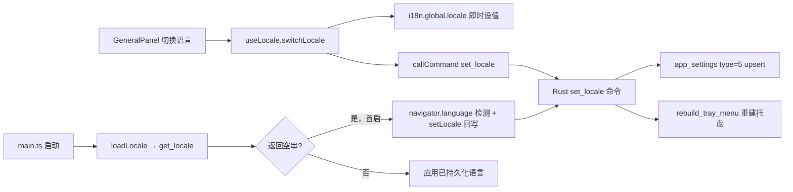

# 国际化子计划（应用界面中英文切换）

| 项 | 内容 |
| :--- | :--- |
| 父计划 | [.codebuddy/plans/桌宠-任务拆分与开发顺序规划.md](桌宠-任务拆分与开发顺序规划.md)（Phase 3 扩展能力，独立子计划） |
| 规则依据 | `.codebuddy/rules/`：`code-standards` §1/§3/§4/§5/§7、`design-baseline` §B/§G/§H/§I、`development-guide` §5（提交规范）、`lint-rules` §4（门禁）、`auto-commit`（提交纪律） |
| 任务性质 | **新增能力**：设置窗口 UI 与系统托盘菜单的中英文切换，首启按 OS 语言自动选择，用户可在「通用」Tab 手动覆盖 |
| 状态 | **已实装并完成自动门禁**（手工回归待用户在 `pnpm tauri dev` 下执行，见 §六） |
| 提出日期 | 2026-11-07 |

---

## 一、需求与澄清裁决

用户原始需求：「生成一套支持应用界面中英文切换功能的子计划」。开工前已确认四项裁决：

| # | 议题 | 裁决 |
| :--- | :--- | :--- |
| 1 | 本地化范围 | **设置窗口（窗口 B）全部 UI 文案 + Rust 系统托盘菜单**。不含桌宠窗口 A 固定 UI 文案、LLM 人设/系统提示词语种、广告营销正文 |
| 2 | 默认语言 | **首启自动检测 OS 语言**（中文系→`zh-CN`，其它→`en-US`），之后以用户手动选择为准；选择持久化，重启保持 |
| 3 | 前端方案 | **vue-i18n `^11`**（Composition API / `legacy:false`），不引自研方案 |
| 4 | 切换入口 | 设置窗口**新增「通用 / General」Tab**，语言 SegmentedControl 切换即存 |

**范围外的明确登记**（避免后续误判为漏翻）：
- 窗口 A：`components/pet/SpeechBubble.vue`、`ChatInput.vue`、`views/pet/PetWindow.vue` 的中文文案保持原样。
- LLM 提示词：`src-tauri/src/llm/prompt.rs` 等系统提示词不随界面切换，猫娘说话语种不变。
- 广告正文：`config/ads` 下发的营销文案保持原样；仅广告位的静态 UI 标签（「广告」角标、关闭/详情 aria-label、了解详情）随语言切换。
- 品牌名「七七」、语言名「中文 / English」按惯例以母语呈现，不翻译。

---

## 二、技术方案

### 2.1 总体架构

**关键决策 1（同步机制）**：采用「`set_locale` 命令内落库 + 直接重建托盘菜单」，命令持 `AppHandle` 调 `tray_by_id("qiqi-main").set_menu`。相比「前端 emit 事件 → Rust 监听」，避免事件未达导致前后端语言不一致；前端 `switchLocale` 只负责即时设值与调用命令。

**关键决策 2（首启检测可判定）**：`get_locale` 命令用**空串**表示「从未配置」，与「显式选择中文」严格区分。仓储层拆为两个函数：
- `get_locale_configured(conn) -> Option<String>`：未配置/坏 JSON/白名单外 → `None`；
- `get_locale(conn) -> String`：在前者基础上缺省回落 `zh-CN`，供 Rust `setup` 构建托盘等必须拿到有效值的场景。

否则会出现两类缺陷：① 英文 OS 首启永远回落中文（检测分支成为死代码）；② 英文 OS 上用户手动选中文后，每次启动被 OS 语言重新覆盖。此拆分由 `locale_configured_distinguishes_unset_from_explicit_zh_cn` 单测固化。

**关键决策 3（持久化）**：SQLCipher `app_settings` **type=5** 行，JSON `{"locale":"zh-CN"}`。**无需 schema 迁移**（仅新增数据行，复用既有 `get_row`/`upsert_value`）。`set_locale` 校验白名单 `{"zh-CN","en-US"}`，非法值返回 `AppError::Config`。

**关键决策 4（纯函数不被污染）**：`utils/affection.ts`（等级名/情绪文案/reason 映射）、`constants/mood.ts` 是纯函数单一真源，已有 F2 单测固化中文原值与数值边界。**不改动这些文件**，改由展示层 `composables/useAffectionI18n.ts` 用 `te()`/`t()` 映射，未知值回落纯函数结果，保证后续新增等级/reason 不丢展示。

**关键决策 5（防字典漂移）**：`en-US.ts` 使用 `satisfies MessageShape<typeof zhCN>`，把「两份字典键结构一致」变成**编译期约束**；另有运行时单测 `src/tests/i18n/locale.spec.ts` 校验叶子键集合与插值。

**关键决策 6（权限）**：自定义命令按 B2 勘误 #1 免 capability 授权，`capabilities/default.json` 无需改动。

### 2.2 红线遵守

- 语言偏好**不写 localStorage / 不记日志**；仅经 `src/api/locale.ts` → IPC → Rust → SQLCipher。
- PIXI 实例未放入 `ref`/`reactive`；`PreviewStage` 仅新增 `useI18n()`，独立实例持有方式不变。
- 所有 `invoke` 走 `src/api/*` 的 `callCommand` 统一出口；`switchLocale` 落库失败回滚前端并抛错，由 `GeneralPanel` toast，不吞错误。
- 公共函数均带 JSDoc / Rust doc 注释（中文说明 + 英文标签）。

---

## 三、文件清单

### 3.1 前端（新增）

| 文件 | 职责 |
| :--- | :--- |
| `src/i18n/index.ts` | `createI18n`（`legacy:false`、`fallbackLocale:'zh-CN'`、`missingWarn/fallbackWarn:false`）；导出 `Locale`、`SUPPORTED_LOCALES`、`DEFAULT_LOCALE`、`detectLocale()` |
| `src/i18n/locales/zh-CN.ts` | 中文字典（= 现状线上原值） |
| `src/i18n/locales/en-US.ts` | 英文字典（`satisfies MessageShape<typeof zhCN>` 编译期同键约束） |
| `src/api/locale.ts` | `getLocale()` / `setLocale()` 封装 `callCommand` |
| `src/composables/useLocale.ts` | 模块级 `currentLocale` ref；`loadLocale()`（首启 OS 检测 + 回写）、`switchLocale()`（即时生效 + 落库 + 失败回滚） |
| `src/composables/useAffectionI18n.ts` | 好感度展示文案适配层（等级名 / reason / 距下档情绪文案） |
| `src/views/settings/panels/GeneralPanel.vue` | 通用 Tab：语言 SegmentedControl，切换即存 |
| `src/tests/setup-i18n.ts` | Vitest 全局装配：`config.global.plugins = [i18n]`，默认 `zh-CN` 保持既有中文断言有效 |
| `src/tests/i18n/locale.spec.ts` | OS 检测、字典同键、译文切换、插值共 7 例 |

### 3.2 前端（修改）

| 文件 | 变更 |
| :--- | :--- |
| `package.json` | 依赖增 `vue-i18n ^11.1.0`（`pnpm-lock.yaml` 同步） |
| `src/main.ts` | `createApp(Root).use(i18n)`；mount 前 `await loadLocale()`，失败不阻断启动 |
| `src/views/settings/SettingsWindow.vue` | `PanelKey` 增 `"general"`；`<KeepAlive>` 内渲染 `GeneralPanel` |
| `src/components/window/SideNav.vue` | `items` / props / emit 联合类型增 `general`；更新标记 aria-label 本地化 |
| `src/views/settings/panels/*.vue`（7 个） | `Chat/Llm/Dnd/Affection/Avatar/Memory/About` 硬编码中文 → `t()`；toast、aria-label、占位符、下拉选项一并提取；随语言变化的常量数组（`FREQ_OPTIONS`、`RULES`、`searchProviders`、`OPTIONS`）改 `computed` |
| `src/components/window/TitleBar.vue` | 最小化/还原/最大化/关闭 aria-label |
| `src/components/ui/AppInput.vue`、`TimeChip.vue` | 密码显隐按钮、时段编辑 aria-label |
| `src/components/settings/*.vue`（8 个） | `ProviderChip`（成本档按 Rust 下发原文映射）、`ModelChips`、`PetOptionCard`、`PreviewStage`、`UpdateNotice`、`AdCard`、`AdBanner`；`QuotaBar` 无文案未改 |
| `src/components/affection/*.vue`（4 个） | `AffectionRing` aria、`LevelPill`/`LevelJourney`/`LogItem` 走 `useAffectionI18n` |
| `src/components/memory/*.vue`（2 个） | `DiaryCard`（标题/重写按钮/mood 标签）、`FactChip`（编辑/删除/确认） |
| `vitest.config.ts` | 增 `setupFiles: ["./src/tests/setup-i18n.ts"]` |

### 3.3 后端（Rust）

| 文件 | 变更 |
| :--- | :--- |
| `src-tauri/src/i18n.rs` | **新增**：`TrayStrings` + `tray_strings(locale)` 中英映射（显示/隐藏桌宠、设置、开机自启、退出），`SUPPORTED_LOCALES` 白名单，非法/缺省回落 zh-CN |
| `src-tauri/src/db/repositories/app_settings.rs` | 增 `SETTING_TYPE_LOCALE=5`、`get_locale_configured()` / `get_locale()` / `set_locale()`；5 个 locale 单测（缺省、往返幂等、坏值、非法拒绝、未配置与显式中文区分） |
| `src-tauri/src/commands/settings.rs` | 增 `#[tauri::command] get_locale()`（空串表示未配置）、`set_locale(locale, state, app)`（白名单 → 落库 → 重建托盘；托盘重建失败非致命，已落库下次启动仍生效） |
| `src-tauri/src/window/tray.rs` | `build_tray(app, locale)`；抽 `build_menu()` 供首次构建与运行时重建共用；新增 `rebuild_tray_menu(app, locale)` |
| `src-tauri/src/lib.rs` | `mod i18n;`；`setup` 读持久化 locale 传 `build_tray`；`invoke_handler!` 注册两命令 |

---

## 四、任务分解与验收

| ID | 任务 | 验收 |
| :--- | :--- | :--- |
| I18N.1 | 后端 i18n 模块、type=5 读写、两命令、托盘按 locale 构建/重建 | `cargo test --lib locale` 5 例通过；`cargo clippy --all-targets -- -D warnings` 零告警 |
| I18N.2 | 前端 vue-i18n 基座、双语字典、api/composable、main.ts 启动加载与 OS 检测 | `pnpm typecheck` 零错；首启逻辑由 §2.1 决策 2 保证 |
| I18N.3 | 通用 Tab + SideNav/SettingsWindow 注册，SegmentedControl 切换即存 | 切换即时刷新、落库失败回滚并 toast |
| I18N.4 | 窗口 B 全量文案提取（含 ui/ 子组件、affection/memory 展示层适配） | 中英字典 265 键一致；`grep` 无窗口 B 遗留硬编码中文 |
| I18N.5 | 收口：门禁、单测、字典防漂移、测试基建 | 见 §五 |

---

## 五、门禁与验证结果（2026-11-07 实跑）

| 命令 | 结果 |
| :--- | :--- |
| `pnpm typecheck`（vue-tsc strict） | ✅ 通过 |
| `pnpm lint`（ESLint） | ✅ 0 error / 0 warning |
| `pnpm format:check`（Prettier） | ✅ 全量通过 |
| `pnpm build`（vue-tsc + vite） | ✅ 通过（仅既有 `INEFFECTIVE_DYNAMIC_IMPORT` 与 chunk >500kB 提示） |
| `pnpm test`（Vitest） | ✅ 22 文件 / 155 例全通过（含新增 7 例 i18n 用例） |
| `cargo test --lib` | ✅ 169 例全通过（含新增 5 例 locale） |
| `cargo clippy --all-targets -- -D warnings` | ✅ 零告警 |
| 字典键一致性 | ✅ zh/en 各 265 键，运行时单测 + 编译期 `satisfies` 双保险 |

**遗留问题登记（非本任务引入，未擅自打包修改）**：`cargo fmt --check` 在 `src-tauri/src/affection/level.rs:106`、`rules.rs:239`、`commands/mod.rs:11/18`、`commands/update.rs:60/93/104/159/212` 与 `window/tray.rs:47` 仍有差异。原因是仓库 `rustfmt.toml` 含 `reorder_impl_items` / `overflow_delimited_expr` / `trailing_semicolon` / `trailing_comma` 等 **nightly-only 选项**，在 stable 工具链下被忽略，导致格式期望与既有提交不一致；对照 `git show ada6e91^` 确认 `tray.rs:47` 相应代码在本任务前已存在。本任务仅修正了自身引入的两处（`lib.rs` 模块声明顺序、`tray.rs` import 顺序）。如需彻底消除，建议统一 rustfmt 工具链版本后单独提交格式整理。

---

## 六、手工回归清单（待用户在 `pnpm tauri dev` 下执行）

| # | 步骤 | 预期 |
| :--- | :--- | :--- |
| 1 | 打开设置窗口 → 「通用」Tab | 显示「语言」SegmentedControl（中文 / English） |
| 2 | 切到 English | 侧栏、面板标题、按钮、提示、表单标签、状态徽标即时变英文；无需重启 |
| 3 | 右键系统托盘 | 菜单变为 Show Pet / Hide Pet / Settings / Launch at Startup / Quit |
| 4 | 关闭设置窗口再打开 | 仍为 English（持久化生效） |
| 5 | 从托盘「退出」后重启应用 | 仍为 English，且启动无中文闪烁（Rust `setup` 读持久化 locale 建托盘） |
| 6 | 切回中文 | 窗口与托盘同步回中文 |
| 7 | 首次以英文 OS 启动（或删 `app_settings` type=5 行模拟） | 自动默认 English 并回写；之后手动选中文不被 OS 语言覆盖 |
| 8 | 窗口 A 桌宠气泡/输入框 | 保持中文（范围外，验证未越界） |
| 9 | 对话回复语种 | 不随界面切换（LLM 提示词范围外） |

---

## 七、提交记录

| 提交 | 内容 |
| :--- | :--- |
| `ada6e91` | `feat(i18n): 后端新增语言偏好存储与托盘菜单本地化` |
| 本次 | 前端 vue-i18n 基座与全量文案提取、测试基建、首启检测修正、子计划文档（按逻辑单元拆分提交，遵循 Conventional Commits） |
