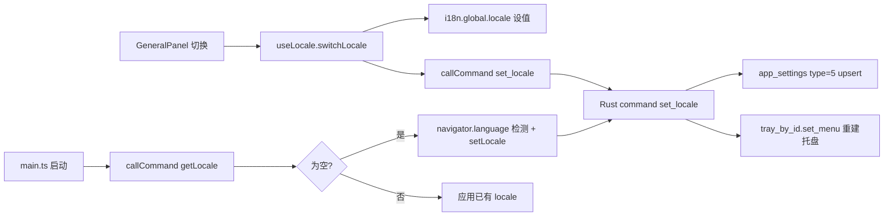

## 用户需求

为「七七」桌面宠物应用新增应用界面中英文切换功能，支持用户手动切换语言，并在首次启动时自动检测操作系统语言。

## 产品概述

在设置窗口新增「通用 / General」Tab，提供中/英语言选择（SegmentedControl）。切换后设置窗口所有 UI 文案即时变化，并将选择持久化到本地加密数据库；系统托盘菜单文字同步切换。语言偏好存于 SQLCipher，首次启动读取 OS 语言作为默认值。

## 核心功能

- 新增「通用」设置 Tab，内含语言切换控件（中文 / English），切换即持久化、即时生效。
- 设置窗口（窗口 B）全部 UI 文案支持中英双语：面板标题、按钮、表单标签、提示、状态徽标等。
- 系统托盘右键菜单（显示桌宠 / 隐藏桌宠 / 设置 / 开机自启 / 退出）随语言切换同步更新。
- 首次启动自动检测 OS 语言（中文系→中文，其它→英文），并写入持久化；之后以用户手动选择为准。
- 语言选择经 IPC 落库，前端不写 localStorage、不记日志；API Key 等敏感数据不受影响。

## 范围边界（已与用户确认）

- 覆盖：设置窗口 UI + Rust 系统托盘菜单。
- 不覆盖：桌宠窗口（窗口 A）固定 UI 文案、LLM 人设/系统提示词语种、广告营销文案（暂保持原样）。

## 技术栈选型

- 前端：Vue 3 + TypeScript + **vue-i18n（^11，Composition API / legacy:false）**；沿用现有 `callCommand` IPC 出口与 `SegmentedControl` 等 `ui/` 组件。
- 后端：Rust（Tauri 2）；复用 `app_settings` 仓储 `get_row`/`upsert_value`，新增轻量 `i18n` 模块；无需 schema 迁移（仅数据，type=5 行）。
- 持久化：SQLCipher `app_settings`，locale 存 type=5 行（JSON `{"locale":"zh-CN"}`）。
- 权限：自定义命令按 B2 勘误#1 免 capability 授权，无需改 `capabilities/default.json`。

## 实现方案

**总体策略**：前端以 vue-i18n 为中枢，启动时从后端拉取 locale（空则读 `navigator.language` 检测并回写），所有窗口 B 文案改用 `t('key')`；后端在 `app_settings` 增 locale 读写命令，托盘菜单按 locale 构建，并在 `set_locale` 命令内直接重建托盘菜单（持 AppHandle），保证前后端最终一致、无事件丢包风险。

**关键技术决策**

1. **locale 同步机制**：选择经 `set_locale` 命令落库 + 重建托盘菜单（命令持有 `AppHandle`，可调用 `tray_by_id("qiqi-main").set_menu`）；前端 `useLocale.switchLocale` 仅负责 `i18n.global.locale` 与调用命令。比「前端 emit 事件 → Rust 监听」更可靠，避免事件未达导致前后端不一致。
2. **首启 OS 检测**：`main.ts` 启动先 `getLocale()`，为空则按 `navigator.language`（WebView2/Chromium 在 Windows 反映 OS UI 语言，`zh*` 前缀→`zh-CN`，否则 `en-US`）调用 `setLocale` 持久化，顺带校正托盘语言。
3. **托盘初始语言**：Rust `setup` 读取持久化 locale（缺省 `zh-CN`）传入 `build_tray`；若首启被前端检测为英文，`set_locale` 会即时重建为英文，仅极短窗口期差异（Windows 专属，可后续用 `GetUserDefaultUILanguage` 消除，MVP 不做）。
4. **复用现有模式**：语言切换控件复用 `ui/SegmentedControl`（受控单选项），即改即存模式与 DndPanel 一致；错误经 `callCommand` 规整、`pushToast` 反馈，沿用既有纪律。

**性能与可靠性**：vue-i18n 全局 locale 为响应式引用，切换仅重渲染绑定文本，无额外开销；托盘菜单重建为低频操作；无 N+1 / 重复遍历风险。红线条：语言不进 localStorage/日志；PIXI 实例不进 reactive；`invoke` 仅经 `src/api/*`。

## 实现要点（执行备注）

- 翻译提取须**逐文件核验**：`ui/` 纯展示组件多数无硬编码文案，仅含中文者改为 `t()`；业务组件（`settings/`、`affection/`、`memory/`、`panels/`、`window/TitleBar`）逐字提取，键名按区域/组件分区（如 `general.title`、`sideNav.general`、`llm.mainTier`）。
- `zh-CN` 字典值 = 当前线上中文原值，`en-US` = 对应译文，避免语义漂移；开启 `missingWarn:false`/`fallbackWarn:false` 防开发期 console 刷屏。
- `SideNav` 与 `SettingsWindow` 的 `PanelKey` 联合类型需同步新增 `"general"`（两处定义）。
- Rust `set_locale` 须校验白名单 `{"zh-CN","en-US"}`，非法值返回 `AppError::Config`，防注入/乱码。
- 回归：`cargo clippy -D warnings` + `cargo test` 增 locale 读写单测（upsert/get 幂等、坏值回落默认）。

## 架构设计



## 目录结构

```
src/
  i18n/
    index.ts                 # [NEW] 创建 i18n 实例（legacy:false, fallbackLocale:'zh-CN'），导出实例与 Locale 类型
    locales/
      zh-CN.ts               # [NEW] 中文消息字典（= 现状原值，键名分区）
      en-US.ts               # [NEW] 英文消息字典（对应译文）
  api/
    locale.ts                # [NEW] getLocale()/setLocale(locale) 封装 callCommand('get_locale'/'set_locale')
  composables/
    useLocale.ts             # [NEW] 模块级 currentLocale ref；loadLocale()/switchLocale()；启动检测 OS 语言
  main.ts                    # [MODIFY] 挂载 i18n；启动调用 loadLocale 后再 mount；PetWindow 不消费 t()
  views/settings/
    SettingsWindow.vue       # [MODIFY] PanelKey 增 "general"；渲染 <GeneralPanel>
    panels/
      GeneralPanel.vue       # [NEW] 通用 Tab：语言 SegmentedControl（中文/English），切换即存
      ChatPanel/LlmPanel/DndPanel/AffectionPanel/AvatarPanel/MemoryPanel/AboutPanel.vue  # [MODIFY] 硬编码中文→t()
  components/window/
    SideNav.vue              # [MODIFY] items 增 general；props/emit 联合类型增 "general"
    TitleBar.vue             # [MODIFY] 含中文字符串→t()
  components/settings/       # [MODIFY] ProviderChip/QuotaBar/PetOptionCard/PreviewStage/ModelChips/AdCard/AdBanner/UpdateNotice 提取中文→t()
  components/affection/      # [MODIFY] AffectionRing/LevelPill/LogItem/LevelJourney 提取中文→t()
  components/memory/         # [MODIFY] FactChip/DiaryCard 提取中文→t()
  components/ui/             # [MODIFY] 逐个核验，含硬编码中文者（如 HintBox 文案、StatusBadge）改为 t()
src-tauri/src/
  i18n.rs                   # [NEW] TrayStrings 结构 + tray_strings(locale) 中英映射（默认 zh-CN）
  db/repositories/app_settings.rs  # [MODIFY] 增 SETTING_TYPE_LOCALE=5、get_locale()/set_locale()
  commands/settings.rs      # [MODIFY] 增 get_locale()/set_locale(locale, app) 命令（set 内重建托盘）
  window/tray.rs            # [MODIFY] build_tray(app, locale) 按 tray_strings 构建；新增 rebuild_tray_menu(app, locale)
  lib.rs                    # [MODIFY] setup 读 locale 传 build_tray；invoke_handler 注册两命令
package.json                # [MODIFY] dependencies 增 vue-i18n（^11）
.codebuddy/plans/国际化-中英文切换实施计划.md  # [NEW] 本计划落地文档
```

## 关键代码结构

```ts
// src/i18n/index.ts（节选）
export type Locale = "zh-CN" | "en-US";
export const SUPPORTED_LOCALES: readonly Locale[] = ["zh-CN", "en-US"] as const;
```

```rust
// src-tauri/src/i18n.rs（节选）
pub struct TrayStrings { pub show: &'static str, pub hide: &'static str,
  pub settings: &'static str, pub autostart: &'static str, pub quit: &'static str }
/// 按 locale 返回托盘菜单文案；非法/缺省回落 zh-CN。
pub fn tray_strings(locale: &str) -> TrayStrings { ... }

// src-tauri/src/db/repositories/app_settings.rs（节选）
pub const SETTING_TYPE_LOCALE: i64 = 5;
/// 读取用户语言（缺省/坏值回落 "zh-CN"）。
pub fn get_locale(conn: &Connection) -> Result<String, AppError> { ... }
/// 写入用户语言（落 type=5 行，JSON {"locale": <v>}）。
pub fn set_locale(conn: &Connection, locale: &str) -> Result<(), AppError> { ... }
```

```rust
// src-tauri/src/commands/settings.rs（节选）
#[tauri::command]
pub fn get_locale(state: State<'_, AppState>) -> Result<String, AppError> { ... }
#[tauri::command]
pub fn set_locale(locale: String, state: State<'_, AppState>, app: AppHandle)
  -> Result<(), AppError> { /* 校验白名单→落库→rebuild_tray_menu(&app,&locale) */ }
```