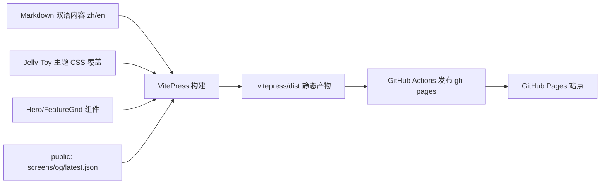

## 产品概述

为 qiqi 桌面数字生命（Windows PC 桌宠）搭建官方宣传站，采用 VitePress 构建，代码置于仓库内 `website/` 目录，通过 GitHub Pages 部署，支持中英双语切换。站点统一沿用桌宠的果冻奶油（Jelly-Toy）视觉风格，对外传递产品定位、核心能力与下载入口，并强调本地加密的隐私底线。

## 核心功能

- 首页 Hero：果冻风主视觉 + 产品一句话定位 + 立即下载 CTA，动态微交互。
- 功能介绍：以真实运行截图 + 要点卡片展示双窗口桌宠、果冻物理交互、好感度进化、AI 对话与记忆召回、主动互动、设置面板、内置形象切换、联网搜索等能力。
- 下载页：联动仓库根 `latest.json` 展示当前版本号、系统要求（Windows 10+ x64、WebView2）与一键前往 GitHub Releases 下载。
- 更新日志：中英双语时间线，记录版本特性与修复，可由 `latest.json`/git tag 同步。
- 常见问题 FAQ 与隐私/关于页：解答安装、API Key、数据安全等疑问，明确本地 SQLCipher 加密与隐私红线。
- 中英双语切换：全站导航、页脚、内容双语，默认中文。
- 部署与可维护性：GitHub Actions 构建并发布 gh-pages；截图、OG 图等资源统一纳入 `website/public`。

## 技术栈选择

- 站点框架：**VitePress**（基于 Vue 3 + Vite 的静态站点生成器，Markdown 内容 + 自定义 Vue 组件，原生 i18n、SEO 友好、零运行时后端）。
- 包管理/脚本：沿用仓库 `pnpm` 工作流，在 `website/` 内独立 `package.json`（不污染根仓库构建）。
- 部署：**GitHub Pages**（gh-pages 分支），由 `.github/workflows/deploy.yml` 构建 `website/` 并发布。
- 视觉：复用现有果冻奶油设计令牌（抹茶绿/蜜桃橙/奶油黄/暖奶油底），通过覆盖 VitePress CSS 变量落地，不引入额外 UI 组件库。

## 实现方案

### 总体策略

以 VitePress 的「内容 + 主题覆盖 + 少量自定义 Vue 组件」模式搭建：Markdown 承载功能/下载/日志/FAQ 文案，自定义 `Hero.vue`/`FeatureGrid.vue` 承载首页主视觉与功能卡片，自定义 `style.css` 将 Jelly-Toy 令牌映射到 VitePress 变量，实现视觉统一。双语通过 VitePress `locales` 实现目录级 `/zh`、`/en` 分流，默认中文。

### 关键技术决策

- **版本联动**：`latest.json`（仓库根，单一版本来源）在构建期由 `scripts/sync-latest.mjs` 拷贝至 `website/public/latest.json`，下载页通过 `fetch('/latest.json')` 展示版本号与 Releases 链接，避免版本号硬编码漂移。
- **真实截图**：执行阶段用 [skill:playwright-cli] 构建并运行桌面应用，抓取窗口 A/B 与关键交互截图存入 `website/public/screens/`（建议 webp、尺寸自适应）。
- **i18n 结构**：`docs/index.md` 为默认（中文）首页，`docs/zh/*` 与 `docs/en/*` 并列；`config.ts` 中 `themeConfig.locales` 配置双语 nav/sidebar/footer 与语言切换器。
- **部署隔离**：工作流仅 checkout 仓库、安装 `website/` 依赖、执行 `vitepress build` 并发布 `website/.vitepress/dist` 到 gh-pages，根仓库 Rust/Vite 构建不受影响。

### 性能与可靠性

- 静态产物，CDN 缓存友好；截图统一压制成 webp（<150KB/张），首屏不阻塞。
- 自定义组件仅首页与功能页使用，避免全站重渲染；VitePress 自带按需打包。
- 部署用官方 `actions/checkout` + `peaceiris/actions-gh-pages` 或 `actions/deploy-pages`，失败即阻断，不覆盖主干。

## 实现备注

- 复用根仓库 `latest.json` 作为版本唯一来源，同步脚本不得改写其语义；`tauri.conf.json` version 与 `latest.json` 保持一致由既有纪律保证。
- 截图步骤依赖桌面应用可运行（Rust 工具链 + WebView2）；若联调期应用未就绪，先用占位图并标注，待可运行后补真实截图。
- 部署工作流权限仅 `contents: read` + `pages: write`，不接触源码密钥；API Key 等敏感信息绝不进入官网。
- 日志等级：构建/部署仅输出必要信息，避免凭据泄露到 Actions 日志。

## 架构设计

### 系统架构

内容层（Markdown 双语页）→ 主题层（VitePress + Jelly-Toy CSS 变量覆盖）→ 组件层（Hero/FeatureGrid 自定义 Vue 组件）→ 资源层（`public/screens`、`og.png`、`latest.json`）→ 部署层（GitHub Actions → gh-pages）。



## 目录结构

```
website/
├── package.json                 # [NEW] VitePress 依赖与脚本（dev/build/preview/deploy），独立 pnpm 工程
├── .vitepress/
│   ├── config.ts                # [NEW] 站点配置：title/description/i18n locales/nav/sidebar/footer/语言切换
│   └── theme/
│       ├── index.ts             # [NEW] 自定义主题入口，引入 style.css 与注册组件
│       ├── style.css            # [NEW] 覆盖 VitePress CSS 变量，映射 Jelly-Toy 令牌（抹茶绿/奶油黄/暖奶油底等）
│       └── components/
│           ├── Hero.vue         # [NEW] 首页主视觉：果冻风标题、产品定位、下载 CTA、微交互动效
│           └── FeatureGrid.vue  # [NEW] 功能卡片网格：截图 + 要点，自适应布局
├── docs/
│   ├── index.md                 # [NEW] 默认（中文）首页，嵌入 Hero/FeatureGrid
│   ├── zh/
│   │   ├── features.md          # [NEW] 功能介绍（真实截图 + 要点，双语内容）
│   │   ├── download.md          # [NEW] 下载页，fetch latest.json 展示版本/系统要求/Releases 链接
│   │   ├── changelog.md         # [NEW] 更新日志时间线
│   │   ├── faq.md               # [NEW] 常见问题
│   │   └── privacy.md           # [NEW] 关于/隐私（本地加密、隐私红线）
│   └── en/
│       ├── features.md          # [NEW] 英文功能介绍
│       ├── download.md          # [NEW] 英文下载页
│       ├── changelog.md         # [NEW] 英文更新日志
│       ├── faq.md               # [NEW] 英文 FAQ
│       └── privacy.md           # [NEW] 英文隐私页
├── public/
│   ├── screens/                 # [NEW] 真实运行截图（执行期抓取：pet-window/settings/dialog 等 webp）
│   ├── og.png                   # [NEW] 社交分享图（果冻风，[skill:multi-modal内容生成] 制作）
│   └── favicon.ico              # [NEW] 复用应用图标（仓库根 icons）
├── scripts/
│   └── sync-latest.mjs          # [NEW] 构建期将根 latest.json 拷贝至 public/latest.json
└── .github/
    └── workflows/
        └── deploy.yml           # [NEW] 安装 website 依赖、构建、发布 gh-pages
```

## 设计风格

沿用桌宠「果冻奶油风（Jelly-Toy）」：暖奶油纸感底色 + 抹茶绿主色 + 蜜桃橙/奶油黄/腮红粉点缀，圆润玩具感。首页 Hero 采用大圆角玻璃拟态卡片、柔和投影、纸张噪点纹理，标题用 ZCOOL QingKe HuangYou 圆润字体，配果冻弹性微动效与悬停浮起交互，营造可爱、治愈、高级的官方形象。功能页以截图卡片网格呈现，卡片圆角与阴影统一，悬停放大高亮。整站响应式，移动端单列可读。

## 页面规划（≤5 屏）

1. 首页（Hero + 功能亮点网格 + 下载 CTA + 页脚）
2. 功能介绍（分类截图卡片 + 文字要点，顶部锚点导航）
3. 下载（版本号徽章 + 系统要求 + 一键下载按钮 + 安装指引）
4. 更新日志（时间线）
5. 常见问题 / 隐私（手风琴式问答 + 隐私承诺）

## Agent Extensions

### Skill

- **playwright-cli**
- Purpose: 执行阶段构建并运行 qiqi 桌面应用，抓取窗口 A/B 与关键交互的真实界面截图，存入 `website/public/screens/`。
- Expected outcome: 获得一组清晰的果冻风功能截图（webp，尺寸自适应），用于功能介绍页，确保展示内容真实可信。
- **multi-modal内容生成**
- Purpose: 生成果冻奶油风的社交分享图 `og.png` 与首页视觉插图，统一官网对外品牌形象。
- Expected outcome: 产出符合 Jelly-Toy 配色与风格的高质量 OG 图与插图资源，可直接放入 `website/public`。