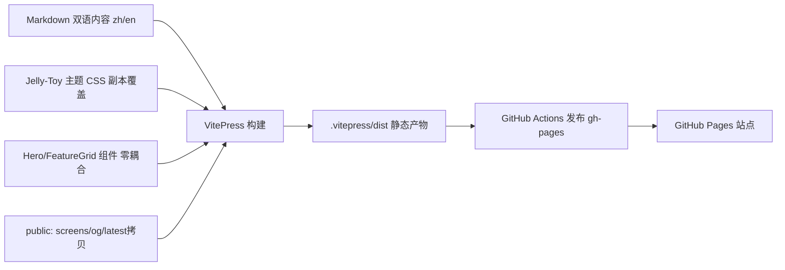

## 用户需求

为 qiqi 桌面数字宠物（Windows PC 桌宠）搭建官方宣传网站，包含功能介绍（真实运行截图）、下载入口、更新日志等模块，并补充 FAQ、隐私页。要求参考同类网站优化体验。

## 产品概述

基于 VitePress 的静态官方站，落于仓库内 `website/` 目录，通过 GitHub Pages 部署，支持中英双语切换，视觉统一沿用应用「果冻奶油风（Jelly-Toy）」。核心定位：对外传递产品（有性格、有记忆、有主动性、会主动找你说话）的价值主张、核心能力与下载入口，并强调本地 SQLCipher 加密的隐私底线。

## 核心特性

- 首页 Hero：果冻风主视觉 + 一句话定位 + 立即下载 CTA + 弹性微交互。
- 功能介绍：以真实运行截图 + 要点卡片展示双窗口桌宠、果冻物理交互、好感度进化、AI 对话与记忆召回、主动互动、设置面板、内置形象切换、联网搜索等能力。
- 下载页：展示当前版本号、系统要求（Windows 10+ x64、WebView2）与一键前往 GitHub Releases 下载。
- 更新日志：中英双语时间线，记录版本特性与修复。
- FAQ 与隐私页：解答安装、API Key、数据安全，明确本地加密与隐私红线。
- 中英双语切换：全站导航、页脚、内容双语，默认中文。
- 部署与可维护性：GitHub Actions 构建并发布 gh-pages。

## 硬性边界约束（用户追加，必须达成）

- 依赖隔离：website 使用独立 `package.json` 与 lockfile，绝不写入根 `package.json`/`pnpm-lock.yaml`，不引入根仓库 Rust/Tauri/Vite 构建链路。
- 代码零耦合：website 不得 `import` 根 `src/`、`src-tauri/`、`.codebuddy/` 任何模块或样式，仅为"文档级引用"。
- 设计令牌副本化：Jelly-Toy 配色/圆角/字体仅作为常量副本存在于 website CSS 中，不 symbol-link 或 import 应用 CSS。
- 数据只读单向联动：版本号仅通过构建期拷贝根 `latest.json` 到 `website/public/latest.json` 实现，下载页 `fetch` 只读展示，绝不回写或改写语义。
- 资源隔离：截图/OG/favicon 副本放入 `website/public/`，应用图标仅复制不引用源路径，不改动应用任何资源。
- 部署隔离：GitHub Actions 作用域限定 website/，独立运行、权限最小化，不触发 tauri build、绝不接触 API Key 等密钥；失败即阻断，不覆盖主干。
- 目录自洽：website 内部自成体系，不在根级新增与应用冲突的配置。

## 技术栈选择

- 站点框架：**VitePress**（Vue 3 + Vite 的静态站点生成器，Markdown 内容 + 自定义 Vue 组件，原生 i18n、SEO 友好、零运行时后端）。
- 包管理：沿用 `pnpm`，在 `website/` 内使用独立 `package.json` 与独立 lockfile，不污染根仓库依赖。
- 部署：**GitHub Pages**（gh-pages 分支），由 `website/.github/workflows/deploy.yml` 构建并发布。
- 视觉：复用 Jelly-Toy 设计令牌的**常量副本**，通过覆盖 VitePress CSS 变量落地，不引入额外 UI 组件库、不共享应用源码。

## 实现方案

### 总体策略

采用 VitePress「内容 + 主题覆盖 + 少量自定义 Vue 组件」模式：Markdown 承载功能/下载/日志/FAQ 文案；自定义 `Hero.vue`/`FeatureGrid.vue` 承载首页主视觉与功能卡片；自定义 `style.css` 将 Jelly-Toy 令牌映射为 VitePress 变量。双语通过 VitePress `locales` 实现 `/zh`、`/en` 目录分流，默认中文。所有自定义代码仅位于 `website/` 内，对应用零依赖。

### 关键技术决策

- **版本只读单向联动**：根 `latest.json` 是版本唯一来源。构建前由 `website/scripts/sync-latest.mjs` 单向拷贝至 `website/public/latest.json`；下载页通过 `fetch('/latest.json')` 展示版本号与 Releases 链接，避免硬编码漂移，且绝不回写源文件。
- **真实截图**：执行阶段用 [skill:playwright-cli] 构建并运行桌面应用，抓取窗口 A/B 与关键交互截图存入 `website/public/screens/`（webp、尺寸自适应）。若联调期应用未就绪，先用占位图并标注，待可运行后补真实截图。
- **i18n 结构**：`docs/index.md` 为默认中文首页；`docs/zh/*` 与 `docs/en/*` 并列。`config.ts` 的 `themeConfig.locales` 配置双语 nav/sidebar/footer 与语言切换器。
- **部署隔离**：Workflow 仅 checkout 仓库、在 website/ 安装依赖、执行 `vitepress build` 并发布 `website/.vitepress/dist`；权限限定 `contents: read` + `pages: write`，不读取密钥、不触发根仓库 tauri 构建。

### 性能与可靠性

- 纯静态产物，CDN 缓存友好；截图统一压制成 webp（<150KB/张），首屏不阻塞。
- 自定义组件仅首页与功能页使用，避免全站重渲染；VitePress 自带按需打包。
- 构建/部署日志仅输出必要信息，避免凭据泄露到 Actions 日志。

## 实现备注

- 复用根 `latest.json` 作为版本唯一来源，同步脚本不得改写其语义；`tauri.conf.json` version 与 `latest.json` 一致性由既有提交纪律保证。
- 截图步骤依赖桌面应用可运行（Rust 工具链 + WebView2）。
- 部署 workflow 权限最小化，API Key 等敏感信息绝不进入官网。

## 架构设计

内容层（Markdown 双语页）→ 主题层（VitePress + Jelly-Toy CSS 常量副本覆盖）→ 组件层（Hero/FeatureGrid 自定义 Vue 组件，零应用依赖）→ 资源层（`public/screens`、`og.png`、`latest.json` 副本）→ 部署层（GitHub Actions → gh-pages，作用域限定 website/）。



## 目录结构

全部位于 `website/` 内，根仓库零侵入：

```
website/
├── package.json                 # [NEW] 独立 VitePress 依赖与脚本(dev/build/preview/sync)，不写根仓库
├── .vitepress/
│   ├── config.ts                # [NEW] title/description/i18n locales/nav/sidebar/footer(双语)
│   └── theme/
│       ├── index.ts             # [NEW] 主题入口，引入 style.css 与注册组件
│       ├── style.css            # [NEW] 覆盖 VitePress CSS 变量，写入 Jelly-Toy 常量副本
│       └── components/
│           ├── Hero.vue         # [NEW] 首页主视觉：果冻风标题/定位/下载CTA/微动效，纯组件无应用依赖
│           └── FeatureGrid.vue  # [NEW] 功能卡片网格：截图+要点，自适应布局，零耦合
├── docs/
│   ├── index.md                 # [NEW] 默认中文首页，嵌入 Hero/FeatureGrid
│   ├── zh/{features,download,changelog,faq,privacy}.md  # [NEW] 中文各页
│   └── en/{features,download,changelog,faq,privacy}.md  # [NEW] 英文各页
├── public/
│   ├── screens/                 # [NEW] 真实运行截图(执行期抓取: pet/settings/dialog 等 webp)
│   ├── og.png                   # [NEW] 社交分享图(果冻风, 由 [skill:多模态内容生成] 制作)
│   ├── favicon.ico              # [NEW] 复制应用图标，仅副本不引用源
│   └── latest.json              # [NEW] 构建期由 scripts 从根 latest.json 单向拷贝(只读)
├── scripts/
│   └── sync-latest.mjs          # [NEW] 拷贝根 latest.json → public/latest.json(单向、构建前)
└── .github/workflows/
    └── deploy.yml               # [NEW] 仅构建 website/ 并发布 gh-pages(权限最小化)
```

## 边界验证清单（执行末项逐条确认）

- 根 `package.json`/`pnpm-lock.yaml` 未被改动（官网依赖独立）。
- 全仓 grep 对 `src/`、`src-tauri/` 的 import 在 website/ 内为零。
- `latest.json` 内容未被回写/改写。
- 应用资源文件未被修改。
- 部署 workflow 未触发 tauri build、未读取密钥。
- `git status` 新增文件仅限 `website/` 范围。

## 设计风格

沿用桌宠「果冻奶油风（Jelly-Toy）」：暖奶油纸感底色 + 抹茶绿主色 + 蜜桃橙/奶油黄/腮红粉点缀，圆润玩具感。参考 Ollama 极简 Hero 与 Obsidian/桌宠类落地页，首页 Hero 采用大圆角玻璃拟态卡片、柔和投影、纸张噪点纹理，标题用 ZCOOL QingKe HuangYou 圆润字体，配果冻弹性微动效与悬停浮起交互，营造可爱、治愈、高级的官方形象。功能页以截图卡片网格呈现，卡片圆角与阴影统一，悬停放大高亮。整站响应式，移动端单列可读，导航固定。

## 页面规划（≤5 屏）

1. 首页（Hero + 功能亮点网格 + 下载 CTA + 页脚）
2. 功能介绍（分类截图卡片 + 文字要点，顶部锚点导航）
3. 下载（版本号徽章 + 系统要求 + 一键下载按钮 + 安装指引）
4. 更新日志（时间线）
5. 常见问题 / 隐私（问答式 + 隐私承诺）

## 单页区块（首页）

- 顶栏：固定果冻风导航，含语言切换与下载按钮。
- Hero 区块：圆角玻璃卡片承载吉祥物主视觉、产品一句话定位、立即下载 CTA，背景纸张噪点 + 柔和渐变。
- 功能亮点网格：3-4 列自适应卡片，图标/截图 + 标题 + 一句话说明，悬停浮起高亮。
- 下载 CTA 区块：大圆角按钮引导至下载页。
- 页脚：版权、隐私链接、GitHub 链接，双语。

## Agent Extensions

### Skill

- **playwright-cli**
- Purpose: 执行阶段构建并运行 qiqi 桌面应用，抓取窗口 A/B 与关键交互的真实界面截图，存入 `website/public/screens/`。
- Expected outcome: 获得一组清晰的果冻风功能截图（webp，尺寸自适应），用于功能介绍页，确保展示内容真实可信。
- **多模态内容生成**
- Purpose: 生成果冻奶油风的社交分享图 `og.png` 与首页视觉插图，统一官网对外品牌形象。
- Expected outcome: 产出符合 Jelly-Toy 配色与风格的高质量 OG 图与插图资源，可直接放入 `website/public`。