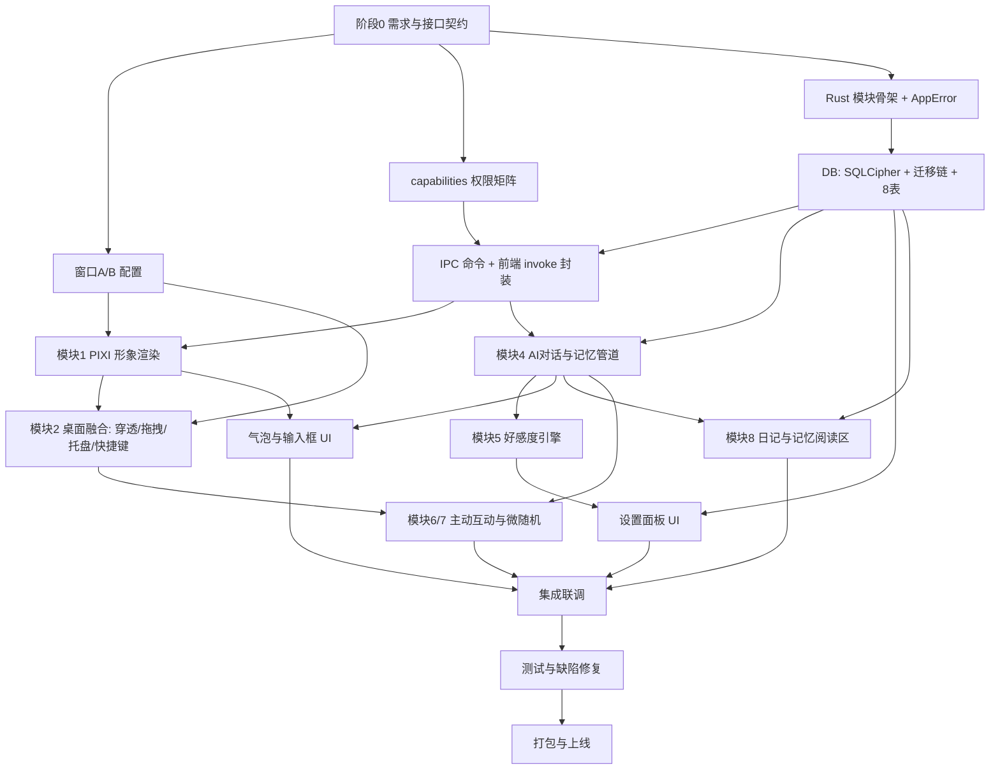

# 桌宠-任务拆分与开发顺序规划

## 产品概述

基于《桌宠技术开发文档 v2.0》，为 Windows 桌面数字生命应用"七七"制定**结构化任务拆分与开发顺序规划**（交付物为任务清单与路线图，非业务代码）。产品定位是"住在桌面上的数字生命"，核心卖点为"电脑里唯一会主动找你说话的东西"，MVP 采用双窗口形态：局部透明桌宠窗口 + 常规设置窗口，形象为纯代码绘制的极简猫/狗，不依赖美术资源。

## 业务需求梳理

- **系统层需求**：透明置顶桌宠窗口、动态点击穿透、系统接管拖拽、托盘与开机自启、全局快捷键、Win32 全局状态探针（空闲检测、前台进程名、鼠标坐标）。
- **表现层需求**：PIXI 代码绘制形象、果冻物理与呼吸动画、视线跟随、气泡流式打字机渲染与防截断。
- **数据与智能需求**：加密本地库（8 张表）、向量+事实混合记忆检索、Rust 代理 LLM SSE 流式对话、异步记忆沉淀、好感度与关系进化、微随机主动互动、日记与记忆阅读区。
- **配置与易用需求**：服务商预设、内置体验额度、API Key 加密存储、勿扰时段与主动频率。

## 核心任务目标（本次交付）

1. 梳理功能需求与业务目标，识别 9 个核心模块及相互依赖关系。
2. 按依赖优先、核心功能优先原则拆分任务，覆盖：需求与技术方案设计、基础架构、核心功能模块、数据层与接口、前端界面与交互、集成联调、测试与缺陷修复、部署上线准备。
3. 每项任务输出：模块名称、具体内容、优先级（P0/P1/P2）、预计开发顺序、依赖任务、可并行标记、验收标准。
4. 定义里程碑节点（M0-M5）与验收条件，并给出单人全栈下的并行开发建议与风险清单。

## MVP 验收锚点

桌面可见角色呼吸与果冻交互 → 能对话且流式输出 → 数小时后回来它记得你 → 好感度/关系等级发生真实变化 → 会主动但不烦人地找你说话。

## 一、技术栈基线（已验证的仓库现状）

| 层次 | 现状 | 规划动作 |
| :--- | :--- | :--- |
| 桌面框架 | Tauri 2（Rust + WebView2），`tauri.conf.json` 仅 1 个 800×600 窗口 | 扩展为窗口 A（透明宠层 400×400）+ 窗口 B（设置层） |
| 前端 | Vue 3.5 + TS(strict) + Vite 8（端口 1420）+ PIXI 8.22，仅默认 greet 模板 | 新建 PIXI 渲染层、气泡、设置面板 |
| Rust | `lib.rs` 仅 `greet` 命令；已预置 `rusqlite`(bundled-sqlcipher-vendored-openssl) + `sqlite-vec` | 新增窗口/DB/LLM/系统探针命令 |
| 依赖缺口 | 无 tokio、rusqlite_migration、reqwest/SSE、tauri-plugin-autostart/global-shortcut/store/dialog/fs | 按阶段引入 |
| 权限 | `capabilities/default.json` 仅 core:default + opener:default | 建立权限矩阵，逐命令授权 |
| 测试 | 无 Vitest / cargo test 用例，ESLint/Prettier 依赖未装 | M0 前补齐工程基线 |

强制规则（来自 `docs/design/rule.md`）：只用 Tauri 2 API；系统能力一律 Rust 实现；API Key 不落前端；PIXI 实例不进响应式；单一 Ticker 且帧内不 new 对象；SQL 参数化；迁移走 `rusqlite_migration` + `PRAGMA user_version` 且迁移前备份 `.db`。

## 二、模块依赖图谱



关键依赖说明：

- **窗口配置（B1）** 是渲染与系统交互的前置，必须最先落地。
- **数据层（B4）** 是记忆、好感度、配置、日记四条业务线的共同底座。
- **模块 4（AI 对话）** 是模块 5/6/7/8 的上游：好感度需要对话后置判定，主动互动需要 LLM 生成话术，日记需要当日 `messages`。
- **模块 1（渲染）** 与模块 4（对话）无强耦合，可并行推进。

## 三、结构化任务清单

### 阶段 0：需求分析与技术方案设计（顺序 1-3，全 P0）

| ID | 模块名称 | 具体内容 | 优先级 | 顺序 | 依赖 | 并行 | 验收标准 |
| :--- | :--- | :--- | :--- | :--- | :--- | :--- | :--- |
| A1 | 需求冻结与验收标准 | 将文档 9 个模块拆成可验收条目，明确 MVP 边界（不做：截图、Live2D、多角色） | P0 | 1 | - | 否 | 需求清单含每个模块"做/不做"边界 |
| A2 | 接口契约设计 | 定稿 `IPetRenderer`（mount/playAction/setExpression/lookAt/getHitRegion/dispose）；定稿 IPC 命令清单与 DTO 类型（窗口、DB、LLM、探针）；定稿 Rust `AppError` 枚举 | P0 | 2 | A1 | 否 | 契约文档落地，前后端可各自开工 |
| A3 | 工程基线与目录结构 | 安装 ESLint/Prettier、配置 Vitest + `cargo test` 骨架；抽取 `pet-design/index.html` `:root` 设计 token 为共享样式源；确立 `src/` 与 `src-tauri/src/` 模块目录 | P0 | 3 | A2 | 是（与 B1 并行） | `pnpm lint` / `pnpm typecheck` / 测试命令可运行 |

### 阶段 1：基础架构搭建（顺序 4-8，P0）

| ID | 模块名称 | 具体内容 | 优先级 | 顺序 | 依赖 | 并行 | 验收标准 |
| :--- | :--- | :--- | :--- | :--- | :--- | :--- | :--- |
| B1 | 双窗口配置 | `tauri.conf.json` 定义窗口 A（400×400、transparent、decorations:false、alwaysOnTop、skipTaskbar）与窗口 B（常规窗口）；窗口 B 关闭改为 hide | P0 | 4 | A2 | 否 | 启动出现透明置顶小窗 + 可开设置窗 |
| B2 | IPC 权限矩阵 | `capabilities/default.json` 按命令补齐 core 窗口/事件权限与插件权限，逐项最小化授权 | P0 | 5 | A2 | 是（与 B1 并行） | 新增命令调用不再因权限失败 |
| B3 | Rust 模块骨架 | 拆分 `window/`、`db/`、`llm/`、`probe/`、`commands/`；`lib.rs` 组装插件与 `invoke_handler`；统一 `AppError` + `?` 传播 | P0 | 6 | A2 | 是（与 B1 并行） | `cargo clippy -D warnings` 通过 |
| B4 | 数据层：加密库与迁移链 | SQLCipher 连接（密钥存系统凭据管理器）、`rusqlite_migration` 有序迁移链建 `messages`/`summaries`/`facts`/`vec_memory`/`pet_states`/`affection_logs`/`app_settings`/`diaries`；`PRAGMA user_version` 版本校验、迁移前 `.db` 备份、`user_version >` 期望则失败关闭；`vec_memory` 可重建 | P0 | 7 | B3 | 是（与 B1/B2 并行） | 独立 `#[test]` 验证建表、加密、迁移与向量检索 |
| B5 | IPC 命令与前端封装 | Rust 暴露 settings/pet_state/memory/chat 命令；前端 `src/api/` 统一 `invoke` 封装 + Interface 类型 | P0 | 8 | B4,B2 | 否 | 前端可读写 `app_settings`/`pet_states`，明文不落前端 |

### 阶段 2：核心功能模块开发（按优先级，P0 优先）

| ID | 模块名称 | 具体内容 | 优先级 | 顺序 | 依赖 | 并行 | 验收标准 |
| :--- | :--- | :--- | :--- | :--- | :--- | :--- | :--- |
| C1 | 模块 1 形象渲染与物理交互 | `IPetRenderer` 接口 + `CodeCatRenderer`（PIXI.Graphics 绘制身体/面部/耳朵/Bezier 尾巴/眼睛容器）；单一 Ticker 内正弦呼吸 + 阻尼果冻形变 + 拖拽 Stretch&Squash + `lookAt` 视线跟随（3-5px）+ `getHitRegion` | P0 | 9 | B1,B5 | **是**（与 B4/C4 并行） | 桌面可见呼吸、点击 Q 弹、眼睛跟随鼠标 |
| C2 | 模块 2 桌面融合与系统交互 | 动态点击穿透（前端上报包围盒 → Rust 轮询 `GetCursorPos` → `set_ignore_cursor_events`）；`pointerdown` → IPC → `window.start_dragging()`；托盘菜单（显示/隐藏/设置/退出）+ 自启；`Ctrl+Shift+P` / `Ctrl+Shift+H` | P0 | 10 | C1,B2 | 否 | 点猫有反应、空白处穿透、跨屏拖拽 60fps |
| C3 | 模块 9 零门槛配置（后端） | 服务商预设常量集中定义：**必选** DeepSeek、通义千问；**可选低成本** 智谱 GLM-Flash、硅基流动 SiliconFlow、豆包 Lite、混元 Lite、文心 Speed/Lite（与「LLM 大模型配置」小节同源，单一常量源）；统一 OpenAI 兼容 base URL + 默认模型 + 用途档位；`app_settings` 读写命令（type 1/2、`is_custom_quota_used`）；内置额度与 BYOK 切换 | P0 | 11 | B4,B5 | **是**（与 C2 并行） | Key 加密入库，前端零明文 |
| C4 | 模块 4 AI 对话与记忆管道 | Rust 侧 OpenAI 兼容 SSE 代理（tokio + reqwest eventsource）；`vec_memory` + `facts` 混合检索拼 System Prompt；前端流式事件驱动打字机气泡 + 表情切换；对话结束异步廉价模型抽取事实/摘要写库并计算向量 | P0 | 12 | B4,B5 | **是**（与 C1/C2 并行） | 流式对话可用，次日仍能召回事实 |
| C5 | 模块 5 好感度与关系进化 | 0-1000 分四档等级；加分（打卡+10、抚摸+1 日上限 20、深度对话+5、共鸣+10~20）；启动时按 `last_decay_at` 结算衰减（超 3 天每天 -5，降至当前等级下限即停）；`affection_logs` 流水；等级注入 Prompt；数值变化一律转成情绪表达 | P0 | 13 | C4 | 否 | 互动后分数与等级真实变化，UI 不播报数字 |
| C6 | 模块 6+7 主动互动与情绪状态 | Rust 探针：`GetLastInputInfo` 空闲（30min→sleep，回归→stretch）、时间窗口锚点（08:30-09:30 / 22:00-23:30）、前台进程名；前端微随机引擎（安静/正常/粘人档位，工作/游戏进程降 80% 概率，连续 3 天未互动触发傲娇 Prompt） | P1 | 14 | C2,C4,C5 | 否 | 主动发言不打扰工作，空闲有睡/醒动作 |
| C7 | 模块 8 日记与记忆阅读区（后端） | 每日/长期离开时后台 LLM 读当日 `messages` 生成第一人称日记写 `diaries`；`facts` 标签查询；记忆编辑/删除后同步重建 `vec_memory` 向量 | P1 | 15 | C4 | **是**（与 C6 并行） | `diaries` 有第一人称日记，改记忆后向量同步 |

### 阶段 3：前端界面与交互开发（P0/P1）

| ID | 模块名称 | 具体内容 | 优先级 | 顺序 | 依赖 | 并行 | 验收标准 |
| :--- | :--- | :--- | :--- | :--- | :--- | :--- | :--- |
| D1 | 窗口 A 气泡与输入交互 | Vue 气泡组件（打字机、表情联动、靠右边缘向左翻转防截断）、`Ctrl+Shift+P` 输入框、文件/图片拖入（Rust 解析路径交前端多模态） | P0 | 16 | C1,C4 | **是**（与 D2 并行） | 长文本不截断，拖入文件可识别 |
| D2 | 窗口 B 设置面板 | **LLM 大模型配置**（服务商下拉：必选 DeepSeek、通义千问 + 可选低成本模型，按「主对话 / 记忆沉淀 / 兜底」三档分别配置 + Key + 模型，详见下方「LLM 大模型配置」小节）、勿扰时段、主动频率档位、好感度看板（进度条 + 等级 + `affection_logs` 流水） | P0 | 17 | C3,C5 | **是**（与 D1 并行） | 设置持久化且重启生效；切换任一档位模型后对话与记忆沉淀链路均可跑通 |
| D3 | 记忆阅读区 Tab | 日记列表 + `facts` 标签云 + 编辑/删除入口，接入 C7 后端 | P1 | 18 | C7,D2 | 否 | 可查看并修正 AI 记忆 |
| D4 | 一键物理交互 UI | 头顶铃铛（点击进勿扰）、拖至屏幕边缘吸附休眠 | P2 | 19 | D1,C2 | 是 | 铃铛与边缘吸附生效 |

### 阶段 3 补充：LLM 大模型配置（模型选型方案）

**分层策略**：主对话（重体验）与记忆沉淀（高频、极低成本）**分离配置**；设置面板按「必选 / 可选」两级暴露，可选模型未配置时自动回落到必选模型。

`main` / `memory` / `fallback` 三档用途：

| 档位 | 用途 | 选型取向 |
| :--- | :--- | :--- |
| `main` | 主对话、情绪表达、主动话术生成 | 质量优先，容忍较低成本 |
| `memory` | 异步事实抽取、会话摘要、日记生成、标签生成 | 成本优先，高频调用 |
| `fallback` | 主模型不可用/配额耗尽时的兜底 | 免费或极低成本，可用性优先 |

#### 必选模型（内置预设，开箱即用）

| 服务商 | 推荐模型 | 定位 | 适用场景 | 成本档 |
| :--- | :--- | :--- | :--- | :--- |
| DeepSeek | `deepseek-chat`（通用对话档，V4-Flash 级） | 中文对话能力强、性价比极高、缓存命中价极低 | **`main` 主对话模型**：陪伴闲聊、情绪表达、主动话术生成 | 低（缓存命中更低） |
| DeepSeek | `deepseek-reasoner`（推理档） | 复杂推理、长链思考，延迟较高 | 记忆冲突消解、复杂事实抽取（非主链路，按需调用） | 中 |
| 阿里云百炼 · 通义千问 | `qwen-plus` | 综合性价比主力，中文稳、指令遵循好、阶梯计价 | **`main` 备选 + `memory` 默认档**：事实抽取、摘要、日记生成 | 低-中（短输入最省） |
| 阿里云百炼 · 通义千问 | `qwen-flash` / `qwen-turbo` | 轻量极速、单价最低 | **`memory` 高频后台任务**：异步事实抽取、会话摘要、标签生成 | 极低 |

#### 可选低成本模型（用户自行勾选配置）

| 服务商 | 模型 | 定位 | 适用场景 | 成本档 |
| :--- | :--- | :--- | :--- | :--- |
| 智谱 AI | `glm-flash` 系列（免费档） | 中文与编码能力均衡，提供长期免费额度 | `fallback` 兜底、内置体验额度池候选 | 免费 / 极低 |
| 硅基流动 SiliconFlow | Qwen 等轻量开源模型（含免费档） | OpenAI 兼容、国内直连、聚合多模型 | `fallback` 兜底、内置额度转发、廉价文本任务 | 免费 / 极低 |
| 字节 · 豆包 | `doubao-lite` 系列 | 轻量低价、响应快、免费额度充足 | 短句闲聊、气泡短回复、情绪化短文案 | 低 |
| 腾讯 · 混元 | `hunyuan-lite` | 免费档、超长上下文 | 长上下文兜底、长对话压缩 | 免费 / 低 |
| 百度千帆 | `ernie-speed` / `ernie-lite` | 免费轻量档 | 关键词提取、分类等结构化小任务 | 免费 / 低 |
| 海外（需可用网络） | OpenRouter `:free` 模型、Gemini Flash 免费层 | 免费额度充足、生态广 | 内置体验额度的海外备选（**不作为国内默认**） | 免费 |

#### 配置与路由规则

- **三档独立**：`main` / `memory` / `fallback` 各自独立配置服务商、模型与 Key，互不影响。
- **必选约束**：DeepSeek、通义千问至少配置其一；两者均可单独支撑「主对话 + 沉淀」全流程。
- **回落机制**：可选模型未配置或调用失败 → 回落必选模型 → 仍失败则降级为本地预设话术，**不阻塞桌宠运行**。
- **价格声明**：厂商调价频繁，本节只标成本档位，**不写死价格**；以各厂商官网 / 控制台实时价为准，设置面板需提供计费说明入口。
- **安全**：前端只传服务商与模型标识，API Key 经 IPC 交 Rust 加密写入 `app_settings`（`llm_base_url` / `llm_api_key` / `llm_model` / `llm_model_custom`），前端零明文。
- **验收补充**：三档分别切换模型后，主对话流式输出与后台沉淀（写 `facts` / `summaries` / `vec_memory`）均正常；断网或 Key 失效时走 `fallback` 且不崩溃。

### 阶段 4：模块集成与联调（P0）

| ID | 模块名称 | 具体内容 | 优先级 | 顺序 | 依赖 | 并行 | 验收标准 |
| :--- | :--- | :--- | :--- | :--- | :--- | :--- | :--- |
| E1 | 全链路联调 | 窗口/渲染/对话/记忆/好感度/主动互动/设置面板打通；事件总线统一（探针事件 → 前端状态机） | P0 | 20 | C*,D* | 否 | 冷启动到主动对话全流程无阻断 |
| E2 | 性能与隐私达标 | 待机 CPU < 2%、内存 < 150MB（PIXI 待机降 30fps、轮询降频）；确认零截图、全库加密、BYOK | P0 | 21 | E1 | 是 | 任务管理器实测达标 |
| E3 | 体验打磨 | 动画曲线、气泡节奏、Prompt 语气（禁止数值播报） | P1 | 22 | E1 | 是 | 主观体验复盘通过 |

### 阶段 5：测试与缺陷修复（P0/P1）

| ID | 模块名称 | 具体内容 | 优先级 | 顺序 | 依赖 | 并行 | 验收标准 |
| :--- | :--- | :--- | :--- | :--- | :--- | :--- | :--- |
| F1 | Rust 单测 | DB 迁移/加密/向量检索/衰减计算的 `#[test]`；IPC 命令独立验证（rule.md 要求先测后集成） | P0 | 23 | B4 | 是（随阶段推进） | `cargo test` 全绿 |
| F2 | 前端单测与类型门禁 | Vitest 覆盖好感度计算、微随机、Prompt 拼装；`vue-tsc --noEmit` + ESLint 零错 | P1 | 24 | C5,C6 | 是 | CI 本地命令全过 |
| F3 | 手工场景回归 | 多屏拖拽、全屏游戏兼容、断网/Key 失效/配额耗尽降级、勿扰生效、长时间挂机衰减 | P0 | 25 | E1 | 否 | 回归清单全通过，严重缺陷清零 |
| F4 | 缺陷修复与收口 | 按优先级修复联调/回归问题，回归验证 | P0 | 26 | F3 | 否 | 无 P0/P1 遗留缺陷 |

### 阶段 6：部署与上线准备（P1/P2）

| ID | 模块名称 | 具体内容 | 优先级 | 顺序 | 依赖 | 并行 | 验收标准 |
| :--- | :--- | :--- | :--- | :--- | :--- | :--- | :--- |
| G1 | 发布配置收紧 | `identifier` 去占位、`security.csp` 启用、版本号与更新配置、图标完整性 | P1 | 27 | E2 | 否 | 配置表与 `CODEBUDDY.md` 同步 |
| G2 | 打包与安装验证 | `pnpm tauri build` 出 MSI/NSIS；干净机器安装、自启、托盘、卸载清理用户数据策略确认 | P1 | 28 | G1,F4 | 否 | 安装包可装可卸可自启 |
| G3 | 发布物料与留档 | README 安装指引、首次启动引导（内置额度说明）、已知问题清单 | P2 | 29 | G2 | 是 | 新手 5 分钟内完成首次对话 |
| G4 | Phase 3 预留（自定义形象） | 预留 `active_renderer`/`renderer_config`；后续实现 `CustomSpriteRenderer` 与导入 UI | P2 | 30 | C1 | 是（后期） | 接口已预留，可插件式替换 |

## 四、里程碑与验收条件

| 里程碑 | 对应阶段 | 周期 | 验收条件 |
| :--- | :--- | :--- | :--- |
| **M0 地基验证** | A 全部 + B1/B2/B3 + C1 | 1-2 周 | 透明置顶窗口可见；PIXI 猫有呼吸、点击果冻回弹、视线跟随；`vue-tsc`/`clippy` 零错 |
| **M1 MVP 闭环** | B4/B5 + C2/C3/C4/C5 + D1/D2 | 3-4 周 | 看着它呼吸 → 聊两句流式回复 → 几小时后回来它记得你 → 好感度/等级真实变化；Key 加密存储 |
| **M2 系统感知与主动** | C6 + E1/E2 | 2-3 周 | 空闲睡觉/回归伸懒腰、时间窗口问候、工作/游戏场景降频、主动不打扰；待机 CPU < 2%、内存 < 150MB |
| **M3 记忆可视化** | C7 + D3 + D4 | 1-2 周 | 设置窗可见猫猫日记与记忆标签，用户可修正记忆并同步向量 |
| **M4 质量收口** | F 全部 + E3 | 1-2 周 | 单测全绿、回归清单通过、P0/P1 缺陷清零 |
| **M5 上线** | G 全部 | 3-5 天 | MSI 干净机安装可用，CSP/权限收紧，发布物料齐备 |

## 五、并行开发建议与风险

**可并行组合（单人全栈按"Rust 先行、前端跟进"节奏）**

1. B1/B2/B3/B4（Rust 基建）与 A3（工程基线）并行。
2. **C1（PIXI 渲染）与 C4（LLM 对话）互不强依赖**，可交替推进：先写 Rust 侧命令，再用前端消费。
3. C2（桌面融合）与 C3（配置后端）并行；D1（气泡）与 D2（设置面板）并行。
4. C6（主动互动）与 C7（日记/记忆）并行，二者同为 C4 下游。

**关键风险与对策**

| 风险 | 对策 |
| :--- | :--- |
| SQLCipher + vendored OpenSSL 首次编译极慢 | 提前跑通一次 `pnpm tauri build` 做依赖预热；M0 先验证连接 |
| 鼠标轮询 + 穿透切换导致 CPU 超标 | 轮询降频（约 100ms）+ 状态变化才调用 `set_ignore_cursor_events`；E2 实测 |
| SSE 流式与打字机卡顿/丢字 | Rust 侧事件分片 emit，前端按帧节流渲染，气泡文本用 ref 持有不进响应式 |
| PIXI 实例进响应式导致性能灾难 | 独立类持有 `Application`，`onUnmounted` 调 `destroy(true)` 并移除监听；单一 Ticker、帧内不 new 对象 |
| sqlite-vec 维度/扩展升级不兼容 | `vec_memory` 视为可重建派生表，迁移脚本 DROP 重建并从 `facts`/`messages` 重新生成 |
| 测试框架未配置 | A3 阶段先装 Vitest 与 `cargo test` 骨架，`pnpm lint:rust` 依赖需先安装 eslint/prettier |
| 好感度"播报数值"破坏人设 | Prompt 层强制约束 + 单测覆盖文案转换 |

## 六、目录结构（规划将新增/修改的文件）

```
qiqi/
├── docs/design/
│   ├── 桌宠.md                      # [只读] 规格来源
│   └── rule.md                      # [只读] 开发规则，权威
├── src-tauri/
│   ├── tauri.conf.json              # [MODIFY] 定义窗口 A（透明宠层 400x400）与窗口 B；收紧 CSP
│   ├── capabilities/default.json    # [MODIFY] 按命令补齐最小权限矩阵
│   ├── Cargo.toml                   # [MODIFY] 增 tokio / rusqlite_migration / reqwest(eventsource) / tauri-plugin-autostart,global-shortcut,store,dialog,fs
│   └── src/
│       ├── lib.rs                   # [MODIFY] 组装插件、注册全部命令、启动迁移与后台任务
│       ├── error.rs                 # [NEW] 统一 AppError 枚举 + serde 序列化
│       ├── window/                  # [NEW] 窗口 A/B 句柄管理、拖拽、点击穿透、托盘、快捷键
│       ├── db/                      # [NEW] SQLCipher 连接、 migrations/（有序迁移链）、models/、repositories/
│       ├── llm/                     # [NEW] OpenAI 兼容 SSE 代理、Prompt 拼装、异步沉淀（事实/摘要/日记/好感度判定）
│       ├── probe/                   # [NEW] Win32 探针：GetCursorPos / GetLastInputInfo / 前台进程名
│       ├── commands/                # [NEW] settings.rs / pet.rs / chat.rs / memory.rs 命令层
│       └── affection/               # [NEW] 加分、弹性衰减结算、等级映射
└── src/
    ├── main.ts                      # [MODIFY] 按窗口 A/B 挂载不同入口
    ├── api/                         # [NEW] invoke 封装 + IPC DTO Interface（settings/pet/chat/memory）
    ├── renderer/                    # [NEW] IPetRenderer.ts、CodeCatRenderer.ts（后续 CustomSpriteRenderer.ts）
    ├── composables/                 # [NEW] usePetRenderer（类实例持有 PIXI）、useSystemProbe、useAffection
    ├── components/                  # [NEW] SpeechBubble.vue（打字机+防截断）、ChatInput.vue、BellToggle.vue
    ├── views/                       # [NEW] PetWindow.vue（窗口 A）、SettingsWindow.vue（窗口 B：模型/勿扰/好感度/记忆 Tab）
    ├── styles/tokens.css            # [NEW] 从 pet-design/index.html :root 抽取的 Jelly-Toy 设计 token
    └── tests/                       # [NEW] Vitest 用例：好感度计算、微随机、Prompt 拼装
```

## 七、关键接口契约（规划定稿，供前后端并行）

- `IPetRenderer`：`mount(container)` / `playAction(name)` / `setExpression(name)` / `lookAt(x, y)` / `getHitRegion(): {x,y,width,height}` / `dispose()` —— 为 Phase 3 `CustomSpriteRenderer` 预留替换点。
- IPC 命令分组：`window_*`（拖拽、穿透、显隐）、`settings_*`（读取/保存 `app_settings`，Key 不明文回传前端）、`pet_*`（`pet_states` 读写、好感度结算）、`chat_*`（SSE 流式对话 + 事件）、`memory_*`（`facts`/`vec_memory`/`diaries` 查询与修正）、`probe_*`（空闲时长、前台进程名、鼠标坐标）。
- `pet_states.id` 固定为 1；`app_settings.value` 为 JSON，承载 `llm_base_url`/`llm_api_key`/`llm_model`/`llm_model_custom`/`dnd_*`。
