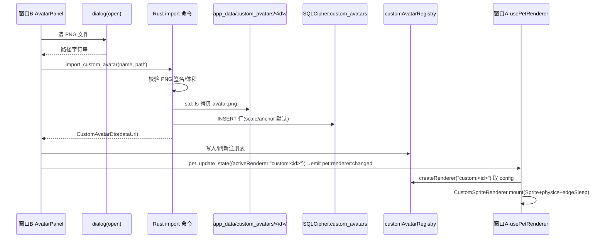

## 用户需求

基于现有 `IPetRenderer` / `PetRendererBase` / `factory` 注册表体系，新增「自定义形象导入」能力（基线 Phase 3 的 `CustomSpriteRenderer` 落地），把单张透明 PNG 变成可上桌的桌宠形象，与内置猫狗并列管理。

## 核心功能

- **导入流程**：窗口 B 设置面板点「导入」→ 系统文件对话框选取单张透明 PNG → Rust 校验（PNG 签名 + 体积/尺寸上限）→ 拷贝进应用数据目录 `custom_avatars/<uuid>/` → 落库 `custom_avatars` 表（含缩放/锚点配置）。
- **多形象图库**：支持导入多个自定义形象，在选项卡中与内置猫狗并列；可重命名、删除、点选「设为当前」。
- **精灵渲染器 `CustomSpriteRenderer`**：独立实现 `IPetRenderer`，用 PIXI `Sprite` 加载图片，复用 `physics.ts` 的呼吸/果冻/阻尼纯函数，保留「整体变换生命感」——呼吸缩放、点击果冻、拖拽拉伸、边缘吸附躺倒；因是单图无矢量分层，**不含**眨眼/视线跟随/摆尾。
- **缩放/锚点微调 UI**：导入后提供缩放滑杆 + 锚点 X/Y 滑杆，把美术图「圆盘中心」对齐物理旋转中心，实时预览并写回命中区与边缘吸附圆心，保证躺倒观感正确。
- **即时生效**：切换沿用既有 `pet:renderer:changed` 事件与 `rebuildRenderer(id)` 链路，`activeRenderer` 直接存 `custom:<uuid>`，不新增跨层通道。

## 视觉/交互效果

设置面板「选择形象」区变为卡片图库（内置两张 + 已导入的自定义卡 + 虚线导入卡）；选中自定义形象后出现微调面板（预览小舞台 + 三条滑杆 + 重命名/删除按钮）。窗口 A 与预览舞台当场用导入图渲染，仍会呼吸起伏、点击 Q 弹、拖到屏边躺倒只露半圆。窗口 B 文案保持中英双语。

## 技术栈

- 前端：Vue 3 + TypeScript + Vite + PIXI.js（v8 `Assets.load` 加载 DataURL 纹理），沿用现有 `AppCard`/`PetOptionCard`/`PreviewStage` 与 Jelly-Toy 设计 token；**不引 React**。
- 后端：Tauri 2 + Rust，新增 `tauri-plugin-dialog`（仅取路径，实际读/写/落库走 Rust），SQLCipher 表 `custom_avatars`，迁移链 `M14`。
- IPC：`@tauri-apps/api/core` 的 `invoke`，不引前端 fs/Node 原生模块（边界红线）。

## 实现思路

**策略**：复用现有「注册表 + 单一 Ticker + 物理纯函数 + `pet:renderer:changed` 重建」架构，把自定义形象当作 `custom:<uuid>` 这一新 id 接入，避免改动内置渲染链路。

**关键决策**

1. **`CustomSpriteRenderer` 不复用 `PetRendererBase`**：基类 `draw()` 强约束 `PetLayers`（tail/body/ears/eyes 矢量分层），精灵图无此结构；故新渲染器独立实现 `IPetRenderer`，仅复用 `physics.ts`（breathScales/dampedRecovery/jellyImpulse）与等价的 Ticker + `setEdgeSleep` 旋转/位移数学（参数化几何来自 `CustomAvatarConfig`）。这样内置猫狗的物理改动仍集中在基类，自定义形象自成一体，互不污染。
2. **图片进入 WebView 用 DataURL**：Rust `import` 命令 `std::fs::read` → `base64::encode` → 返回 `data:image/png;base64,...`，前端 `PIXI Assets.load(dataURL)` 建纹理；`customAvatarRegistry` 模块级缓存避免每次重建重复 IPC。MVP 最简、免 asset 协议配置（性能：单图 ≤5MB，base64 一次性传输可接受；可用 `URL.createObjectURL` 进一步优化，列为可选）。
3. **前端零文件系统访问**：对话框只返回路径字符串（`dialog:allow-open` 权限），拷贝/校验/落库全在 Rust 命令内（`std::fs` + SQLCipher），契合 baseline §G。
4. **动态 id 注册**：`factory.createRenderer(id)` 对 `custom:` 前缀查 `customAvatarRegistry`；注册表在启动（`PetWindow` 挂载先 `await loadCustomAvatars()`）与导入/删除后刷新，保证窗口 A 与 `PreviewStage` 重建时能取到配置。

## 实现要点（防回归）

- 复用 `rebuildRenderer` 的幂等 + 防竞态 + 表情重放 + 命中区重启上报，自定义形象零改动接入。
- `AvatarPanel.selectRenderer` 已接受 `OPTIONS` 内任意 id；图库 `OPTIONS` 由「`listRenderers()` + 自定义 id 列表」合并派生。
- 删除当前正在使用的形象时，Rust `delete` 后若该 id == `active_renderer`，回退 `active_renderer` 为 `code_cat` 并 emit 重建事件（防孤儿引用）。
- 迁移遵守铁律：新增 `M14__custom_avatars.sql`，`CREATE TABLE IF NOT EXISTS`，`user_version` 由 `rusqlite_migration` 管理；不改既有建表 SQL。
- 门禁：`vue-tsc` strict、`noUnusedLocals/Parameters`；Rust `cargo clippy -D warnings`；`grep` 验证 `src/renderer/` 零 Vue 响应式持有、Ticker 帧内零 `new`。

## 架构与数据流



## 目录结构与文件清单

```
src-tauri/
├── Cargo.toml                         # [MODIFY] 增 tauri-plugin-dialog = "2"
├── capabilities/default.json          # [MODIFY] 增 "dialog:allow-open"
├── src/lib.rs                         # [MODIFY] .plugin(tauri_plugin_dialog::init())；invoke_handler 增 5 命令
├── src/error.rs                       # [MODIFY?] 复用 Io/Db/Config；如需要增 Validation 变体
├── src/db/migrations/
│   └── M14__custom_avatars.sql       # [NEW] CREATE TABLE custom_avatars(id,name,rel_path,scale,anchor_x,anchor_y,created_at)
├── src/db/models.rs                   # [MODIFY] 增 CustomAvatarDto
├── src/db/repositories/
│   └── custom_avatars.rs             # [NEW] insert/list/get/update_config/rename/delete(含回退 active_renderer)
└── src/commands/
    └── custom_avatar.rs               # [NEW] import/list/update_config/rename/delete 命令(薄层+AppError)

src/
├── api/customAvatar.ts                # [NEW] invoke 封装 + DTO 类型
├── renderer/
│   ├── CustomSpriteRenderer.ts        # [NEW] IPetRenderer 实现(Sprite+physics+edgeSleep)
│   ├── customAvatarRegistry.ts        # [NEW] 模块级 Map<id, CustomAvatarConfig> 缓存 + load/list
│   └── factory.ts                     # [MODIFY] createRenderer 支持 custom:<id> 前缀查注册表
├── views/pet/PetWindow.vue            # [MODIFY] 挂载前 await loadCustomAvatars() 填充注册表
├── views/settings/panels/AvatarPanel.vue  # [MODIFY] 图库合并自定义卡 + 导入流程 + 打开微调 + 双语
├── components/settings/CustomAvatarEditor.vue # [NEW] 缩放/锚点滑杆 + 实时预览 + 重命名/删除
├── i18n/locales/zh-CN.ts / en-US.ts   # [MODIFY] 增 avatar.import*/custom* 键
└── tests/renderer/
    ├── rendererRegistry.spec.ts       # [MODIFY] 增 custom:<id> 解析用例
    └── customSpriteRenderer.spec.ts   # [NEW] 构造/edgeSleep 命中区/物理复用断言

src-tauri/tests/custom_avatars_it.rs   # [NEW] 迁移 + insert/list/delete/rename 集成测试
docs/design/接口契约.md                # [MODIFY] active_renderer 值域增 custom:<uuid>
.codebuddy/plans/自定义形象导入子计划.md # [NEW] 本计划存档
```

## 关键类型（接口级）

```ts
/** 自定义形象配置（Rust 落库 + 前端注册表复用，字段一一对应）。 */
export interface CustomAvatarConfig {
  id: string;            // UUID；active_renderer 存 "custom:<id>"
  name: string;
  dataUrl: string;       // data:image/png;base64,...（仅内存缓存，不落前端存储）
  scale: number;         // 整体缩放（默认 1）
  anchorX: number;       // 圆盘中心 X（局部像素，默认图宽/2）
  anchorY: number;       // 圆盘中心 Y（局部像素，默认图高/2，边缘吸附旋转圆心）
}

/** 新增 Rust 命令签名（薄层，返回 DTO 或 Ok）。 */
// import_custom_avatar(name: String, src_path: String, app: AppHandle, state: State<AppState>) -> Result<CustomAvatarDto, AppError>
// list_custom_avatars(state) -> Result<Vec<CustomAvatarDto>, AppError>
// update_custom_avatar_config(id: String, scale: f64, anchor_x: f64, anchor_y: f64, state) -> Result<(), AppError>
// rename_custom_avatar(id: String, name: String, state) -> Result<(), AppError>
// delete_custom_avatar(id: String, app: AppHandle, state) -> Result<(), AppError>  // 若删当前则回退 code_cat + emit
```

## 设计风格

延续设置窗口 B 既有的 Jelly-Toy 圆润玩具风与 `src/styles/tokens.css` 设计 token（抹茶/蜜桃/奶油配色、圆角卡片、`--font-disp` 标题字），不对齐引入外部组件库，保证与内置猫狗卡片、预览舞台视觉一致。整体为桌面端设置窗口内的「形象」子面板。

## 页面与区块（窗口 B·形象面板）

面板采用既有两栏栅格：左=预览卡，右=形象操作。继承窗口 B 自绘标题栏与左侧设置主导航（顶部/底部导航由窗口框架提供，本面板不重复）。

- **区块1 预览卡（复用）**：`PreviewStage` 展示当前生效形象；下方显示宠物名 + 「果冻/Q弹」「点击穿透」徽标。选中自定义形象时预览即为导入图。
- **区块2 形象图库（改造）**：3 列网格卡片。内置「喵喵/汪汪」沿用 `PetOptionCard`（选中显示「✓ 使用中」）；已导入自定义形象各占一张卡（emoji 用 🖼，显示用户命名与「✓ 使用中」角标）；末尾虚线「＋导入」卡触发系统文件对话框。
- **区块3 自定义微调面板（新增，仅当选中自定义卡时出现）**：左侧小 `PreviewStage`（传 `custom:<id>`，实时反映滑杆）＋ 三条滑杆（缩放 / 锚点 X / 锚点 Y）＋ 操作行（重命名输入框、删除按钮、提示「设为当前即点选该卡」）。滑杆拖动即时调 `update_custom_avatar_config` 并刷新注册表，预览当场变形。
- **区块4 窗口与交互（复用）**：边缘吸附休眠开关 + 露出比例滑杆 + 提示框（双语）。

## 交互细节

- 导入后自动选中新形象并展开微调面板，用户拖锚点滑杆把「圆盘中心」对齐到躺倒时想露出的部位；缩放滑杆控制整体大小。
- 删除当前在用形象 → 卡片消失、预览回落内置猫、toast 提示；删除非当前形象无打断。
- 滑杆/输入框 hover 有轻微高亮，按钮点击有按压反馈，沿用现有微动效语言。