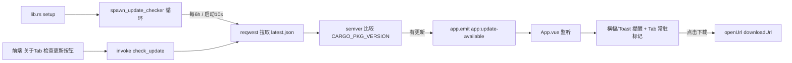

## 用户需求

为桌面应用「七七」实现轻量自建的远程更新能力：当 GitHub 仓库发布新版本时，客户端能检测到更新并弹出提醒，用户可点击跳转下载安装包（手动运行），无需代码签名证书与自建发布服务器。

## 产品概述

在现有 GitHub 仓库的 Releases 中维护一个 `latest.json` 版本清单与应用安装包（.msi）。应用启动时、空闲周期（每约 6 小时）以及用户在设置页手动点击「检查更新」时，Rust 侧拉取并解析 `latest.json`，与当前版本号比较；若有更新，通过 Tauri 事件通知前端，前端在「关于」面板与全局提醒中展示新版本号、更新说明与「下载更新」按钮，点击后调用系统默认浏览器打开下载链接。

## 核心功能

- 版本检测：Rust 后台拉取 `latest.json`，用 semver 与 `env!("CARGO_PKG_VERSION")` 比较，判定是否可更新。
- 三种检查时机：启动后延迟约 10s 首次检查；之后每约 6 小时静默再查；设置页「关于」Tab 提供手动「检查更新」按钮。
- 更新提醒：检测到更新时 Tauri emit 事件，前端在可见窗口以横幅/toast 呈现，并在设置 Tab 条加常驻「更新可用」标记。
- 下载入口：提醒中提供「下载更新」按钮，调用 `@tauri-apps/plugin-opener` 的 `openUrl` 打开 `downloadUrl`（复用已有 opener 权限）。
- 失败优雅降级：网络异常、404、解析失败均静默跳过（后台检查不打扰；手动检查给友好提示），不弹错误、不写日志噪音。

## 技术栈

- 后端：Rust + Tauri 2（沿用现有栈）；网络复用已依赖的 `reqwest(0.12, rustls-tls)`；新增 `semver = "1"` 做版本比较；`tokio` 已有用于周期任务。
- 前端：Vue 3 + TypeScript（`<script setup>`）；沿用 `useToast`、`plugin-opener`、`callCommand` 封装；不引入新 Tauri 插件与新 capability。
- 数据契约：`latest.json` 托管于仓库根，经 `raw.githubusercontent.com/<owner>/<repo>/<branch>/latest.json` 稳定读取（无限流，免 token）。

## 实现方案

- 总体策略：版本信息源（latest.json）与检测逻辑完全独立，Rust 命令负责「拉取+解析+比较」返回 `UpdateInfo`；后台周期检查由 `lib.rs .setup()` 中以 `tauri::async_runtime::spawn` 起的独立循环驱动；前端通过 Tauri 事件解耦接收，UI 只负责呈现与跳转。
- 关键技术决策：

1. 不引入 `tauri-plugin-updater`，规避代码签名、updater 密钥对与发布服务器配置；只「提醒 + 跳转下载」，由用户手动运行安装包，符合单人项目轻量落地。
2. `latest.json` 走 raw 读取而非 GitHub REST API，避免 API 限流与 `releases/latest` 资产 URL 不稳定，且 downloadUrl 由发布者手工维护、语义明确。
3. 当前版本用 `env!("CARGO_PKG_VERSION")`；须在发版时保持 `tauri.conf.json` 的 `version` 与其同步（二者当前均为 0.1.0）。
4. 周期检查循环用「首次 sleep 10s → 检查 → sleep 6h」结构，单任务单点（参考 C2 探针线程既定语义），不设定时器堆积；release 为 `panic="abort"`，检查循环内所有错误必须 `?`/`match` 吞掉，绝不让任务 panic 拖垮进程。

- 性能与可靠性：reqwest 请求设 5s 超时与合理 User-Agent，避免卡死；比较与解析 O(1)；后台检查失败静默；事件只在新版本出现时 emit，避免刷屏。

## 实现要点

- 复用既有范式：`commands/` 薄层转发仓储；自定义命令免 capability 授权（勘误#1）；打开外链复用 `opener:default`；事件收发权限已具备（`core:event`）。
- 不改动 `tauri.conf.json` 的 bundle 配置；不新增权限矩阵条目。
- 注意 `latest.json` 地址做成可配置常量（默认 raw URL），便于后续切换托管。

## 架构设计



## 目录结构

```
src-tauri/src/
├── commands/
│   └── update.rs              # [NEW] 更新检测薄命令层：UpdateInfo 结构、check_update 命令、
│                              #         latest.json 解析+semver 比较、spawn_update_checker 周期任务；
│                              #         含 #[cfg(test)] 单测（解析+比较）。
├── lib.rs                     # [MODIFY] invoke_handler 注册 check_update；.setup() 调用 spawn_update_checker。
└── Cargo.toml                 # [MODIFY] 新增 semver = "1" 依赖。
src/
├── api/
│   └── update.ts              # [NEW] checkUpdate() 封装 + UpdateInfo 类型（统一走 callCommand）。
├── views/settings/panels/
│   └── AboutPanel.vue         # [NEW] 关于 Tab：当前版本、检查更新按钮、状态文案、更新说明、下载按钮。
├── views/settings/
│   └── SettingsWindow.vue     # [MODIFY] 注册 About Tab（import + v-else-if + 侧栏入口）。
├── App.vue                    # [MODIFY] 监听 app:update-available，置响应式标志并在可见窗口弹提醒。
└── components/
    └── settings/
        └── UpdateNotice.vue   # [NEW] 极简更新提醒横幅（下载/稍后），随事件出现、可关闭。
.codebuddy/plans/
└── 远程更新-实施计划.md        # [NEW] 本计划可读快照，供后续追溯。
```

## 关键代码结构

```rust
// commands/update.rs
#[derive(Debug, Serialize)]
#[serde(rename_all = "camelCase")]
pub struct UpdateInfo {
    pub available: bool,
    pub current: String,
    pub latest: String,
    pub notes: Option<String>,
    pub download_url: Option<String>,
}

// latest.json 契约
// { "version":"0.2.0", "notes":"...", "pubDate":"2026-11-04T00:00:00Z",
//   "downloadUrl":"https://github.com/<owner>/<repo>/releases/download/v0.2.0/qiqi_0.2.0_x64_en-US.msi" }
```

## 设计风格

沿用设置窗口既有的「果冻玩具（Jelly-Toy）」设计语言与 Design Token（--matcha / --peach / --butter / --ink / --bg-soft），保持与现有 Tab 视觉一致；不做独立视觉体系，新增的「关于」Tab 与更新横幅复用现有卡片、圆角与阴影规范。

## 页面规划（不超过 5 屏，桌面端）

仅涉及设置窗口内的「关于」Tab 与一处全局横幅，均为桌面布局（非移动端放大）。

### 关于面板（AboutPanel.vue）区块设计（自上而下）

- 区块1 顶部标题区：应用名「七七」+ 当前版本号（如 v0.1.0），小号次要色。
- 区块2 检查区：一行「检查更新」按钮（主色 matcha-deep）+ 状态文案（检查中…/已是最新/发现新版本 vX）。
- 区块3 更新卡片（仅 available 时显示）：圆角卡片（bg-window + 阴影），展示新版本号、发布日期、更新说明（notes 多行），底部「下载更新」主按钮（peach 强调色）+「复制链接」次按钮。
- 区块4 说明区：一行小字「更新包托管于 GitHub Releases，下载后手动运行安装即可」，避免用户疑惑为何不自动安装。

### 全局更新横幅（UpdateNotice.vue）

- 区块1 横幅：固定贴在设置窗口顶部或右上角的小卡片，含「发现新版本 vX」文案 + 「下载更新」按钮 + 关闭（稍后）图标；非阻塞、可关闭；关闭后仅保留 Tab 条常驻标记。
- 区块2 设置 Tab 条常驻标记：在「关于」Tab 文字旁加一个小红点/「更新」小标签，保证用户下次打开设置即注意到。

## 交互与响应式

- 按钮 hover 用既有 `filter: brightness` 微交互；横幅出现用 200ms 淡入位移。
- 面板内容少、布局简单，沿用现有 `scroll-area` 与栅格即可，无需额外响应式断点（设置窗口固定 1000×660）。

## 字体与配色

沿用现有 `--font-body` 字体族与字号层级（标题 600/13–18px，正文 400/13px）；不引入新字体。